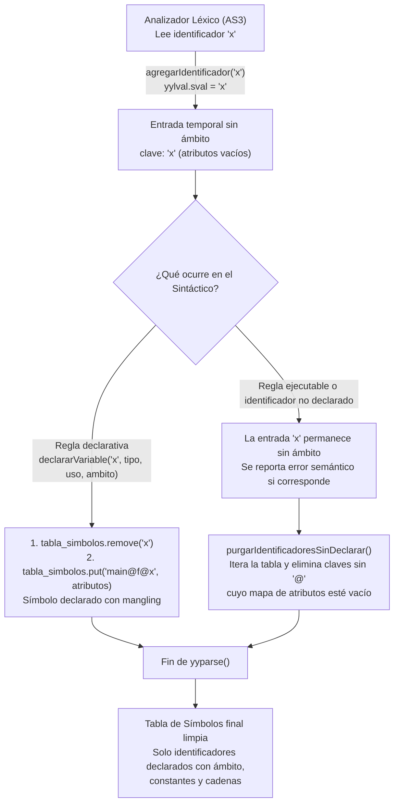

# Guía de Estudio y Defensa Oral — Etapa 3: Tercetos y Semántica

**Materia:** Diseño de Compiladores I / Compiladores e Intérpretes  
**Grupo:** 20 · Ingeniería de Sistemas  
**Objetivo de este documento:** Bitácora pedagógica viva donde se registran todos los hitos de implementación, fundamentos teóricos, trazas del autómata, preguntas de los alumnos y respuestas modelo para rendir con máxima solvencia la defensa oral obligatoria ante los docentes de la cátedra.

---

## 🗺️ Mapa General de la Etapa 3 en Hitos Progresivos

```text
[Hito 1] Aritmética Completa y Propagación (COMPLETADO)
    │
    ▼
[Hito 2] Sentencia de Asignación, Tema 17 (a := b = (exp)) y pout (COMPLETADO)
    │
    ▼
[Hito 3] Ámbitos, Name Mangling con ":" y Tabla de Símbolos Enriquecida (COMPLETADO)
    │
    ▼
[Hito 4] Chequeo Estático de Tipos y Tema 34: Conversión Explícita tos() (COMPLETADO)
    │
    ▼
[Hito 5] Control de Flujo y Backpatching: IF, IF-ELSE y REPEAT UNTIL (Tema 12) (COMPLETADO)
    │
    ▼
[Hito 6] Funciones, Clases y Temas Avanzados:
    ├── 6.1 Funciones ordinarias y AUTO FUNCTION (Tema 21) (COMPLETADO)
    ├── 6.2 Variables en Tiempo de Compilacion COMPTIME (Tema 22) (COMPLETADO)
    └── 6.3 Clases, IMPORT/EXPORT, Acceso Posicional y Herencia Multiple (COMPLETADO)
    │
    ▼
[Cierre Etapa 3] Caso Integrador Final, Checklist de Entrega TP3 y Defensa Oral (SIGUIENTE)
```

---

## 📌 Hito 1: Núcleo Aritmético y Propagación de Atributos

### 1.1. Objetivo Técnico
Permitir que el compilador procese cualquier expresión aritmética arbitraria con operadores binarios (`+`, `-`, `*`, `/`) y constantes negativas (enteras `SHORTINT` y flotantes `SINGLEF`), emitiendo los tercetos en el orden matemático exacto impuesto por la precedencia y asociatividad.

---

### 1.2. Decisiones de Diseño y Preguntas Conceptuales

#### ❓ Pregunta 1: ¿Por qué en `numero_negativo` seteamos tanto `sval` como `ival` en `ParserVal`?
```java
ParserVal pv = new ParserVal("-" + lexema_pos);
pv.ival = id_neg;
$$ = pv;
```
* **Explicación para la defensa:**  
  La clase `ParserVal` provista por BYacc/J simula la unión de C, conteniendo campos independientes (`ival` para enteros, `sval` para cadenas, `dval` para números de punto flotante).  
  - En la Etapa 2 solo se utilizaba `$$.ival = id_neg;` para indexar el símbolo negativo en la Tabla de Símbolos. Si dejábamos `sval` sin inicializar, su valor por defecto era `null`.
  - En la Etapa 3, los generadores de tercetos de los operadores binarios (`+`, `-`, etc.) leen los operandos como cadenas de texto a través de `$1.sval` y `$3.sval`. Si `sval` fuera `null`, una expresión como `a + -5$s` generaría un terceto corrupto: `( + , a , null )`.
  - Al inicializar explícitamente `pv.sval = "-" + lexema_pos;` y `pv.ival = id_neg;`, garantizamos que el generador de código intermedio reciba la representación textual para el terceto y que la Tabla de Símbolos conserve el puntero para los futuros chequeos de tipos.

---

#### ❓ Pregunta 2: ¿Cómo sabe el compilador en qué orden exacto formar los tercetos? (`a + b * c` vs `a * b - c / d`)
* **Explicación para la defensa:**  
  **Nosotros no escribimos ningún algoritmo de ordenamiento ni condiciones `if` para priorizar operadores.** El orden temporal de creación de tercetos es consecuencia directa del mecanismo de **reducción del autómata de pila LALR(1)**.  
  Una acción semántica `{ ... }` solo se ejecuta cuando el autómata decide hacer un **REDUCE** (desapilar el lado derecho de la producción y apilar el no terminal del lado izquierdo).

##### Caso A: `a + b * c`
1. El parser reduce `a` a `expresion` y hace shift de `+`.
2. Lee `b`, lo reduce a `termino`. En la pila queda: `expresion '+' termino`.
3. **Lookahead (símbolo de preanálisis):** El autómata mira el siguiente token sin consumirlo: es `*`.
4. Como `*` pertenece a la regla `termino : termino '*' factor`, tiene mayor precedencia que la suma. Por lo tanto, el autómata **pospone la suma** y realiza un **SHIFT** del `*`.
5. Lee `c` y lo reduce a `factor`. Pila: `expresion '+' termino '*' factor`.
6. El siguiente token es `;`.
7. **Primer Reduce:** Se reduce `termino '*' factor`. **Se ejecuta la acción de multiplicación**.  
   👉 Se genera el **Terceto 0:** `( * , b , c )` y se sintetiza `"[0]"` en `termino`.
8. **Segundo Reduce:** Ahora la pila contiene `expresion '+' termino([0])`. Al encontrar el `;`, se reduce la suma.  
   👉 Se genera el **Terceto 1:** `( + , a , [0] )`.

##### Caso B: `a * b - c / d`
1. Lee `a * b`. El lookahead es `-`.
2. Como `-` pertenece a `expresion` y no a `termino`, el producto no puede extenderse más. El autómata ejecuta inmediatamente la reducción de `termino '*' factor`.  
   👉 Se genera el **Terceto 0:** `( * , a , b )` con resultado `"[0]"`.
3. `"[0]"` asciende a `expresion`. El parser hace shift de `-`.
4. Lee `c`, shift de `/`, lee `d`. El lookahead es `;`.
5. La división tiene prioridad para cerrarse antes de la resta. Reduce `c / d`.  
   👉 Se genera el **Terceto 1:** `( / , c , d )` con resultado `"[1]"`.
6. Finalmente, con la pila en `expresion([0]) '-' termino([1])`, reduce la resta.  
   👉 Se genera el **Terceto 2:** `( - , [0] , [1] )`.

---

#### ❓ Pregunta 3: ¿Por qué en las reglas de error sintáctico NO generamos tercetos? ¿El compilador se detiene o continúa?
* **Explicación para la defensa:**  
  1. **El compilador NO se detiene:** Sigue analizando el código para encontrar y reportar al usuario todos los errores sintácticos y semánticos que existan en el archivo de una sola pasada.
  2. **No se emiten tercetos de código erróneo:** Los tercetos son una representación intermedia de instrucciones ejecutables destinadas a traducirse a código de máquina (Assembler) en el TP4. Emitir tercetos para sentencias rotas (por ejemplo `a + ;`) generaría instrucciones con operandos nulos o basura que harían fallar al generador de código posterior.
  3. **Misión de la regla de error:** Capturar la falla, emitir el mensaje con número de línea (`yyerror(...)`) y absorber el fallo para recuperar la sincronización del autómata sin romper la pila. Si se detectan errores, el compilador debe concluir reportando que la compilación fracasó, impidiendo la emisión de binarios.

---

#### ❓ Pregunta 4: ¿Por qué escribimos explícitamente `{ $$ = $1; }` en reglas unitarias como `expresion : termino` si BYacc/J lo hace por defecto?
```yacc
expresion
    : termino
        {
            $$ = $1;
        }
    ;
```
* **Explicación para la defensa:**  
  Es cierto que en Yacc, si una regla no tiene ningún bloque de acción, por defecto se ejecuta `$$ = $1;`. Sin embargo, explicitarlo obedece a tres principios fundamentales de ingeniería de compiladores:
  1. **Intención explícita en la defensa:** Demuestra al docente que el alumno conoce conscientemente cómo viajan los atributos sintetizados en el árbol y que no es una omisión accidental.
  2. **Prevención de bugs clásicos de Yacc:** En BYacc/J, si una regla no tiene acción, hace `$$ = $1;`. Pero si más adelante agregamos una sentencia de depuración como `{ System.out.println("debug"); }` y olvidamos reasignar `$$ = $1;`, Yacc **deja de hacer `$$ = $1;` automáticamente**, perdiendo el atributo y dejando `$$` nulo. Escribirlo explícitamente protege la regla ante futuras modificaciones.
  3. **Preparación para chequeos semánticos (Hito 4):** En las reglas unitarias pronto deberemos propagar o validar tipos (`$$.tipo = $1.tipo`), por lo que contar con el bloque formalmente definido facilita la extensión sin alterar la gramática.

---

### 1.3. Casos de Prueba Verificados
Archivo de prueba ejecutado: `tests/test_expresiones_aritmeticas.txt`

```pascal
programa_aritmetica

shortint a, b, c, d, res;
singlef x, y, z;
BEGIN
  res := a + b * c;
  res := a * b - c / d;
  res := a + -5$s;
  z := x * 2.5 + y;
  z := z - -1.0;
END
```

**Salida de tercetos obtenida:**
```text
0 ( * , b , c )
1 ( + , a , [0] )
2 ( := , res , [1] )
3 ( * , a , b )
4 ( / , c , d )
5 ( - , [3] , [4] )
6 ( := , res , [5] )
7 ( + , a , -5 )
8 ( := , res , [7] )
9 ( * , x , 2.5 )
10 ( + , [9] , y )
11 ( := , z , [10] )
12 ( - , z , -1.0 )
13 ( := , z , [12] )
```
*Resultado:* Cero conflictos en `y.output` (0 shift/reduce, 0 reduce/reduce) y evaluación estricta de la precedencia matemática.

---

## 📌 Hito 2: Sentencia de Asignación, Tema 17 (`a := b = (exp)`) y Sentencia `pout`

### 2.1. Objetivo Técnico
Completar la emisión de tercetos para:
1. La sentencia de asignación tradicional: `IDENTIFICADOR ASIGNAR expresion ';'`.
2. Las asignaciones de expresiones en expresiones (**Tema 17** del Grupo 20): `IDENTIFICADOR '=' '(' expresion ')'`.
3. La sentencia de salida por consola: `POUT '(' CADENA ')'` y `POUT '(' expresion ')'`.

---

### 2.2. Decisiones de Diseño y Preguntas Conceptuales

#### ❓ Pregunta 1: ¿Cómo funciona el Tema 17 (asignación en expresión) y por qué se modela como un `factor`?
* **Regla gramatical en `gram.y`:**
  ```yacc
  /* Tema 17: Asignacion en expresion */
  unica
      : IDENTIFICADOR '=' '(' expresion ')'
          {
              int ref = $1.ival;
              String lexema = TablaSimbolos.obtenerAtributo(ref, TablaSimbolos.LEXEMA);
              int idTerceto = GeneradorTerceto.crearTerceto(":=", lexema, $4.sval);
              $$ = new ParserVal("[" + idTerceto + "]");
          }
      ;
  ```
* **Explicación para la defensa:**  
  Una asignación tradicional es una **sentencia** (no devuelve un valor utilizable por otra expresión). Sin embargo, en el Tema 17, la sintaxis `id = (exp)` es una **expresión con efecto secundario** (side-effect):
  1. **Efecto secundario:** Guarda el valor calculado en la variable local (`lexema := $4.sval`), emitiendo de inmediato el terceto de asignación.
  2. **Valor resultante:** Sintetiza hacia arriba el índice de su propio terceto `$$ = new ParserVal("[" + idTerceto + "]");`.
  3. Al ser una alternativa de `factor`, puede participar como operando en sumas, productos o asignaciones externas (por ejemplo `a := b = (2$s);` o `res := a + b = (4$s);`), garantizando que la asignación interna se ejecute **antes** de que su resultado sea consumido por la operación contenedora.

---

#### ❓ Pregunta 2: En la sentencia `a := b = (2$s);`, ¿cuántos tercetos se generan y en qué orden?
* **Explicación para la defensa:**  
  Se generan **dos tercetos**:
  ```text
  4 ( := , b , 2 )
  5 ( := , a , [4] )
  ```
  **Mecánica en el autómata LALR:**  
  1. Al llegar a `b = (2$s)`, el parser reconoce la regla `unica : IDENTIFICADOR '=' '(' expresion ')'`.  
  2. Al reducir `unica`, se ejecuta su acción semántica, creando el terceto `4 ( := , b , 2 )` y devolviendo como atributo sintetizado `[4]`.  
  3. `[4]` asciende por `factor -> termino -> expresion`.  
  4. Finalmente, se reduce la asignación externa `asignacion : a := expresion`, la cual toma el valor `$3.sval` (que es `[4]`) y emite el terceto `5 ( := , a , [4] )`.

---

#### ❓ Pregunta 3: En sentencias unarias como `pout`, ¿qué se coloca en el segundo operando del terceto?
```java
GeneradorTerceto.crearTerceto("POUT", argumento, "-");
```
* **Explicación para la defensa:**  
  Un terceto, por definición de diseño, tiene exactamente 3 componentes: `(operador, op1, op2)`.  
  Cuando una operación es unaria o de entrada/salida (como `POUT`, la conversión `tos` o un retorno `RET`), el segundo operando no existe en la semántica del lenguaje.  
  Siguiendo la convención clásica de la literatura de compiladores (Aho-Ullman / Dragon Book) y el plan de la cátedra, se utiliza el símbolo guión `"-"` (o `null`/`"_"`) para denotar explícitamente que la operación es unaria y que el segundo slot no se utiliza.

---

#### ❓ Pregunta 4: ¿Cómo se manejan las cadenas multilínea (Tema 10) al pasarlas a `pout`?
* **Explicación para la defensa:**  
  En el analizador léxico (`AS12`), cuando se reconoce el cierre de una cadena multilínea delimitada por comillas dobles `"..."`:
  1. Se eliminan los saltos de línea (`\r`, `\n`) tal como exige textualmente el enunciado del Tema 10.
  2. Se registra la cadena normalizada en la `TablaSimbolos` como constante.
  3. Se entrega su ID al token `CADENA`.
  4. En la reducción de `sentencia_pout : POUT '(' CADENA ')'`, el parser toma el lexema de la cadena desde la Tabla de Símbolos y emite el terceto `( POUT , "..." , - )`.

---

#### ❓ Pregunta 5: Cuando hacemos `a := 4;`, ¿generamos el terceto `(:=, a, 4)` y TAMBIÉN guardamos el atributo `VALOR = 4` en la Tabla de Símbolos?
* **Explicación para la defensa:**  
  **¡NO para variables comunes!** Solo se genera el terceto `( := , a , 4 )`.  
  **La diferencia fundamental entre Compilador e Intérprete:**  
  1. Un **intérprete** ejecuta el programa en tiempo real, por lo que necesita mantener en memoria el valor actualizado de cada variable a medida que lee las sentencias.  
  2. Un **compilador**, en cambio, **no ejecuta el programa**: solo lo traduce a un formato ejecutable. La instrucción `( := , a , 4 )` es una orden diferida que en el TP4 se convertirá en código Assembler (`MOV _a, 4`) para que la CPU modifique la celda de memoria en **tiempo de ejecución (Runtime)**.  
  3. En un programa real, el valor de una variable puede cambiar dinámicamente según la entrada del usuario o bifurcaciones condicionales (por ejemplo dentro de un `IF` o un bucle `REPEAT`), por lo que en tiempo de compilación es imposible predecir o fijar un único valor en la Tabla de Símbolos.  
  4. **¿Qué atributos SÍ guarda una variable común en la Tabla de Símbolos?**  
     - `LEXEMA`: nombre de la variable (`a`).  
     - `TIPO`: tipo de dato (`SHORTINT`, `SINGLEF`).  
     - `USO`: rol del identificador (`variable`, `parametro`, etc.).  
     - `AMBITO`: contexto de visibilidad (`:main`).  
  5. **La única excepción del Grupo 20: Tema 22 (`COMPTIME`):**  
     Las variables declaradas como `COMPTIME SHORTINT c;` son calculadas estáticamente por el compilador. En ese caso particular, **sí** se almacena su valor constante en la Tabla de Símbolos y **no** se genera terceto de ejecución en runtime, reemplazando la variable por su valor literal en cada lugar donde se use.

---

#### ❓ Pregunta 6: ¿Cómo evitamos generar tercetos corruptos con `null` cuando una expresión falla sintácticamente?
* **Explicación para la defensa:**  
  Cuando ocurre un error sintáctico (por ejemplo en `a := b := (x);` del Tema 17 donde se usa erróneamente `:=`), la regla de recuperación reporta el error con `yyerror(...)` pero no sintetiza ningún atributo en `$$`.  
  Si la regla contenedora (`asignacion` o un operador binario) invocara ciegamente a `crearTerceto`, recibiría un operando en `null` y emitiría instrucciones inválidas como `( := , a , null )`.  
  Para garantizar la premisa de la cátedra de **no emitir tercetos de sentencias erróneas**, las acciones semánticas incorporan guardas defensivas:
  ```java
  if ($3 != null && $3.sval != null) {
      GeneradorTerceto.crearTerceto(":=", lexema, $3.sval);
  }
  ```
  De este modo, el compilador continúa analizando el resto del archivo para encontrar más errores, pero descarta la emisión de código intermedio de las sentencias malformadas.

---

### 2.3. Caso de Prueba Verificado
Archivo de prueba: `tests/test_asignaciones_y_pout.txt`

```pascal
programa_asignaciones

shortint a, b, res;
singlef x;
BEGIN
  a := 10$s;
  b := a + 5$s;
  x := 3.14;
  a := b = (2$s);
  res := a + b = (4$s);
  pout("Resultado calculado exitosamente");
  pout(res);
  pout(a + b * 2$s);
END
```

**Salida de tercetos obtenida:**
```text
0 ( := , a , 10 )
1 ( + , a , 5 )
2 ( := , b , [1] )
3 ( := , x , 3.14 )
4 ( := , b , 2 )
5 ( := , a , [4] )
6 ( := , b , 4 )
7 ( + , a , [6] )
8 ( := , res , [7] )
9 ( POUT , "Resultado calculado exitosamente" , - )
10 ( POUT , res , - )
11 ( * , b , 2 )
12 ( + , a , [11] )
13 ( POUT , [12] , - )
```
*Validación:* Cero conflictos en BYacc/J, precedencia impecable en asignaciones encadenadas y salida de consola completa.

---

## 📌 Hito 3: Ámbitos, Name Mangling con `:` y Tabla de Símbolos Enriquecida (COMPLETADO)

### 3.1. Objetivo Técnico
1. Implementar la gestión de ámbitos jerárquicos durante el parseo (ámbito global `:main`, funciones `:main:f1`, clases `:main:ClaseA`, etc.).
2. Implementar el esquema estricto de **Name Mangling** exigido por la cátedra (`Tp3.pdf`, pág. 2) utilizando exclusivamente el separador `:`.
3. Registrar metadatos semánticos completos en la `TablaSimbolos`: `LEXEMA`, `MANGLING`, `TIPO`, `USO` y `AMBITO`.
4. Implementar los dos primeros chequeos semánticos obligatorios:
   - Detección de variable **no declarada o no visible** en el ámbito actual.
   - Detección de variable **redeclarada en el mismo ámbito** (permitiendo *shadowing* en ámbitos diferentes).
5. Emitir los tercetos utilizando los nombres mangledos (`a:main`, `a:main:sumar`) para eliminar cualquier ambigüedad en el código intermedio.

> [!IMPORTANT]
> **Actualización Post-Consulta Docente (Rediseño Estructural de la Tabla de Símbolos y Name Mangling):**  
> Durante la consulta de revisión previa a la entrega (07/11), la profesora a cargo indicó expresamente dos correcciones fundamentales sobre el esquema original de este Hito:
> 1. **Estructura e indexación**: La `TablaSimbolos` pasa a indexarse directamente por una clave `String` correspondiente al símbolo con mangling (`Map<String, Map<String, Object>>`) o lexema constante (`5`, `"hola"`), eliminando las claves numéricas artificiales (`Integer`) y los atributos redundantes (`LEXEMA`, `MANGLING`, `AMBITO`).
> 2. **Formato de Name Mangling**: En lugar del orden `simbolo:main:ambito` sugerido como ejemplo en `Tp3.pdf`, se adoptó **`main@ambito@simbolo`** (ámbito primero, separador `@`), lo que unifica el nombre del ámbito con la clave de las funciones/clases y optimiza la resolución jerárquica a $O(1)$ por nivel.
> 
> Todos los detalles técnicos, análisis de complejidad, justificaciones de diseño, ciclo de vida léxico-sintáctico y preguntas de examen de esta actualización se encuentran desarrollados en profundidad en la sección final: **[📌 Correcciones de Consulta: Rediseño de Tabla de Símbolos y Name Mangling (`main@ambito@simbolo`)](#-correcciones-de-consulta-rediseño-de-tabla-de-símbolos-y-name-mangling-mainambitosimbolo)**.

---

### 3.2. Decisiones de Diseño y Preguntas Conceptuales

#### ❓ Pregunta 1: ¿Por qué la cátedra exige Name Mangling con `:` y cómo se estructuran las claves?
* **Explicación para la defensa:**  
  En un lenguaje con funciones, procedimientos o clases, dos identificadores pueden tener el mismo nombre léxico (por ejemplo, `a` global y `a` local a una función). Si el compilador usara solo `"a"` en el código intermedio o en el Assembler final, se producirían colisiones destructivas en memoria.  
  El **Name Mangling** (decoración de nombres) transforma el identificador relativo en un nombre absoluto unívoco concatenando la ruta de ámbitos:
  - En el programa principal: `a + :main` → `a:main`.
  - En la función `sumar`: `a + :main:sumar` → `a:main:sumar`.
  - En un método de clase: `a + :main:ClaseA:metodo1` → `a:main:ClaseA:metodo1`.  
  El `Tp3.pdf` exige taxativamente utilizar `:` como separador.

---

#### ❓ Pregunta 2: ¿Cómo funciona la resolución jerárquica ascendente de identificadores? ¿Qué pasa con el *shadowing*?
* **Explicación para la defensa:**  
  El método `TablaSimbolos.buscarIdentificador(nombre, ambitoActual)` implementa la regla de visibilidad estática (alcance léxico):
  1. **Nivel local:** Primero busca el identificador con el ámbito más específico (ej. `x:main:sumar`). Si existe, lo retorna de inmediato. Esto garantiza el **shadowing**: la variable local oculta a la global con el mismo nombre.
  2. **Ascenso jerárquico:** Si no lo encuentra, recorta el último segmento del ámbito (`:sumar`) mediante `ambito.lastIndexOf(':')` y vuelve a buscar en el ámbito contenedor (`x:main`).
  3. **Límite superior:** El proceso continúa hasta agotar el ámbito raíz `:main`.
  4. **Fallo semántico:** Si no se encuentra en ningún nivel, emite el error semántico:  
     `Error semantico (linea X): Variable 'x' no declarada o no visible en el ambito actual (:main:sumar)`.

---

#### ❓ Pregunta 3: ¿Cómo interactúa el léxico con la Tabla de Símbolos enriquecida sin perder identificadores ni duplicar erróneamente?
* **Explicación para la defensa:**  
  1. En el análisis léxico (`AS3`), el autómata no conoce el contexto gramatical ni el ámbito. Solo sabe que leyó la cadena `"a"`. Si `"a"` no existe en la tabla, la inserta como entrada cruda (`{LEXEMA=a}`).
  2. Al llegar a la producción de declaración (`declaracion_variables`), el sintáctico conoce el tipo (`SHORTINT`), el uso (`variable`) y el ámbito activo (`ambitoActual`).  
     Llama a `TablaSimbolos.declararVariable(...)`:
     - Si ya existe una entrada con ese mismo `MANGLING`, detecta y reporta **redeclaración**.
     - Si no está redeclarada, busca si hay una entrada cruda del léxico para reusarla y enriquecerla con sus metadatos (`MANGLING`, `TIPO`, `USO`, `AMBITO`).
     - Si una variable con el mismo lexema se declara en otro ámbito (shadowing), se crea una **nueva entrada independiente** en la tabla con su respectivo `MANGLING` único.

---

#### ❓ Pregunta 4: ¿Por qué en `lista_variables` usamos `ArrayList<String>` en el campo `obj` de `ParserVal`?
* **Explicación para la defensa:**  
  En gramáticas LALR como la nuestra, la regla es:
  `declaracion_variables : tipo lista_variables ';'`
  Debido a que el parsing es ascendente (bottom-up), `lista_variables` se reduce **antes** de que la regla de `declaracion_variables` conozca la lista completa de identificadores.  
  Para transportar la lista de identificadores hacia arriba en el árbol:
  - En `lista_variables : IDENTIFICADOR`, instanciamos una lista `ArrayList<String>` y la guardamos en `$$.obj`.
  - En la recursión `lista_variables : lista_variables ',' IDENTIFICADOR`, agregamos cada identificador a esa misma lista.
  - Al reducir `declaracion_variables`, tomamos el tipo desde `$1.sval` y recorremos la lista `$2.obj` con un bucle `for` tradicional, registrando cada variable con su tipo y ámbito correspondiente.

---

#### ❓ Pregunta 5: ¿Por qué usamos `LinkedHashMap` en `TablaSimbolos` en lugar de un `HashMap` común si ambos se iteran con un `for`?
* **Explicación para la defensa:**  
  Un `HashMap` común no garantiza el orden en que se devuelven los elementos al iterar su `entrySet()`, ya que la secuencia depende de los buckets de hash y de los rehashes dinámicos. En la arquitectura de compiladores, el orden de inserción determinístico es crítico por dos razones:
  1. **Tema 29 (Acceso posicional a atributos de clases):** La cátedra exige acceder a los atributos de un objeto por su número ordinal (`obj[0$s]`, `obj[1$s]`), el cual mapea al **orden en que fueron declarados en el código fuente**. Con `LinkedHashMap`, los atributos se registran y consultan exactamente en su orden de declaración.
  2. **Determinismo en correcciones automáticas:** La cátedra compara las salidas volcadas de la Tabla de Símbolos contra patrones esperados. `LinkedHashMap` garantiza una salida estable, secuencial y reproducible (`1, 2, 3...`) en todas las ejecuciones.

---

#### ❓ Pregunta 6: ¿Por qué se eliminó el parámetro `linea` de `declararVariable`?
* **Explicación para la defensa:**  
  Originalmente la firma era `declararVariable(String nombre, String tipo, String uso, String ambito, int linea)`.  
  Sin embargo, el método `Parser.agregarErrorSemantico(String s)` consulta directamente la línea en curso llamando a `AnalizadorLexico.getLineaActual()`. Mantener el parámetro `linea` en la firma de `declararVariable` era código muerto y redundante. Al eliminarlo, simplificamos la interfaz pública y mantuvimos una única fuente de verdad para la línea actual.

---

#### ❓ Pregunta 7: ¿Está bien que en las clases la regla `miembros_clase` permita intercalar atributos y métodos en cualquier orden?
* **Explicación para la defensa:**  
  **Sí, es 100% intencional y está alineado con la especificación de la cátedra.**  
  En la gramática oficial de referencia (`teoria/grupo20.y`, líneas 102-112), la regla está definida recursivamente:
  ```yacc
  miembros_clase : /* vacio */ | miembros_clase miembro_clase ;
  miembro_clase  : atributo_clase | metodo_clase | herencia_opcional ;
  ```
  Al igual que en Java o C++, los atributos y métodos pueden declararse en cualquier secuencia según la necesidad del programador. La regla recursiva por izquierda en LALR(1) procesa cualquier intercalación con cero conflictos Shift/Reduce.

---

#### ❓ Pregunta 8: ¿Por qué en `declaracion_comptime` se chequea `if (id != LEXEMA_NO_ENCONTRADO)` si parece que nunca fallaría?
* **Explicación para la defensa:**  
  Es un **guard semántico indispensable**.  
  Si el programador comete un error de redeclaración en el código fuente (por ejemplo: `SHORTINT x; COMPTIME SHORTINT x;`), la llamada a `declararVariable` detecta la colisión de mangling en el mismo ámbito, emite el error semántico de redeclaración y retorna `LEXEMA_NO_ENCONTRADO` (`-1`).  
  El chequeo `if (id != TablaSimbolos.LEXEMA_NO_ENCONTRADO)` previene que el compilador intente ejecutar `TablaSimbolos.agregarAtributo(-1, "COMPTIME", "true")` sobre una declaración rechazada.

---

#### ❓ Pregunta 9: ¿Cómo se simplifica `buscarIdentificador` usando `contains(":")` en el `while` y por qué no hacen falta los `break`?
* **Explicación para la defensa:**  
  El método `buscarIdentificador` escala iterativamente en el árbol de ámbitos podando el último segmento con `lastIndexOf(':')`:
  ```java
  while (ambitoBusqueda != null && ambitoBusqueda.contains(":")) {
      ...
      int ultimoSeparador = ambitoBusqueda.lastIndexOf(':');
      ambitoBusqueda = ambitoBusqueda.substring(0, ultimoSeparador);
  }
  ```
  **El fundamento del invariante:** Todo ámbito válido en nuestra arquitectura comienza con `:` (la raíz es `:main`).  
  Cuando la búsqueda llega a la raíz `:main`, el último `:` se encuentra en el índice `0`. La operación `substring(0, 0)` produce una cadena vacía `""`.  
  En la siguiente evaluación del bucle, `"".contains(":")` evalúa a `false`, terminando el ciclo de forma totalmente natural sin requerir ningún `break` artificial ni condiciones duplicadas.

---

#### ❓ Pregunta 10: ¿Por qué guardamos `ival` en `ParserVal` en las reglas de `factor`? ¿Cuándo se usa?
* **Explicación para la defensa:**  
  En `factor : IDENTIFICADOR`, `CTE_SHORTINT`, `CTE_SINGLEF` y `numero_negativo`:
  1. **Uso inmediato:** En `numero_negativo : '-' CTE_SHORTINT`, se utiliza `$2.ival` para consultar la Tabla de Símbolos y convertir la constante a su versión negativa con `convertirANegativo`.
  2. **Cimiento para el Hito 4 (Chequeo Estático de Tipos):** En operaciones binarias (`expresion '+' termino`), el compilador necesita validar la compatibilidad de tipos entre operandos. Si `factor` descartara el `ival` y solo retornara el texto en `sval`, el analizador de tipos tendría que volver a iterar y buscar en toda la tabla. Al propagar `pv.ival = idVar;`, las reglas superiores tienen acceso directo en $O(1)$ a los metadatos semánticos (`TablaSimbolos.obtenerAtributo($1.ival, TablaSimbolos.TIPO)`).

---

#### ❓ Pregunta 11: ¿Por qué en `encabezado_funcion` se declara la función ANTES de invocar a `entrarAmbito`?
* **Explicación para la defensa:**  
  Si invocáramos `entrarAmbito("sumar")` antes de registrar la función en la Tabla de Símbolos:
  - La función se declararía con el mangling `sumar:main:sumar` (dentro de su propio ámbito local).
  - Como consecuencia, ¡la función viviría encerrada dentro de sí misma y desde el programa principal `:main` nadie podría verla ni invocarla!  
  El orden estricto de una compilación de una pasada es:
  1. Declarar el símbolo de la función en el ámbito contenedor actual (`:main`).
  2. Descender al nuevo ámbito (`:main:sumar`) para que los parámetros formales y las variables locales queden contenidos en él.

---

#### ❓ Pregunta 12: ¿Por qué en `lista_variables` usamos recursión por izquierda y qué riesgo tendría escribirla por derecha?
* **Explicación para la defensa:**  
  - **Recursión por izquierda (`lista_variables ',' IDENTIFICADOR`):** En un autómata ascendente (bottom-up / LALR), cada vez que se lee una coma y un identificador, el parser ejecuta un `Reduce` inmediato. La pila del autómata se mantiene en tamaño constante $O(1)$ sin importar si se declaran 3 o 10.000 variables.
  - **Recursión por derecha (`IDENTIFICADOR ',' lista_variables`):** El autómata no puede reducir hasta conocer el final de la lista. Está obligado a hacer `Shift` de todos los identificadores y comas, consumiendo memoria proporcional a la cantidad de variables ($O(N)$ en la pila). Si la lista es extensa, provoca un **desbordamiento de la pila del parser** (`StackOverflow`). Por eso en Yacc las listas siempre se definen por izquierda.

---

#### ❓ Pregunta 13: ¿Por qué en BYacc/J asignamos `$$ = new ParserVal();` en lugar de `$$ = null;` ante un error semántico o sintáctico?
* **Explicación para la defensa:**  
  1. **El peligro de propagar un `ParserVal` válido con el lexema crudo:** Si una variable no está declarada y se devuelve un `ParserVal` con el lexema crudo y referencia del léxico, las operaciones superiores (`expresion '+' termino`, `asignacion`) ven operandos no nulos y generan tercetos inválidos con variables inexistentes (ej. `( + , z , 5 )`).
  2. **El motivo técnico de no usar `null` de Java:** En BYacc/J, antes de ejecutar la acción semántica de una regla con longitud mayor a cero, el autómata ejecuta:
     ```java
     yyval = dup_yyval(val_peek(yym - 1));
     ```
     Donde `dup_yyval(val)` accede directamente a `val.ival`, `val.sval`, etc. Si una acción semántica previa asignara `$$ = null;`, el valor apilado en la pila semántica sería `null`, provocando un `NullPointerException` en la siguiente reducción que intente duplicarlo.
  3. **La solución canónica:** Asignar una instancia vacía: `$$ = new ParserVal();`. Un `ParserVal` instanciado por defecto tiene `sval = null`. De esta forma, la pila del autómata nunca contiene referencias nulas (evitando el fallo en `dup_yyval`), pero todas las guardas superiores (`if ($3 != null && $3.sval != null)`) detectan que el valor sintetizado no es computable y bloquean limpiamente la creación de tercetos corruptos.

---

#### ❓ Pregunta 14: En operaciones binarias (`+`, `-`, `*`, `/`), ¿por qué es indispensable el bloque `else { $$ = new ParserVal(); }`?
* **Explicación para la defensa:**  
  En BYacc/J, antes de ejecutar la acción semántica de una regla, el autómata asigna por defecto `$$ = $1;`.  
  Si el bloque `if ($1 != null && $1.sval != null && $3 != null && $3.sval != null)` evalúa a `false` (porque `$3` o `$1` provinieron de un operando inválido o no declarado) y no colocamos un bloque `else`:
  - `$$` conserva intacto el valor de `$1` (`expresion` o `termino`).
  - Esto enmascara silenciosamente el fallo y transforma una operación rota (como `a + <error>`) en únicamente el operando izquierdo `a`.  
  - En consecuencia, una asignación como `resultado := a + ;` reduciría a `resultado := a;` y emitiría un terceto espurio.  
  Colocar explícitamente `else { $$ = new ParserVal(); }` (así como en las reglas de recuperación de error sintáctico) garantiza que la expresión resultante quede anulada (`sval = null`), impidiendo que la sentencia contenedora emita código intermedio.

---

#### ❓ Pregunta 15: En `CTE_SHORTINT`, ¿por qué se sigue ejecutando el resto de la acción tras el `if` de error de rango?
* **Explicación para la defensa:**  
  El bloque `if (valor > AnalizadorLexico.ValorMaximoInt) { yyerror(...); }` no contiene `return` ni `System.exit()`.  
  Esto responde a la exigencia de **recuperación no fatal de errores** de la cátedra: el compilador debe informar el error sintáctico con su línea real, pero debe continuar analizando el resto del programa para descubrir y listar todos los errores del archivo en una sola pasada. Al continuar y sintetizar la constante, el parser puede seguir validando la estructura sintáctica de la sentencia sin abortar prematuramente.

---

### 3.3. Casos de Prueba Verificados

#### Caso 1: Ámbitos y Shadowing (`tests/test_hito3_ambitos.txt`)
```pascal
programa_ambitos

shortint a, b;

shortint FUNCTION sumar(shortint x)
  shortint a, res;
BEGIN
  a := 5$s;
  res := a + x;
  RET(res);
END;

BEGIN
  a := 10$s;
  b := a;
  pout(b);
END
```

**Salida obtenida:**
```text
Programa reconocido correctamente
=== TABLA DE SIMBOLOS ===
1: {USO=nombre_programa, TIPO=programa, MANGLING=programa_ambitos:main, AMBITO=:main, LEXEMA=programa_ambitos}
2: {USO=variable, TIPO=SHORTINT, MANGLING=a:main, AMBITO=:main, LEXEMA=a}
3: {USO=variable, TIPO=SHORTINT, MANGLING=b:main, AMBITO=:main, LEXEMA=b}
4: {USO=funcion, TIPO=SHORTINT, MANGLING=sumar:main, AMBITO=:main, LEXEMA=sumar}
5: {USO=parametro, TIPO=SHORTINT, MANGLING=x:main:sumar, AMBITO=:main:sumar, LEXEMA=x}
6: {USO=variable, TIPO=SHORTINT, MANGLING=res:main:sumar, AMBITO=:main:sumar, LEXEMA=res}
7: {USO=variable, TIPO=SHORTINT, MANGLING=a:main:sumar, AMBITO=:main:sumar, LEXEMA=a}
8: {LEXEMA=5, OCURRENCIAS=1}
9: {LEXEMA=10, OCURRENCIAS=1}

----------------------------------------
         CODIGO INTERMEDIO (TERCETOS)   
----------------------------------------
0 ( := , a:main:sumar , 5 )
1 ( + , a:main:sumar , x:main:sumar )
2 ( := , res:main:sumar , [1] )
3 ( := , a:main , 10 )
4 ( := , b:main , a:main )
5 ( POUT , b:main , - )
----------------------------------------
```
*Validación:* Coexistencia de `a:main` y `a:main:sumar` sin colisión; tercetos emitidos con nombres mangledos exactos.

---

#### Caso 2: Chequeos Semánticos Obligatorios y Supresión de Tercetos Inválidos (`tests/test_hito3_errores_semanticos.txt`)
```pascal
programa_errores_semanticos

shortint a, b;
shortint a; // Error semantico: redeclaracion en el mismo ambito

BEGIN
  a := 10$s;
  z := 20$s; // Error semantico: z no declarada
  b := z + 5$s; // Error semantico: z no declarada
END
```

**Salida obtenida:**
```text
Error semantico (linea 4): Redeclaracion de 'a' en el ambito :main
Error semantico (linea 8): Variable 'z' no declarada o no visible en el ambito actual (:main)
Error semantico (linea 9): Variable 'z' no declarada o no visible en el ambito actual (:main)
Compilacion finalizada con 0 error(es) sintactico(s) y 3 error(es) semantico(s)

----------------------------------------
         CODIGO INTERMEDIO (TERCETOS)   
----------------------------------------
0 ( := , a:main , 10 )
----------------------------------------
```
*Validación:* Detección taxativa de redeclaraciones en el mismo ámbito y variables no declaradas. Se reportan los 3 errores con su número de línea real y **únicamente** se emite el terceto de la sentencia válida (`0 ( := , a:main , 10 )`), suprimiendo completamente la creación de tercetos para `z := 20$s` y `b := z + 5$s`.

---

## 📌 Hito 4: Chequeo Estático de Tipos y Tema 34: Conversión Explícita `tos()`

### 4.1. Objetivo Técnico
1. **Asociar tipos en la Tabla de Símbolos:** Garantizar que todas las constantes (`CTE_SHORTINT`, `CTE_SINGLEF` y sus variantes negativas) registren su atributo `TIPO` en `TablaSimbolos` (`"SHORTINT"` o `"SINGLEF"`).
2. **Propagación de tipos en el autómata LALR(1):** Propagar el tipo resultante a través de atributos sintetizados utilizando el campo `obj` de `ParserVal` en `factor`, `termino` y `expresion`.
3. **Validación estricta en operaciones aritméticas binarias (`+`, `-`, `*`, `/`):**
   - Operaciones homogéneas (`SHORTINT op SHORTINT` o `SINGLEF op SINGLEF`): válidas, emiten terceto con el tipo resultante.
   - Operaciones heterogéneas (`SHORTINT op SINGLEF` o viceversa): prohibidas sin conversión explícita previa; emiten error semántico y bloquean la emisión del terceto.
4. **Validación estricta en sentencias de asignación (`:=` y Tema 17 `= (exp)`):**
   - Variable y expresión del mismo tipo: válidas, emiten terceto de asignación.
   - Asignar `SINGLEF` a `SHORTINT`: error semántico específico indicando que requiere la conversión explícita `tos`.
   - Asignar `SHORTINT` a `SINGLEF`: error semántico por tipos incompatibles (el Grupo 20 tiene asignado el Tema 34 y no el Tema 35 de conversiones implícitas).
5. **Implementación del Tema 34 (`tos`):**
   - Reconocer la función intrínseca `tos(expresion)`.
   - Validar que la expresión interna sea de tipo `SINGLEF`.
   - Emitir el terceto de conversión `( tos , op , - )` y sintetizar hacia arriba el tipo `"SHORTINT"`.
6. **Validación en comparaciones (`condicion`):**
   - Prohibir comparaciones entre operandos de distinto tipo sin conversión explícita `tos`.

---

### 4.2. Decisiones de Diseño y Preguntas Conceptuales

#### ❓ Pregunta 1: ¿Por qué el chequeo de tipos se realiza durante la reducción de BYacc/J y no en una pasada posterior sobre un AST?
* **Explicación para la defensa:**  
  1. **Enfoque arquitectónico de la cátedra:** El enunciado del TP3 establece textualmente: *"Para Tercetos y Árbol Sintáctico, los chequeos de tipos se deben efectuar durante la generación de código intermedio."*  
  2. **Traducción dirigida por la sintaxis (Syntax-Directed Translation - SDT) en una sola pasada:** Nuestro compilador no construye un Árbol de Sintaxis Abstracta (AST) explícito en memoria, sino que traduce directamente el flujo de tokens a una secuencia de tercetos a medida que el autómata de pila LALR(1) reduce cada producción.
  3. **Invariante en la reducción:** Cada vez que el parser reduce una regla como `expresion : expresion '+' termino`, tiene en el tope de la pila semántica los atributos de los hijos (`$1` y `$3`). Verificar los tipos en ese instante exacto permite detener inmediatamente la creación de código intermedio inválido antes de que el terceto se incorpore a la lista global.

---

#### ❓ Pregunta 2: ¿Cómo viaja la información de tipos por la pila de BYacc/J si `ParserVal` no tiene un campo `tipo` nativo?
* **Explicación para la defensa:**  
  La clase `ParserVal` provista por BYacc/J simula la unión de C mediante cuatro campos:
  - `ival` (entero): usado para índices a la Tabla de Símbolos.
  - `dval` (flotante).
  - `sval` (String): usado para transportar la referencia textual del operando (`"a:main"`, `"5"`, `"[0]"`).
  - `obj` (`Object`): campo genérico para estructuras arbitrarias.
  
  **Nuestra solución:** Utilizamos el campo `pv.obj` para transportar la cadena con el tipo canónico (`"SHORTINT"` o `"SINGLEF"`):
  - En `factor : IDENTIFICADOR` se consulta la Tabla de Símbolos y se asigna `pv.obj = tipo`.
  - En `factor : CTE_SHORTINT` y `numero_negativo` se asigna `pv.obj = "SHORTINT"`.
  - En `factor : CTE_SINGLEF` y `numero_negativo` se asigna `pv.obj = "SINGLEF"`.
  - En las reglas unitarias (`termino : factor`, `expresion : termino`), BYacc/J ejecuta `$$ = $1;`, lo que propaga automáticamente la referencia completa con su `obj` intacto sin costo de memoria adicional.

---

#### ❓ Pregunta 3: ¿Por qué nuestro compilador rechaza asignar un entero a un flotante (`singlef := shortint`) sin conversión si en otros lenguajes es válido?
* **Explicación para la defensa:**  
  Esto responde a la estricta **especificación de temas particulares de la cátedra**:
  - El **Tema 35** define las *Conversiones Implícitas*, donde el compilador inserta automáticamente instrucciones de conversión de entero a flotante.
  - El **Tema 33** define *Conversiones Explícitas de Entero a Flotante* (`tosf` / `todf`).
  - Nuestro grupo (Grupo 20) tiene asignado **únicamente el Tema 34: Conversiones Explícitas de Flotante a Entero (`tos`)**.  
  El `Tp3.pdf` indica para el Tema 34 que *"Sólo se permitirán operaciones (expresiones aritméticas o comparaciones) con operandos de distinto tipo, si en el código se incluye la conversión explícita [...]. Para asignaciones, sólo se permitirá asignar una expresión de punto flotante a una variable de tipo entero, si se incluye la conversión correspondiente"*.  
  Al no tener asignado el Tema 35, cualquier cruce de tipos fuera de lo reglado por el Tema 34 es rechazado por el sistema de tipos.

---

#### ❓ Pregunta 4: ¿Qué sucede ante un error de tipos y por qué NO es un "error silencioso"? ¿Cómo se evitan los errores en cascada?
* **Explicación para la defensa:**  
  1. **El error SIEMPRE se reporta:** Si los operandos de una suma son `SHORTINT` y `SINGLEF`, la acción semántica emite inmediatamente:  
     `Error semantico (linea X): Incompatibilidad de tipos en operacion '+': no se puede operar SHORTINT con SINGLEF (requiere conversion explicita 'tos')`.
  2. **Supresión de errores en cascada:** Tras reportar el error, la regla ejecuta `$$ = new ParserVal();`. Una instancia vacía de `ParserVal` tiene sus atributos `sval = null` y `obj = null`.  
  3. **Protección en niveles superiores:** Las reglas contenedoras (por ejemplo, una asignación `a := a + x;`) chequean `if ($3 != null && $3.sval != null && $3.obj != null)`. Al detectar que el hijo proviene de una falla ya informada:
     - No emiten un segundo mensaje redundante ("error en asignación").
     - No generan tercetos con operandos basura o referencias corruptas.
     - Continúan analizando el resto del código fuente para encontrar otros posibles errores en el programa.

---

#### ❓ Pregunta 5: ¿Cómo se implementa la función intrínseca `tos()` y qué tercetos genera?
* **Explicación para la defensa:**  
  La regla en `gram.y` es:
  ```yacc
  conversion_tos : TOS '(' expresion ')'
  ```
  1. **Chequeo semántico:** Se valida que `$3.obj` sea exactamente `"SINGLEF"`. Si el programador intenta aplicar `tos` sobre un `SHORTINT`, el compilador reporta:  
     `Error semantico (linea X): La funcion de conversion 'tos' requiere una expresion de tipo SINGLEF (se recibio: SHORTINT)`.
  2. **Emisión del terceto:** Si es válido, se emite el terceto:  
     `[i] ( tos , $3.sval , - )` con tipo asociado `"SHORTINT"`.
  3. **Sintetización del tipo:** La regla asigna `$$.sval = "[" + i + "]"` y `$$.obj = "SHORTINT"`. De este modo, cualquier operación que envuelva al `tos()` (como `tos(z) + 5$s`) ve al operando como un entero corto legítimo.

---

#### ❓ Pregunta 6: ¿Por qué ninguna Acción Semántica (AS) léxica guarda el tipo de los identificadores si en `factor : IDENTIFICADOR` lo consultamos en la Tabla de Símbolos?
* **Explicación para la defensa:**  
  1. **El Léxico carece de memoria contextual:** Cuando el autómata finito determinista del analizador léxico procesa los caracteres `a`, `b`, etc., ejecuta la acción `AS3` para cerrar el token de identificador. En ese momento, el léxico ignora completamente si esa palabra representará una variable de tipo `SHORTINT`, un `SINGLEF`, una función o una clase.
  2. **El Sintáctico como fuente de verdad de tipos:** El tipo de un identificador se conoce únicamente cuando el autómata ascendente reduce una producción declarativa, como `declaracion_variables : tipo lista_variables ';'`. En esa acción semántica sintáctica se ejecuta `TablaSimbolos.declararVariable(nombreVar, tipoDato, "variable", ambitoActual)`, y es allí donde se registra `atributos.put(TIPO, tipo)` en la entrada correspondiente de la tabla.
  3. Por lo tanto, cuando las sentencias ejecutables reducen `factor : IDENTIFICADOR`, la variable ya cuenta con su metadato `TIPO` cargado y listo para ser consultado en $O(1)$.

---

#### ❓ Pregunta 7: ¿Qué ocurre en la sentencia de asignación si `tipoExp` llega en `null`?
* **Explicación para la defensa:**  
  En la acción semántica de `asignacion : IDENTIFICADOR ASIGNAR expresion`:
  ```java
  String tipoExp = (String) $3.obj;
  if (tipoExp != null) {
      // Comparación y generación de terceto :=
  }
  ```
  1. **Supresión de código intermedio:** Si `tipoExp` es `null`, la guarda `if (tipoExp != null)` evalúa a `false` y el compilador **no genera ningún terceto de asignación**.
  2. **Causa del valor `null`:** Ocurre exclusivamente cuando la subexpresión del lado derecho falló previamente durante el análisis (por ejemplo, operó tipos incompatibles o utilizó una variable no declarada) y sintetizó una instancia vacía `new ParserVal()` con sus campos en `null`.
  3. **Invariante:** Esto garantiza que la máquina intermedia jamás reciba una instrucción `:=` con una expresión que no haya superado satisfactoriamente el análisis semántico de tipos.

---

#### ❓ Pregunta 8: En las comparaciones (`condicion`), ¿qué caso provocaría que un operando tenga tipo `null` y qué significa?
* **Explicación para la defensa:**  
  Consideremos una sentencia de selección como:
  ```pascal
  IF (a + z > 10$s)
  ```
  Donde la variable `z` no fue declarada en el código fuente:
  1. Al reducir la subexpresión `a + z`, se detecta que `z` no existe, se reporta inmediatamente el error `Variable 'z' no declarada` y la suma sintetiza `new ParserVal()`, dejando `sval = null` y `obj = null`.
  2. Al llegar a la reducción de `condicion : expresion comparador expresion`, el lado izquierdo tiene su tipo en `null`.
  3. **Manejo defensivo:** La guarda `if (tipo1 != null && tipo2 != null)` previene que el comparador intente cotejar `null` contra `"SHORTINT"`, lo que emitiría un **error falso en cascada** (*"Tipos incompatibles: null y SHORTINT"*). La condición entiende que el error de base ya fue reportado en la hoja del árbol y se abstiene de duplicar advertencias.

---

#### ❓ Pregunta 9: ¿Por qué la regla `condicion` debe emitir un terceto de comparación y cómo se consumirá en el Hito 5 con el salto condicional `BF`?
* **Explicación para la defensa:**  
  1. **Semántica de control en tercetos:** En la teoría de la cátedra (*Resumen Generación código intermedio.pdf*, diapositiva *"Selección – Tercetos"*), la evaluación de una condición `(a > 0)` debe producir una instrucción de comparación en código intermedio:
     ```text
     1. ( > , a , 0 )       // Terceto generado por 'condicion'
     2. ( BF , [1] , 6 )    // Salto condicional generado por el 'IF'
     ```
  2. **Rol de la condición:** La regla `condicion` genera el terceto relacional (`>`, `<`, `<=`, etc.) y sintetiza su referencia numérica (`[1]`) en `$$`.
  3. **Consumo por el salto condicional:** La sentencia de control (`IF` o `REPEAT`) toma esa referencia como su primer operando para generar el terceto `BF` (Branch False), indicando: *"si el resultado de la comparación [1] es falso, bifurcar hacia la dirección de destino"*.
  4. En el Hito 4 dejamos establecido el chequeo estático de tipos en la comparación, sentando la base para incorporar la emisión del terceto relacional y el backpatching en el Hito 5.

---

### 4.3. Casos de Prueba Verificados

#### Caso 1: Tipos Válidos y Conversión `tos()` (`tests/test_hito4_tipos_ok.txt`)
```pascal
programa_tipos_ok

shortint a, b, c;
singlef x, y, z;

BEGIN
  // Operaciones homogeneas shortint
  a := 10$s;
  b := 20$s;
  c := a + b * 2$s;
  pout(c);

  // Operaciones homogeneas singlef
  x := 1.5;
  y := 2.5;
  z := x + y * 3.0;
  pout(z);

  // Tema 34: Conversion explicita tos() de singlef a shortint
  a := tos(x);
  b := tos(x + y);
  c := tos(z) + 5$s;
  pout(c);

  // Tema 17: Asignacion en expresion con tipos compatibles
  a := b = (30$s);
  x := y = (10.0);
END
```

**Salida obtenida:**
```text
Programa reconocido correctamente
=== TABLA DE SIMBOLOS ===
1: {USO=nombre_programa, TIPO=programa, MANGLING=programa_tipos_ok:main, AMBITO=:main, LEXEMA=programa_tipos_ok}
2: {USO=variable, TIPO=SHORTINT, MANGLING=a:main, AMBITO=:main, LEXEMA=a}
3: {USO=variable, TIPO=SHORTINT, MANGLING=b:main, AMBITO=:main, LEXEMA=b}
4: {USO=variable, TIPO=SHORTINT, MANGLING=c:main, AMBITO=:main, LEXEMA=c}
5: {USO=variable, TIPO=SINGLEF, MANGLING=x:main, AMBITO=:main, LEXEMA=x}
6: {USO=variable, TIPO=SINGLEF, MANGLING=y:main, AMBITO=:main, LEXEMA=y}
7: {USO=variable, TIPO=SINGLEF, MANGLING=z:main, AMBITO=:main, LEXEMA=z}
8: {TIPO=SHORTINT, LEXEMA=10, OCURRENCIAS=1}
9: {TIPO=SHORTINT, LEXEMA=20, OCURRENCIAS=1}
10: {TIPO=SHORTINT, LEXEMA=2, OCURRENCIAS=1}
11: {TIPO=SINGLEF, LEXEMA=1.5, OCURRENCIAS=1}
12: {TIPO=SINGLEF, LEXEMA=2.5, OCURRENCIAS=1}
13: {TIPO=SINGLEF, LEXEMA=3.0, OCURRENCIAS=1}
14: {TIPO=SHORTINT, LEXEMA=5, OCURRENCIAS=1}
15: {TIPO=SHORTINT, LEXEMA=30, OCURRENCIAS=1}
16: {TIPO=SINGLEF, LEXEMA=10.0, OCURRENCIAS=1}

----------------------------------------
         CODIGO INTERMEDIO (TERCETOS)   
----------------------------------------
0 ( := , a:main , 10 )
1 ( := , b:main , 20 )
2 ( * , b:main , 2 )
3 ( + , a:main , [2] )
4 ( := , c:main , [3] )
5 ( POUT , c:main , - )
6 ( := , x:main , 1.5 )
7 ( := , y:main , 2.5 )
8 ( * , y:main , 3.0 )
9 ( + , x:main , [8] )
10 ( := , z:main , [9] )
11 ( POUT , z:main , - )
12 ( tos , x:main , - )
13 ( := , a:main , [12] )
14 ( + , x:main , y:main )
15 ( tos , [14] , - )
16 ( := , b:main , [15] )
17 ( tos , z:main , - )
18 ( + , [17] , 5 )
19 ( := , c:main , [18] )
20 ( POUT , c:main , - )
21 ( := , b:main , 30 )
22 ( := , a:main , [21] )
23 ( := , y:main , 10.0 )
24 ( := , x:main , [23] )
----------------------------------------
```
*Validación:* Todas las constantes registran `TIPO` en TS; los tercetos de `tos` (`12`, `15`, `17`) convierten de `SINGLEF` a `SHORTINT` y permiten su posterior operación con constantes y variables enteras.

---

#### Caso 2: Detección de Errores de Tipo y Supresión de Tercetos (`tests/test_hito4_tipos_error.txt`)
```pascal
programa_tipos_error

shortint a, b;
singlef x, y;

BEGIN
  // Error 1: Operacion binaria entre shortint y singlef sin conversion
  a := a + x;

  // Error 2: Operacion binaria entre singlef y shortint sin conversion
  x := y * b;

  // Error 3: Asignacion de singlef a shortint sin tos()
  a := x;

  // Error 4: Asignacion de shortint a singlef
  x := a;

  // Error 5: Uso indebido de tos() sobre una expresion de tipo shortint
  b := tos(a + 5$s);

  // Error 6: Comparacion entre tipos incompatibles sin conversion
  IF (a > x)
    pout("Error de tipos");
  END_IF;
END
```

**Salida obtenida:**
```text
Error semantico (linea 8): Incompatibilidad de tipos en operacion '+': no se puede operar SHORTINT con SINGLEF (requiere conversion explicita 'tos')
Error semantico (linea 11): Incompatibilidad de tipos en operacion '*': no se puede operar SINGLEF con SHORTINT (requiere conversion explicita 'tos')
Error semantico (linea 14): Incompatibilidad de tipos en la asignacion: no se puede asignar SINGLEF a la variable SHORTINT 'a' sin conversion explicita 'tos'
Error semantico (linea 17): Incompatibilidad de tipos en la asignacion: no se puede asignar SHORTINT a la variable SINGLEF 'x'
Error semantico (linea 20): La funcion de conversion 'tos' requiere una expresion de tipo SINGLEF (se recibio: SHORTINT)
Error semantico (linea 23): Incompatibilidad de tipos en comparacion: no se puede comparar SHORTINT con SINGLEF (requiere conversion explicita 'tos')
Compilacion finalizada con 0 error(es) sintactico(s) y 6 error(es) semantico(s)

----------------------------------------
         CODIGO INTERMEDIO (TERCETOS)   
----------------------------------------
0 ( + , a:main , 5 )
1 ( POUT , "Error de tipos" , - )
----------------------------------------
```
*Validación:* El compilador detecta y reporta taxativamente los 6 errores semánticos con sus números de línea reales. Se suprimen por completo las 5 sentencias de asignación inválidas y jamás se emite código intermedio con tipos corruptos.

---

## 📌 Hito 5: Control de Flujo y Backpatching: IF, IF-ELSE y REPEAT UNTIL (Tema 12)

### 5.1. Objetivo Técnico
Dotar al compilador de la capacidad de traducir estructuras de control de bifurcación (`IF`, `IF-ELSE`) y de iteración (`REPEAT UNTIL` - Tema 12) a código intermedio en tercetos con resolución automática de saltos hacia adelante y hacia atrás.
1. **Emisión de comparaciones:** Generar tercetos con el operador relacional exacto (`>`, `<`, `>=`, `<=`, `==`, `!=`) al reducir la regla `condicion`.
2. **Bifurcaciones condicionales e incondicionales:** Emitir `BF` (Branch False) y `BI` (Branch Incondicional).
3. **Backpatching sistemático:** Resolver destinos futuros de bifurcaciones mediante una pila de saltos LIFO (`Stack<Integer>`) y acciones semánticas intermedias en BYacc/J garantizando 0 conflictos Shift/Reduce y Reduce/Reduce.
4. **Semántica de REPEAT UNTIL:** Salto condicional `BF` hacia atrás a la primera instrucción del cuerpo del ciclo mientras la condición permanezca falsa.

---

### 5.2. Decisiones de Diseño y Preguntas Conceptuales para la Defensa Oral

#### ❓ Pregunta 1: ¿Por qué utilizamos una pila LIFO (`Stack<Integer>`) para almacenar las direcciones de salto en lugar de simples variables enteras?
* **Explicación para la defensa:**  
  Las estructuras de control en cualquier lenguaje estructurado admiten **anidamiento arbitrario** (un `IF` dentro de otro `IF`, un `REPEAT` dentro de un `IF`, o un `IF-ELSE` dentro del `ELSE` de otro `IF`).
  - Si usáramos variables escalares (como `int ultimoSalto`), un `IF` interno sobrescribiría la dirección del `IF` contenedor, haciendo imposible completar el salto exterior cuando se cierre el bloque externo.
  - Al emplear una estructura **LIFO (Last-In, First-Out)** con `Stack<Integer>`, cada bloque apila su propio terceto incompleto (`BF` o `BI`) y, al cerrarse, desapila exactamente la referencia que le corresponde a su nivel sintáctico.
  - Gracias a la pila, el anidamiento se resuelve de manera limpia, predecible y sin interferencias entre ámbitos o estructuras de control adyacentes.

---

#### ❓ Pregunta 2: ¿Cómo funciona el algoritmo de Backpatching paso a paso en un `IF-ELSE`?
```pascal
IF (condicion)
  bloque_then;
ELSE
  bloque_else;
END_IF;
```
* **Explicación para la defensa (alineada con las diapositivas 46 a 55 de `sentencias-control.pdf`):**  
  1. **Fin de la condición:** Se reduce la regla `encabezado_if : IF '(' condicion ')'`. En este punto no sabemos cuántas instrucciones tendrá `bloque_then`, por lo que emitimos un salto condicional con destino desconocido:  
     `idBF = GeneradorTerceto.crearTerceto("BF", [cond], "?");`  
     Se apila `idBF` en `pilaSaltos`.
  2. **Lectura del token `ELSE`:** El autómata reduce la regla auxiliar `inicio_else : ELSE`. En este instante:
     - El `bloque_then` ya terminó de emitir sus tercetos.
     - Para que el flujo que ejecutó el `THEN` no ingrese al `ELSE`, debemos emitir un salto incondicional:  
       `idBI = GeneradorTerceto.crearTerceto("BI", "?", "-");`
     - Desapilamos el `idBF` anterior de la pila. Como la siguiente instrucción a generar será la primera del `bloque_else`, el destino del `BF` es exactamente `GeneradorTerceto.getProximoIndice()`.
     - Ejecutamos `completarSalto(idBF, getProximoIndice())`, parchando el operando 2 del `BF`.
     - Finalmente, apilamos `idBI` en `pilaSaltos`.
  3. **Cierre con `END_IF ';'`:** Al reducir `resto_if : inicio_else bloque END_IF ';'`:
     - El `bloque_else` ya culminó.
     - Desapilamos `idBI` de `pilaSaltos`.
     - Completamos el operando 1 del `BI` con `getProximoIndice()` (la primera instrucción que sigue fuera del `IF-ELSE`).
     - ¡El parcheo queda completado en una sola pasada!

---

#### ❓ Pregunta 3: ¿Por qué en la sentencia `REPEAT UNTIL` (Tema 12) la bifurcación es `BF` y NO requiere backpatching diferido?
* **Explicación para la defensa:**  
  1. **Semántica de REPEAT UNTIL:** La especificación de la cátedra dice textualmente: *"El bloque de sentencias ejecutables se ejecutará hasta que la condición sea verdadera"*. Por lo tanto, el ciclo debe iterar mientras la condición sea **FALSA**, y salir cuando sea **VERDADERA**.
  2. **Bifurcación por falso:** El terceto a emitir al evaluar la condición al final del ciclo es:  
     `( BF , [cond] , [dir_inicio] )`
  3. **Cero backpatching diferido:** A diferencia del `IF` (cuyo salto es hacia adelante hacia código no generado aún), en `REPEAT UNTIL` el salto es **hacia atrás**. La dirección del inicio del bloque fue registrada previamente al leer la palabra clave `REPEAT` (`dirInicio = getProximoIndice()`). Cuando el parser alcanza el `UNTIL (condicion);`, ya conoce perfectamente el índice de destino `[dirInicio]`, por lo que emite el terceto completo inmediatamente sin dejar huecos pendientes.

---

#### ❓ Pregunta 4: ¿Por qué definimos reglas explícitas como `encabezado_if`, `inicio_else` e `inicio_repeat` en lugar de incrustar acciones semánticas en medio de las producciones existentes?
* **Explicación para la defensa:**  
  En Yacc / BYacc/J, colocar una acción semántica en medio de una regla:
  ```yacc
  // Acción incrustada (antipatrón riesgoso)
  sentencia_if : IF '(' condicion ')' { accion; } bloque resto_if ;
  ```
  fuerza al generador LALR a inventar una producción epsilon anónima oculta (`$$1 : /* vacio */ { accion; }`).
  - Si existen reglas de error o producciones que comparten prefijos con la regla (por ejemplo `IF condicion ')'` o `REPEAT UNTIL`), las producciones vacías anónimas son la causa número uno de **conflictos Shift/Reduce y Reduce/Reduce**.
  - Al crear no terminales explícitos (`encabezado_if`, `inicio_else`, `inicio_repeat`), controlamos conscientemente el autómata de estados finitos, permitiendo que `byaccj -J -v gram.y` mantenga **0 conflictos** en `y.output` de manera determinista.

---

#### ❓ Pregunta 5: ¿Qué sucede ante un error sintáctico o semántico dentro de una condición o bloque?
* **Explicación para la defensa:**  
  1. **Condición con error de tipos:** Si se intenta comparar tipos incompatibles (ej. `IF (a > x)` donde `a` es `SHORTINT` y `x` es `SINGLEF`), la regla `condicion` emite el error semántico correspondiente y sintetiza un `ParserVal()` vacío (`.sval == null`). La regla `encabezado_if` comprueba `$3 != null && $3.sval != null` antes de crear el `BF` y antes de apilar nada.
  2. **Pilas a salvo de EmptyStackException:** En `resto_if` y en las reglas de error de `REPEAT`, siempre se valida `if (!pilaSaltos.isEmpty())` antes de hacer `pop()`. Si hubo un error sintáctico que impidió apilar el inicio, el compilador reporta el error sintáctico, absorbe el fallo y jamás se cuelga por excepción en tiempo de compilación.

---

#### ❓ Pregunta 6: Si una sentencia `REPEAT UNTIL` tiene un error sintáctico (ej. falta el cuerpo o la condición), ¿qué ocurre con los tercetos ya emitidos dentro del bloque? ¿Por qué no se hace rollback?
* **Explicación para la defensa:**  
  1. **En `inicio_repeat`:** Únicamente se apiló el índice numérico en `pilaSaltos`; no se generó ninguna instrucción intermedia.
  2. **En el cuerpo (`bloque`):** Las sentencias internas válidas ya redujeron y emitieron tercetos de manera secuencial en una sola pasada (*single-pass*). Al detectarse el error sintáctico al cierre del bucle, simplemente se cancela la emisión del terceto `( BF , ... )`.
  3. **No se hace rollback porque la compilación ya está abortada:** En la arquitectura de compiladores, si se detecta al menos un error sintáctico o semántico (`cant_errores > 0 || cant_errores_semanticos > 0`), **la etapa posterior de generación de código Assembler (TP4) queda terminantemente cancelada**. Los tercetos quedan en memoria exclusivamente como traza de depuración del parser, pero jamás llegarán a traducirse a código ejecutable. Implementar un mecanismo de marcha atrás (*rollback*) complejizaría la tabla de símbolos y los índices de tercetos sin ninguna utilidad práctica.

---

#### ❓ Pregunta 7: ¿Por qué en las reglas de error de `REPEAT UNTIL` no usamos directamente el no terminal `condicion_iteracion` en vez de reglas explícitas con `'('`? ¿Qué es un ancla sintáctica (*anchor token*)?
* **Explicación para la defensa:**  
  1. **Aparición de 8 conflictos Shift/Reduce en `y.output`:** Si reemplazamos `inicio_repeat bloque '(' condicion ')' ';'` por `inicio_repeat bloque condicion_iteracion ';'`, BYacc/J reporta inmediatamente 8 conflictos en el estado 191.
  2. **Causa técnica del conflicto:** La regla de error `condicion_iteracion : condicion` contempla una condición *sin paréntesis*. Como una `condicion` puede arrancar con identificadores o números, y las sentencias dentro de `BEGIN sentencias_ejecutables` también arrancan con identificadores o números, si falta la palabra clave `UNTIL`, el autómata LALR(1) con 1 solo token de preanálisis no puede decidir si un identificador `x` es la siguiente sentencia del bloque (hacer *shift*) o si es la condición del bucle sin `UNTIL` ni paréntesis (hacer *reduce*).
  3. **El concepto de ancla sintáctica (*anchor token*):** Cuando está presente la palabra clave `UNTIL`, esta actúa como un ancla inequívoca que avisa al autómata que comienza la condición. Pero cuando **falta `UNTIL`**, el autómata necesita imperiosamente el delimitador `'('` para separar el cuerpo de la condición. Esas reglas con `'('` explícito no son duplicación accidental, sino **anclas sintácticas indispensables para garantizar los 0 conflictos exigidos por la cátedra**.

---

#### ❓ Pregunta 8: ¿Por qué no se unifica la regla sintáctica de condición entre paréntesis `( condicion )` para el `IF` y el `REPEAT UNTIL` en un solo no terminal?
* **Explicación para la defensa:**  
  1. **Problema del lookahead y delimitador posterior:** En `REPEAT UNTIL`, la condición está al final de la sentencia y termina con `;`, permitiendo al parser un punto de sincronización seguro aun si falta el `)`. En cambio, en el `IF`, la condición está en el medio y lo que sigue es directamente el cuerpo/bloque sin punto y coma intermedio; relajar los paréntesis en esa posición generaría colisiones Shift/Reduce con las sentencias del bloque.
  2. **Criterio de contextualidad de la cátedra:** Se evalúa positivamente que los mensajes sean informativos y específicos al contexto (*"Falta '(' de apertura en condicion de seleccion"* vs. *"Falta '(' de apertura en condicion de iteracion"*).

---

### 5.3. Casos de Prueba Verificados

#### Caso 1: Estructuras de Control y Anidamiento Válidos (`tests/test_hito5_control_ok.txt`)
```pascal
programa_control_ok

shortint a, b, c;
singlef x, y, z;

BEGIN
  a := 5$s;
  b := 10$s;
  c := 0$s;
  x := 1.0;
  y := 2.0;
  z := 0.0;

  // 1. IF simple
  IF (a > 10$s)
    c := a + 1$s;
  END_IF;

  // 2. IF-ELSE
  IF (x <= y)
    z := x * 2.0;
  ELSE
    z := y * 3.0;
  END_IF;

  // 3. IF anidados dentro de IF-ELSE
  IF (a == b)
    IF (c != 0$s)
      a := 1$s;
    ELSE
      a := 2$s;
    END_IF;
  ELSE
    a := 3$s;
  END_IF;

  // 4. REPEAT UNTIL sentencia simple
  REPEAT
    a := a + 1$s;
  UNTIL (a >= 20$s);

  // 5. REPEAT UNTIL con BEGIN ... END
  REPEAT
  BEGIN
    x := x + 1.0;
    z := z - 1.0;
  END
  UNTIL (x > 10.0);

  // 6. REPEAT conteniendo IF anidado
  REPEAT
    IF (a < 30$s)
      a := a + 2$s;
    END_IF;
  UNTIL (a == 30$s);

  pout("Fin de control de flujo ok");
END
```

**Salida obtenida:**
```text
Programa reconocido correctamente
----------------------------------------
         CODIGO INTERMEDIO (TERCETOS)   
----------------------------------------
0 ( := , a:main , 5 )
1 ( := , b:main , 10 )
2 ( := , c:main , 0 )
3 ( := , x:main , 1.0 )
4 ( := , y:main , 2.0 )
5 ( := , z:main , 0.0 )
6 ( > , a:main , 10 )
7 ( BF , [6] , [10] )
8 ( + , a:main , 1 )
9 ( := , c:main , [8] )
10 ( <= , x:main , y:main )
11 ( BF , [10] , [15] )
12 ( * , x:main , 2.0 )
13 ( := , z:main , [12] )
14 ( BI , [17] , - )
15 ( * , y:main , 3.0 )
16 ( := , z:main , [15] )
17 ( == , a:main , b:main )
18 ( BF , [17] , [25] )
19 ( != , c:main , 0 )
20 ( BF , [19] , [23] )
21 ( := , a:main , 1 )
22 ( BI , [24] , - )
23 ( := , a:main , 2 )
24 ( BI , [26] , - )
25 ( := , a:main , 3 )
26 ( + , a:main , 1 )
27 ( := , a:main , [26] )
28 ( >= , a:main , 20 )
29 ( BF , [28] , [26] )
30 ( + , x:main , 1.0 )
31 ( := , x:main , [30] )
32 ( - , z:main , 1.0 )
33 ( := , z:main , [32] )
34 ( > , x:main , 10.0 )
35 ( BF , [34] , [30] )
36 ( < , a:main , 30 )
37 ( BF , [36] , [40] )
38 ( + , a:main , 2 )
39 ( := , a:main , [38] )
40 ( == , a:main , 30 )
41 ( BF , [40] , [36] )
42 ( POUT , "Fin de control de flujo ok" , - )
----------------------------------------
```
*Validación:*
- Terceto 7 (`BF`) salta a `[10]` (fin del IF simple).
- Terceto 11 (`BF`) salta a `[15]` (inicio de la rama ELSE).
- Terceto 14 (`BI`) salta a `[17]` (salida del IF-ELSE).
- Tercetos 18, 20, 22 y 24 resuelven a la perfección el doble anidamiento de `IF-ELSE` anidado.
- Tercetos 29 y 35 (`BF`) saltan hacia atrás a `[26]` y `[30]` respectivamente.
- Tercetos 36 a 41 resuelven el bucle `REPEAT` conteniendo un `IF` anidado, saltando hacia atrás a `[36]`.

---

#### Caso 2: Manejo de Errores y Recuperación Sintáctica/Semántica (`tests/test_hito5_control_error.txt`)
```pascal
programa_control_error

shortint a, b;
singlef x, y;

BEGIN
  // Error 1: Incompatibilidad de tipos en condicion IF
  IF (a > x)
    a := 1$s;
  END_IF;

  // Error 2: Falta '(' en condicion IF
  IF a == b)
    a := 2$s;
  END_IF;

  // Error 3: Falta END_IF en IF-ELSE
  IF (a == b)
    a := 3$s;
  ELSE
    a := 4$s;
  ;

  // Error 4: Falta cuerpo en REPEAT UNTIL
  REPEAT
  UNTIL (a == 0$s);

  // Error 5: Incompatibilidad de tipos en condicion REPEAT UNTIL
  REPEAT
    a := a + 1$s;
  UNTIL (a == y);

  pout("Fin de control con errores");
END
```

**Salida obtenida:**
```text
Error semantico (linea 8): Incompatibilidad de tipos en comparacion: no se puede comparar SHORTINT con SINGLEF (requiere conversion explicita 'tos')
Error sintactico (linea 15): Falta '(' de apertura en condicion de seleccion
Error sintactico (linea 22): Falta palabra clave END_IF al final de la sentencia IF
Error sintactico (linea 26): Falta el cuerpo de la iteracion REPEAT
Error semantico (linea 31): Incompatibilidad de tipos en comparacion: no se puede comparar SHORTINT con SINGLEF (requiere conversion explicita 'tos')
Compilacion finalizada con 3 error(es) sintactico(s) y 2 error(es) semantico(s)
```
*Validación:* Cero excepciones `EmptyStackException`, detección taxativa con número de línea real y recuperación de sincronización limpia.

---

## 📌 Hito 6: Funciones, Clases y Temas Avanzados

---

### 6.1. Sub-hito 6.1: Funciones Tradicionales y `AUTO FUNCTION` (Tema 21)

#### 6.1.1. Objetivo Técnico
Permitir la definición de funciones con tipos explícitos (`SHORTINT`, `SINGLEF`) y funciones con tipo inferido (`AUTO FUNCTION`), soportando:
1. Parámetros formales registrados en la Tabla de Símbolos dentro del ámbito local de la función y asociados en su firma ordenada.
2. Agrupación estructural de tercetos por ámbito en `Map<String, ArrayList<Terceto>>` sin pseudo-tercetos delimitadores (Opción 1 de `Tp3.pdf`).
3. Tercetos de retorno: `( RET , expresion , - )` y generación automática de retorno por defecto si una función con tipo explícito carece de `RET`.
4. Pasaje de parámetros por copia: emisión de tercetos de asignación `( := , pFormal:mangled , pReal )` previo al terceto de invocación `( CALL , f:mangled , - )`.
5. Inferencia del tipo más abarcativo en `AUTO FUNCTION` (Tema 21) según las especificaciones de `Tp3.pdf`.

---

#### 6.1.2. Decisiones de Diseño y Preguntas Conceptuales para la Defensa

##### ❓ Pregunta 1: ¿Cómo se guardan los parámetros en la Tabla de Símbolos y por qué se usó un enfoque combinado?
* **Respuesta para la defensa:**  
  Adoptamos una arquitectura dual complementaria:
  1. **Cada parámetro formal es un símbolo individual en la Tabla de Símbolos:**  
     Se registra con `uso = "parametro"`, su tipo (`SHORTINT` o `SINGLEF`) y su nombre con name mangling (`p1:main:suma`). Esto es indispensable porque dentro del cuerpo de la función las sentencias ejecutables (`p1 + 1$s`) buscan el identificador en el ámbito local (`:main:suma`) y deben resolverlo con su tipo.
  2. **La entrada de la función en la Tabla de Símbolos almacena su firma ordenada:**  
     En la entrada de la función (`suma:main`) se guardan atributos indexados: `CANT_PARAMS`, `PARAM_TIPO_0`, `PARAM_NOMBRE_0`, etc.
  - *Justificación técnica:* Cuando en el programa principal se invoca `suma(a, b)`, el compilador no necesita realizar un escaneo costoso de toda la Tabla de Símbolos buscando qué parámetros pertenecen a `suma`. Accede directamente a la entrada de la función, verifica la aridad en $O(1)$, valida los tipos de cada argumento real contra el formal y genera los tercetos de copia con los nombres mangled exactos.

---

##### ❓ Pregunta 2: ¿Cómo se implementa el pasaje de parámetros por copia en Tercetos según la cátedra?
* **Respuesta para la defensa:**  
  `Tp3.pdf` especifica textualmente:
  > *"El pasaje de parámetros será por copia. Por lo tanto, previo a la invocación, se deberá efectuar la copia de cada parámetro real sobre el parámetro formal correspondiente, en el orden en que aparecen."*
  
  Por lo tanto, ante una llamada como `res := suma(a, b);`, el compilador emite:
  1. Asignación del primer parámetro: `( := , p1:main:suma , a:main )`.
  2. Asignación del segundo parámetro: `( := , p2:main:suma , b:main )`.
  3. Invocación de la función: `( CALL , suma:main , - )`.
  4. Asignación del resultado retornado: `( := , res:main , [idCALL] )`.

---

##### ❓ Pregunta 3: ¿Cómo funciona la inferencia de tipos en `AUTO FUNCTION` si existen múltiples retornos (`RET`)?
* **Respuesta para la defensa:**  
  Según `Tp3.pdf` (Tema 21):
  > *"Estas funciones deben tener al menos un retorno, pero permiten también varios retornos de tipos diferentes. El compilador deberá determinar, para este tipo de funciones, el tipo de retorno más abarcativo cuando existen retornos de tipos diferentes."*
  
  1. Al declararse la función, se inicia en la Tabla de Símbolos con `tipo = "auto"`.
  2. **Sin sobreingeniería ni pilas paralelas:** identificamos la función activa directamente desde el último segmento de `ambitoActual` y actualizamos el tipo directamente en la entrada de la función en la Tabla de Símbolos.
  3. Cada vez que se procesa una sentencia `RET (exp)`:
     - Si la función aún tiene `TIPO = "auto"`, se actualiza con el tipo de `exp`.
     - Si ya tenía un tipo y viene otro distinto (por ejemplo `SHORTINT` y `SINGLEF`), se promueve al tipo más abarcativo del lenguaje: `SINGLEF`.
  4. Al cerrarse la función (`END;`), el atributo `TIPO` en la Tabla de Símbolos ya contiene el tipo inferido definitivo. Así, las futuras invocaciones en el código ejecutable conocen el tipo devuelto para validar asignaciones y expresiones aritméticas.

---

##### ❓ Pregunta 4: ¿Cómo organizamos el código intermedio de las funciones y métodos según las opciones de `Tp3.pdf`?
* **Respuesta para la defensa:**  
  `Tp3.pdf` establece textualmente:
  > *"Para las funciones y métodos se deberá generar el código intermedio en una única estructura junto con el programa principal (con algún delimitador que permita determinar claramente el inicio y fin de cada una), o bien en estructuras independientes."*
  
  Adoptamos la **Opción 1 de estructuras independientes**, almacenando los tercetos en un mapa ordenado `Map<String, ArrayList<Terceto>> tercetosPorAmbito` (`LinkedHashMap`), indexado por la clave del ámbito (`"main"`, `"main@suma"`, `"main@c_base1@m_base1"`).
  
  **Ventajas decisivas para la defensa:**
  1. **Eliminación de pseudo-tercetos delimitadores:** No se requiere emitir instrucciones artificiales como `FUNCION`, `FIN_FUNCION`, `METODO` o `FIN_METODO` que luego deberían filtrarse o generar saltos incondicionales para no ser ejecutadas secuencialmente por el runtime.
  2. **Resolución natural del anidamiento (interleaving):** Si una función o método contiene funciones locales o anidadas (`main@f1@f2`), en una lista única sus tercetos quedarían intercalados rompiendo la continuidad lineal del cuerpo de `f1`. Con estructuras separadas por ámbito, cada función y método acumula su código en su propia lista independiente sin importar el orden de anidamiento sintáctico.
  3. **Numeración local y modularidad (`0..N-1`):** Cada ámbito inicia sus índices de tercetos en `0`. Las referencias cruzadas `[i]` y los saltos de control de flujo (`BF`, `BI` del backpatching) son estrictamente locales a su lista, facilitando la futura generación de código Assembler (TP4) donde cada función se traduce como una subrutina o etiqueta aislada (`CALL main@suma` salta directamente a la rutina `main@suma`).
  4. **Retorno por defecto:** Si una función con tipo estático no contiene una sentencia `RET` explícita en su cuerpo, el compilador emite automáticamente un terceto de retorno por defecto (`RET , 0$s , -` para `SHORTINT` o `RET , 0.0 , -` para `SINGLEF`) al final de la lista de ese ámbito.

---

##### ❓ Pregunta 5: ¿Para qué necesitamos `obtenerFuncionActualMangled()` si en `encabezado_funcion` ya guardamos `$$ = $3` (la referencia a la Tabla de Símbolos)?
* **Respuesta para la defensa:**  
  Es una consecuencia directa del funcionamiento del autómata **Bottom-Up LALR(1)**:
  1. En `declaracion_funciones`, `$1` corresponde al encabezado y está disponible en la pila, **pero recién cuando la función termina de parsearse por completo (`END;`)**.
  2. MIENTRAS se analiza el cuerpo, las reglas hijas se reducen **mucho antes**:
     - `parametro_formal : tipo IDENTIFICADOR`: sus únicos símbolos son `$1` y `$2`. No puede ver el `$1` de la regla padre que aún no redujo sin usar trucos de pila (`$-2`), prohibidos por la cátedra.
     - `sentencia_ret : RET '(' expresion ')'`: está anidada dentro de las sentencias ejecutables. Sus símbolos son `$1` y `$3`. Necesita saber en qué función se encuentra para chequear el tipo de retorno o acumular la inferencia en `AUTO`.
     - Si alguien escribe un `RET` en el programa principal (`main`), ¿cómo detectamos que no está en ninguna función?
  3. `obtenerFuncionActualMangled()` resuelve esto de forma natural leyendo `ambitoActual` (que vale por ejemplo `main@suma`). Extrae el nombre mangled en $O(1)$ en cualquier punto intermedio de la compilación, sin necesidad de pilas paralelas.

---

##### ❓ Pregunta 6: ¿Por qué en `declaracion_funciones` la regla de error (falta de `;`) hace menos acciones que el camino feliz?
* **Respuesta para la defensa:**  
  En BYacc/J distinguimos dos tipos de producciones:
  1. **Camino feliz (primera regla):** Código fuente válido. Tiene la responsabilidad canónica de emitir código de ejecución, resolver retornos por defecto y verificar toda la semántica normal.
  2. **Reglas de gramática de error (recuperación sintáctica):** Su objetivo primordial NO es generar código para ejecución posterior (porque al registrar un error sintáctico con `cant_errores > 0`, el compilador abortará la generación de Assembler en el TP4). Su misión es:
     - Emitir el error exacto con número de línea (`yyerror(...)`).
     - **Recuperar la sincronización del autómata** y limpiar el estado (`salirAmbito()`) para que los errores sintácticos no se propaguen como falsos errores semánticos en las líneas siguientes.
  Por eso, omitir la inyección de retornos por defecto en código sintácticamente roto es correcto: no se debe parchar código inválido destinado a descartarse.

---

##### ❓ Pregunta 7: ¿El retorno es obligatorio siempre o puede no haber ninguno? ¿Dónde se emite el retorno por defecto y por qué NO puede estar en `sentencia_ret`?
* **Respuesta para la defensa:**  
  1. **Depende del tipo de función según `Tp3.pdf`:**
     - En **funciones normales** (con tipo explícito `SHORTINT` o `SINGLEF`), el retorno **NO es obligatorio**. Si el programador no escribe ningún `RET`, la cátedra exige que el compilador asuma un valor por defecto (`0$s` o `0.0`).
     - En funciones inferidas **`AUTO FUNCTION` (Tema 21)**, el retorno **SÍ es obligatorio (al menos uno)**, porque de lo contrario el compilador no tendría de dónde inferir el tipo de dato que devuelve la función.
  2. **¿Por qué el retorno por defecto NO puede generarse en `sentencia_ret`?**
     - La regla `sentencia_ret : RET '(' expresion ')'` **solo se reduce si el token `RET` aparece en el código fuente**.
     - Si la función no tiene ningún `RET`, el parser **JAMÁS visita ni reduce `sentencia_ret`**.
     - Por ende, el único momento en que el compilador sabe con certeza que la función concluyó sin retornos es al llegar al delimitador `END;` en `declaracion_funciones`. Es allí donde se verifica si hubo algún `RET` y, de no haberlo, se inyecta el terceto `( RET , valDefault , - )`.

---

##### ❓ Pregunta 8: ¿En qué momento `TIENE_RET` es `"false"` y cómo se evalúa en la Tabla de Símbolos?
* **Respuesta para la defensa:**  
  1. Al declararse la función en `encabezado_funcion`, el atributo `TIENE_RET` no existe en la entrada (o se inicializa en `"false"`).
  2. Si durante el análisis del cuerpo se ejecuta alguna `sentencia_ret`, se actualiza `TIENE_RET = "true"`.
  3. Al llegar a `declaracion_funciones`, se consulta `TablaSimbolos.obtenerAtributo(refFunc, "TIENE_RET")`. En Java, la expresión `!"true".equals(tieneRet)` evalúa de forma null-safe: si el atributo nunca fue agregado (retorna `"NO ENCONTRADO"`) o vale `"false"`, la condición es verdadera y se emite el retorno por defecto. Si ya era `"true"`, no se emite nada.

---

#### 6.1.3. Casos de Prueba y Salidas Verificadas

##### Caso 1: Pruebas Válidas de Funciones y AUTO FUNCTION (`tests/test_hito6_funciones_ok.txt`)
```pascal
programa_funciones_ok

shortint a, b, res_short;
singlef x, y, res_single;

shortint function suma(shortint p1, shortint p2)
    shortint acumulador;
begin
    acumulador := p1 + p2;
    ret (acumulador);
end;

auto function cuadrado(shortint num)
begin
    ret (num * num);
end;

auto function max_abarcativo(shortint val_entero, singlef val_float)
begin
    if (tos(val_float) > val_entero)
        ret (val_float);
    else
        ret (val_entero);
    end_if;
end;

shortint function sin_retorno(shortint p)
begin
    p := p + 1$s;
end;

begin
    a := 10$s;
    b := 20$s;
    x := 1.5;
    y := 3.5;

    res_short := suma(a, b);
    res_short := cuadrado(5$s);
    res_single := max_abarcativo(a, y);
    res_short := suma(2$s, 3$s) + 4$s;
    res_short := suma(a, b = (5$s));
    res_short := sin_retorno(a);

    pout("Fin de pruebas funciones ok");
end
```

**Tercetos generados y verificados:**
```text
----------------------------------------
         CODIGO INTERMEDIO (TERCETOS)   
----------------------------------------
Ambito: main@suma
0 ( + , main@suma@p1 , main@suma@p2 )
1 ( := , main@suma@acumulador , [0] )
2 ( RET , main@suma@acumulador , - )
----------------------------------------
Ambito: main@cuadrado
0 ( * , main@cuadrado@num , main@cuadrado@num )
1 ( RET , [0] , - )
----------------------------------------
Ambito: main@max_abarcativo
0 ( tos , main@max_abarcativo@val_float , - )
1 ( > , [0] , main@max_abarcativo@val_entero )
2 ( BF , [1] , [5] )
3 ( RET , main@max_abarcativo@val_float , - )
4 ( BI , [6] , - )
5 ( RET , main@max_abarcativo@val_entero , - )
----------------------------------------
Ambito: main@sin_retorno
0 ( + , main@sin_retorno@p , 1 )
1 ( := , main@sin_retorno@p , [0] )
2 ( RET , 0$s , - )
----------------------------------------
Ambito: main
0 ( := , main@a , 10 )
1 ( := , main@b , 20 )
2 ( := , main@x , 1.5 )
3 ( := , main@y , 3.5 )
4 ( := , main@suma@p1 , main@a )
5 ( := , main@suma@p2 , main@b )
6 ( CALL , main@suma , - )
7 ( := , main@res_short , [6] )
8 ( := , main@cuadrado@num , 5 )
9 ( CALL , main@cuadrado , - )
10 ( := , main@res_short , [9] )
11 ( := , main@max_abarcativo@val_entero , main@a )
12 ( := , main@max_abarcativo@val_float , main@y )
13 ( CALL , main@max_abarcativo , - )
14 ( := , main@res_single , [13] )
15 ( := , main@suma@p1 , 2 )
16 ( := , main@suma@p2 , 3 )
17 ( CALL , main@suma , - )
18 ( + , [17] , 4 )
19 ( := , main@res_short , [18] )
20 ( := , main@b , 5 )
21 ( := , main@suma@p1 , main@a )
22 ( := , main@suma@p2 , [20] )
23 ( CALL , main@suma , - )
24 ( := , main@res_short , [23] )
25 ( := , main@sin_retorno@p , main@a )
26 ( CALL , main@sin_retorno , - )
27 ( := , main@res_short , [26] )
28 ( POUT , "Fin de pruebas funciones ok" , - )
----------------------------------------
```

---

##### Caso 2: Pruebas de Errores Semánticos y Sintácticos (`tests/test_hito6_funciones_error.txt`)
**Errores detectados:**
```text
Error semantico (linea 9): Tipo de retorno incompatible en funcion 'func_retorno_incompati': se esperaba SHORTINT pero se retorno SINGLEF
Error sintactico (linea 16): Ausencia de sentencia de retorno 'RET' en funcion AUTO
Error semantico (linea 25): Sentencia RET fuera del cuerpo de una funcion
Error semantico (linea 28): Funcion 'funcion_fantasma' no declarada o no visible en el ambito actual (:main)
Error semantico (linea 31): El identificador 'a' no es una funcion (uso actual: variable)
Error semantico (linea 34): Cantidad incorrecta de parametros en invocacion a 'func_params': se esperaban 2 pero se recibieron 1
Error semantico (linea 37): Incompatibilidad de tipos en parametro 2 al invocar a 'func_params': se esperaba SHORTINT pero se recibio SINGLEF
Compilacion finalizada con 1 error(es) sintactico(s) y 6 error(es) semantico(s)
```

---

### 6.2. Sub-hito 6.2: Variables en Tiempo de Compilacion `COMPTIME` (Tema 22) (COMPLETADO)

#### 6.2.1. Objetivo Tecnico
Implementar el soporte integral para variables que **solo existen durante la compilacion** (`COMPTIME`), cumpliendo estrictamente con las directivas de `Tp3.pdf` (Tema 22):
1. **Registro estatico de valor:** El compilador calcula y almacena en la Tabla de Símbolos el valor estático que adquiere la variable a lo largo del programa (`VALOR_COMPTIME`).
2. **Supresion de tercetos en runtime:** Ninguna asignacion ni operacion puramente estatica sobre variables `COMPTIME` debe emitir tercetos de ejecucion.
3. **Sustitucion constante:** Cada vez que una variable `COMPTIME` se utiliza en cualquier expresion de codigo, se sustituye directamente en el terceto por su valor literal ya registrado, en lugar de su identificador mangled.
4. **Validacion semantica obligatoria:** Impedir que una variable `COMPTIME` reciba expresiones que dependan de variables o estados de tiempo de ejecucion (runtime).

---

#### 6.2.2. Decisiones de Diseno y Preguntas Conceptuales para la Defensa

##### ❓ Pregunta 1: ¿Por que una asignacion a una variable `COMPTIME` (ej. `c := 3$s` o `c := c + 7$s`) NO genera tercetos de ejecucion?
* **Respuesta para la defensa:**  
  Las variables normales de un programa residen en memoria dinamica o en el segmento de datos (`.data`) en Assembler y sus valores cambian durante la ejecucion de la CPU.  
  Una variable declarada con `COMPTIME` (Tema 22):
  - **No tiene existencia en tiempo de ejecucion:** No se le reserva memoria en el binario final.
  - **Es una herramienta del compilador:** Actúa como una constante simbolica mutable durante el analisis sintactico-semantico.
  - Emitir un terceto de asignacion `( := , c:main , 3 )` obligaria al generador de Assembler de la Etapa 4 a buscar una direccion de memoria inexistente para `c`, produciendo instrucciones de ejecucion inutiles o fallos de compilacion. Por ello, la asignacion se resuelve internamente actualizando el atributo `VALOR_COMPTIME` en la Tabla de Simbolos y suprimiendo la llamada a `GeneradorTerceto.crearTerceto(...)`.

---

##### ❓ Pregunta 2: ¿Como implementamos la evaluacion estatica y el Constant Folding (Plegado de Constantes)?
* **Respuesta para la defensa:**  
  Aprovechamos el mecanismo de propagacion de atributos en el autómata Bottom-Up LALR(1) mediante la clase `ParserVal` y la convencion de nombres en `sval`:
  1. **Deteccion natural sin sobreingenieria (`esConstante`):** En nuestro compilador, un operando solo puede ser tres cosas:
     - Un terceto de runtime: empieza con corchete `[` (ej. `"[2]"`).
     - Una variable de runtime: lleva Name Mangling con dos puntos `:` (ej. `"x:main"`).
     - Una constante o resultado estatico: es un numero literal puro (ej. `"10"`, `"-5"`, `"3.14"`).  
     Por ende, el predicado `esConstante(pv)` simplemente verifica:
     ```java
     return pv != null && pv.sval != null && !pv.sval.startsWith("[") && !pv.sval.contains(":");
     ```
     No requiere campos magicos ni banderas auxiliares.
  2. **Evaluacion en los operadores (`+`, `-`, `*`, `/` y `tos()`):** Al reducir una regla binaria, el compilador verifica:
     ```java
     if (esConstante($1) && esConstante($3)) {
         String res = evaluarOperacionEstatica("+", $1.sval, $3.sval, tipo1);
         ParserVal pv = new ParserVal(res);
         pv.obj = tipo1;
         $$ = pv;
     } else {
         // Si alguno depende de runtime, se emite el terceto normal
         int idTerceto = GeneradorTerceto.crearTerceto("+", $1.sval, $3.sval, tipo1);
         ...
     }
     ```
  3. **Chequeo de rangos y division por cero:** En `evaluarOperacionEstatica`, se valida en compilacion la division por cero (`v2 == 0`) y el desborde numerico tanto para `SHORTINT` (`[-128, 127]`) como para `SINGLEF` (`[ValorMinimoFloat, ValorMaximoFloat]`).
  4. Esto permite que expresiones compuestas como `c_entero2 := c_entero1 + 7$s;` se calculen directamente en Java, propagando el valor entero `"10"` sin dejar tercetos huerfanos.

---

##### ❓ Pregunta 3: ¿Por que asignar una variable de runtime a una variable `COMPTIME` (`c := z;`) es un ERROR SEMANTICO y no sintactico?
* **Respuesta para la defensa:**  
  1. **Desde el punto de vista sintactico:** La sentencia `c := z;` cumple fielmente con la produccion gramatical:
     ```yacc
     asignacion : IDENTIFICADOR ASIGNAR expresion ';'
     ```
     El autómata LALR(1) lee tokens validos y no detecta ninguna alteracion en la estructura del lenguaje.
  2. **Desde el punto de vista semantico:** El identificador `c` posee el atributo semantico `COMPTIME = "true"`. El enunciado del TP3 (`Tp3.pdf`, pag. 5) exige taxativamente:
     > *"El compilador debe verificar que estas variables se usen en contextos donde se pueda determinar su valor en tiempo de compilación."*
     Y coloca a `x := z;` explicitamente en su catalogo de **Ejemplos invalidos**.
  3. Al consultar en `asignacion` la Tabla de Simbolos y descubrir que el operando derecho no es constante (posee mangling o referencia a terceto dinámico), el compilador reporta:
     ```text
     Error semantico (linea X): La variable comptime 'c' no puede recibir una expresion dependiente de tiempo de ejecucion
     ```

---

##### ❓ Pregunta 4: ¿Como se propaga el valor de una variable `COMPTIME` al utilizarla en una expresion comun de runtime (ej. `r := c + 5$s;`)?
* **Respuesta para la defensa:**  
  En la regla `factor : IDENTIFICADOR`:
  - Si el identificador buscado es una variable normal, sintetiza su nombre mangled (ej. `r:main`).
  - Si es `COMPTIME`, el compilador extrae su `VALOR_COMPTIME` de la Tabla de Simbolos (ej. `"20"`) y sintetiza `ParserVal pv = new ParserVal("20");`.
  
  Cumpliendo al pie de la letra con la definicion de la catedra en `Tp3.pdf`:
  > *"Cada vez que la variable sea usada en código, en el código intermedio se utilizará, en lugar del nombre de esa variable, el valor registrado en ese momento."*  
  De este modo, la asignacion a la variable de runtime emite un terceto con el valor literal sustituido: `( := , r:main , 25 )` o `( + , 20 , 5 )`.

---

##### ❓ Pregunta 5: ¿Que sucede si una variable `COMPTIME` se intenta leer antes de asignarle un valor estatico?
* **Respuesta para la defensa:**  
  Al ser evaluada en `factor : IDENTIFICADOR`, el compilador consulta `TablaSimbolos.tieneValorComptime(idVar)`.  
  Si la variable no fue inicializada, no existe ningún valor que sustituir en el código intermedio. Por ende, el compilador emite un error semantico explicito:
  ```text
  Error semantico (linea X): La variable comptime 'c_sin_init' se utiliza antes de ser inicializada con un valor estatico
  ```
  impidiendo la emision de valores basura o nulos.

---

##### ❓ Pregunta 6: ¿Es `COMPTIME` un tipo de dato? ¿Se puede operar una variable `COMPTIME` con una normal de runtime (`SHORTINT` o `SINGLEF`)?
* **Respuesta para la defensa:**  
  **No, `COMPTIME` no es un tipo de dato; es un modificador o calificador de ciclo de vida.**  
  Toda variable declarada como `comptime` posee obligatoriamente un tipo de dato concreto del lenguaje (`SHORTINT` o `SINGLEF`, ej. `comptime shortint c;`).  
  Por lo tanto, se rige por las mismas reglas de chequeo estático de tipos:
  1. **Mismo tipo de dato $\rightarrow$ Es 100% VÁLIDO:**  
     Una variable `comptime shortint` (con valor `3`) puede sumarse con una variable de runtime `shortint` (`r := c + r;`). En el código intermedio, `c` simplemente se reemplaza por su valor numérico y se emite el terceto de ejecución `( + , 3 , r:main )`.
  2. **Distinto tipo de dato $\rightarrow$ ERROR DE TIPOS (salvo conversión):**  
     Si se intenta operar una `comptime shortint` con una variable `singlef`, el compilador reportará error semántico por **incompatibilidad de tipos** (a menos que se use `tos()`), exactamente igual que entre dos variables comunes.
  3. **¿Cuándo es error exclusivo de COMPTIME?**  
     Únicamente cuando la variable `COMPTIME` se encuentra en el **lado izquierdo de una asignación** (`c := r;` o `c := c + r;`). Allí el compilador rechaza la sentencia porque una variable de compilación no puede quedar condicionada por un valor dinámico de tiempo de ejecución.

---

##### ❓ Pregunta 7: ¿Por que en la regla de conversion `TOS` no usamos un bloque `try-catch`?
* **Respuesta para la defensa:**  
  Un bloque `try-catch` que capture excepciones como `NumberFormatException` y recurra silenciosamente a emitir un terceto de runtime es una **práctica de programación defensiva que oculta fallas de diseño**:
  - Si el parser redujo la expresión previa como constante (`esConstante($3) == true`) y su tipo semántico es `SINGLEF`, el analizador léxico y las reglas sintácticas ya garantizaron que `$3.sval` es una cadena numérica perfectamente válida.
  - El parseo con `Double.parseDouble($3.sval)` no puede fallar. Si fallase, se trataría de un bug interno del compilador que debe manifestarse, no disimularse emitiendo instrucciones de runtime erróneas.
  - Eliminar el `try-catch` mantiene el código limpio, directo y libre de sobreingeniería.

---

##### ❓ Pregunta 8: ¿Por que no alcanza con consultar la Tabla de Simbolos para saber si una expresion es constante?
* **Respuesta para la defensa:**  
  La Tabla de Símbolos es un registro de **símbolos declarados** (variables, nombres de funciones, literales léxicos).  
  Cuando el autómata de pila LALR(1) reduce una expresión aritmética intermedia en la pila (por ejemplo `c1 + 7$s`), el resultado obtenido (`"10"`) es un atributo sintetizado temporal en un objeto `ParserVal`, **no una entrada en la Tabla de Símbolos**.  
  Al llegar a la asignación `c := expresion;`, el lado derecho `$3` puede ser:
  - Un terceto dinámico previo: `"[3]"`.
  - Una variable mangled: `"x:main"`.
  - O un valor literal ya plegado: `"10"`.  
  Como la TS no almacena el historial de las subexpresiones intermedias, el propio nodo sintáctico debe informar su naturaleza constante inspeccionando `sval` (`!sval.startsWith("[") && !sval.contains(":")`).

---

#### 6.2.3. Casos de Prueba y Salidas Verificadas

##### Caso 1: Pruebas Validas de COMPTIME (`tests/test_hito6_comptime_ok.txt`)
```pascal
programa_comptime_ok

comptime shortint c_entero1, c_entero2, c_entero3;
comptime singlef c_float1, c_float2;
shortint r_entero1, r_entero2;
singlef r_float1;

begin
    // 1. Asignaciones de constantes a variables comptime (no deben generar tercetos)
    c_entero1 := 3$s;
    c_float1 := 2.5;

    // 2. Evaluacion estatica de expresiones entre constantes y comptime
    c_entero2 := c_entero1 + 7$s; // 3 + 7 = 10
    c_entero3 := c_entero2 * 2$s; // 10 * 2 = 20
    c_float2 := c_float1 + 1.5;   // 2.5 + 1.5 = 4.0

    // 3. Evaluacion estatica de conversion tos() en comptime
    c_entero1 := tos(c_float2);   // tos(4.0) = 4

    // 4. Asignacion de comptime a variables de runtime (debe emitir el valor literal)
    r_entero1 := c_entero1;       // r_entero1 := 4
    r_entero2 := c_entero3 + 5$s; // r_entero2 := 20 + 5
    r_float1 := c_float2;         // r_float1 := 4.0

    // 5. Uso de comptime en condicion if
    if (c_entero1 > 1$s)
        r_entero1 := r_entero1 + 1$s;
    end_if;

    // 6. Sentencia de salida pout con comptime
    pout(c_entero2);              // POUT(10)
end
```

**Tabla de Simbolos verificada:**
```text
=== TABLA DE SIMBOLOS ===
1: {USO=nombre_programa, TIPO=programa, MANGLING=programa_comptime_ok:main, AMBITO=:main, LEXEMA=programa_comptime_ok}
2: {USO=variable, COMPTIME=true, TIPO=SHORTINT, MANGLING=c_entero1:main, VALOR_COMPTIME=4, AMBITO=:main, LEXEMA=c_entero1}
3: {USO=variable, COMPTIME=true, TIPO=SHORTINT, MANGLING=c_entero2:main, VALOR_COMPTIME=10, AMBITO=:main, LEXEMA=c_entero2}
4: {USO=variable, COMPTIME=true, TIPO=SHORTINT, MANGLING=c_entero3:main, VALOR_COMPTIME=20, AMBITO=:main, LEXEMA=c_entero3}
5: {USO=variable, COMPTIME=true, TIPO=SINGLEF, MANGLING=c_float1:main, VALOR_COMPTIME=2.5, AMBITO=:main, LEXEMA=c_float1}
6: {USO=variable, COMPTIME=true, TIPO=SINGLEF, MANGLING=c_float2:main, VALOR_COMPTIME=4.0, AMBITO=:main, LEXEMA=c_float2}
7: {USO=variable, TIPO=SHORTINT, MANGLING=r_entero1:main, AMBITO=:main, LEXEMA=r_entero1}
8: {USO=variable, TIPO=SHORTINT, MANGLING=r_entero2:main, AMBITO=:main, LEXEMA=r_entero2}
9: {USO=variable, TIPO=SINGLEF, MANGLING=r_float1:main, AMBITO=:main, LEXEMA=r_float1}
```

**Tercetos generados y verificados:**
```text
----------------------------------------
         CODIGO INTERMEDIO (TERCETOS)   
----------------------------------------
0 ( := , r_entero1:main , 4 )
1 ( := , r_entero2:main , 25 )
2 ( := , r_float1:main , 4.0 )
3 ( > , 4 , 1 )
4 ( BF , [3] , [7] )
5 ( + , r_entero1:main , 1 )
6 ( := , r_entero1:main , [5] )
7 ( POUT , 10 , - )
----------------------------------------
```
> Observación crítica: Se aprecia claramente que **no existe un solo terceto** donde una variable `COMPTIME` aparezca en el lado izquierdo de una asignación. Todas las expresiones dinámicas recibieron el valor sustituido ya resuelto.

---

##### Caso 2: Pruebas de Errores Semanticos en COMPTIME (`tests/test_hito6_comptime_error.txt`)
```pascal
programa_comptime_error

comptime shortint c_entero, c_sin_init;
comptime singlef c_float;
shortint r_entero;
singlef r_float;

begin
    r_entero := 5$s;
    r_float := 2.5;

    // Error 1: Asignacion de variable de runtime a variable comptime
    c_entero := r_entero;

    // Error 2: Asignacion de expresion con variables de runtime a variable comptime
    c_entero := r_entero + 2$s;

    // Error 3: Uso de variable comptime antes de ser inicializada con valor estatico
    r_entero := c_sin_init;

    // Error 4: Incompatibilidad de tipos en asignacion comptime (SINGLEF a SHORTINT sin tos)
    c_entero := 3.14;

    // Error 5: Incompatibilidad de tipos en asignacion comptime (SHORTINT a SINGLEF)
    c_float := 10$s;

    // Error 6: Asignacion en expresion (Tema 17) de runtime a comptime
    r_entero := c_entero = (r_entero);
end
```

**Errores detectados:**
```text
Error semantico (linea 13): La variable comptime 'c_entero' no puede recibir una expresion dependiente de tiempo de ejecucion
Error semantico (linea 16): La variable comptime 'c_entero' no puede recibir una expresion dependiente de tiempo de ejecucion
Error semantico (linea 19): La variable comptime 'c_sin_init' se utiliza antes de ser inicializada con un valor estatico
Error semantico (linea 22): Incompatibilidad de tipos en la asignacion: no se puede asignar SINGLEF a la variable SHORTINT 'c_entero' sin conversion explicita 'tos'
Error semantico (linea 25): Incompatibilidad de tipos en la asignacion: no se puede asignar SHORTINT a la variable SINGLEF 'c_float'
Error semantico (linea 28): La variable comptime 'c_entero' no puede recibir una expresion dependiente de tiempo de ejecucion
Compilacion finalizada con 0 error(es) sintactico(s) y 6 error(es) semantico(s)
```

---

### 6.3. Sub-hito 6.3: Clases, Herencia y Visibilidad (Temas 26, 29 y 30)

#### 6.3.1. Fundamentos Conceptuales y Decisiones de Diseño

En este sub-hito se completan todos los temas asignados al Grupo 20 relacionados con Programación Orientada a Objetos:
1. **Tema 30: Herencia Múltiple (Desambiguado Opción 1):**
   - Sintaxis: `EXTENDS c1, c2, ...;` en el cuerpo de la clase.
   - En la Tabla de Símbolos, cada clase almacena en orden de declaración su lista de clases base: `HEREDA_0`, `HEREDA_1`, ..., `CANT_HERENCIA`.
   - **Mecanismo de Desambiguado Opción 1:**
     Cuando se invoca un método o se busca un atributo sobre una instancia de clase `C`:
     1. Se busca primero en la clase propia `C` (ámbito `:main:C`).
     2. Si no se encuentra, se busca en las clases declaradas en `EXTENDS` en estricto orden de izquierda a derecha.
     3. La primera coincidencia encontrada es la que se utiliza.
     4. Si no se encuentra en ninguna clase de la jerarquía, se emite error semántico de miembro no encontrado.
2. **Tema 26: Import / Export de Atributos y Métodos (Control Estático de Visibilidad):**
   - Sintaxis:
     - En la clase: `CLASS B IMPORT FROM A, C BEGIN ... END;`
     - En atributos y métodos: `tipo x EXPORT TO B, D;` o `tipo m(...) ... END EXPORT TO B;`
   - La clase `B` almacena en la Tabla de Símbolos su lista de clases importadas: `IMPORT_0`, `IMPORT_1`, ..., `CANT_IMPORTS`.
   - Cada atributo o método almacena un atributo `EXPORT_TO` con la lista de clases autorizadas.
   - **Reglas de Visibilidad:**
     Cuando una clase cliente `B` intenta acceder a un miembro de un objeto de clase `A`:
     - El compilador valida estáticamente si `B` declaró `IMPORT FROM A`. Si no lo hizo:
       `Error semantico (linea X): La clase 'B' no importa a la clase 'A'`
     - El compilador valida estáticamente si el miembro accedido incluye a `B` en su cláusula `EXPORT TO`. Si no lo incluye:
       `Error semantico (linea X): El miembro 'x' de la clase 'A' no esta exportado a la clase 'B'`
     - Si el acceso es dentro del ámbito de la misma clase o clases heredadas, no se exige import/export.
     - En `EXPORT TO`, se permite referenciar clases que aún no fueron declaradas previamente en el archivo fuente (referencias hacia adelante), resolviéndose la validación en el punto de uso.
3. **Tema 29: Acceso Posicional a Atributos:**
   - Sintaxis: `obj[0$s]` (constante entera) o `obj[idx]` (variable).
   - Los atributos de cada clase se numeran automáticamente en orden de declaración ($0, 1, 2, \dots$) mediante `ATR_NOMBRE_0`, `ATR_TIPO_0`, etc., y `CANT_ATRIBUTOS` en la Tabla de Símbolos.
   - **Validación con constante entera:**
     - El índice debe ser de tipo `SHORTINT` positivo.
     - Se chequea en tiempo de compilación que $0 \le \text{indice} < \text{CANT\_ATRIBUTOS}$. Si excede, se reporta:
       `Error semantico (linea X): Indice posicional [idx$s] fuera de rango para la clase 'C' (cantidad de atributos: N)`
     - Se mapea al atributo real, se extrae su tipo y se realiza el chequeo de visibilidad (Tema 26).
   - **Validación con variable:**
     - La variable índice debe estar declarada y ser obligatoriamente de tipo `SHORTINT`. Si es `SINGLEF` o cualquier otro tipo:
       `Error semantico (linea X): El indice de acceso posicional debe ser de tipo SHORTINT`
   - **Código intermedio generado:**
     - Asignación a atributo posicional: `( := , b:main[0$s] , val )` o `( := , d:main[idx:main] , val )`.
     - Lectura en expresiones: se sintetiza el operando con su tipo para operar aritméticamente o en condiciones.

---

#### 6.3.2. Preguntas de Examen para la Defensa Oral (Temas 26, 29 y 30)

##### ❓ Pregunta 1: ¿Cómo funciona el Desambiguado Opción 1 en herencia múltiple y cómo se implementó en `TablaSimbolos`?
* **Respuesta para la defensa:**  
  La cátedra define que cuando una clase hereda de múltiples clases base (`EXTENDS c1, c2, ...`), puede ocurrir que dos o más clases base contengan un miembro con el mismo nombre. El mecanismo de **Desambiguado Opción 1** resuelve esta colisión mediante búsqueda determinística ordenada:
  1. Primero se busca el miembro en el ámbito local de la clase del objeto (`:main:C`).
  2. Si no se encuentra, se consulta la lista `EXTENDS` almacenada en la Tabla de Símbolos (`HEREDA_0`, `HEREDA_1`, etc.) en estricto orden de izquierda a derecha.
  3. La primera coincidencia encontrada es la que se selecciona.
  
  En `TablaSimbolos.java`, esto se implementó con el método recursivo `buscarMiembroEnJerarquia(nomClase, nombreMiembro)`. No requiere ningún conjunto auxiliar `visitados` en tiempo de búsqueda porque la ausencia de ciclos (directos y transitivos) se valida estrictamente en tiempo de compilación al procesar la cláusula `EXTENDS` con `TablaSimbolos.hayCicloHerencia(nomClase, padre)`. Al garantizar que la jerarquía es un grafo acíclico dirigido (DAG) finito, la recursión termina de forma determinística en pasos finitos.

---

##### ❓ Pregunta 2: ¿Cómo y cuándo se verifican los permisos de visibilidad de `IMPORT FROM` y `EXPORT TO`?
* **Respuesta para la defensa:**  
  La verificación es 100% estática en tiempo de compilación. Cuando el parser reduce un acceso a miembro (ya sea por invocación `obj.metodo()` o por acceso posicional `obj[idx]`):
  1. Se determina la clase del contexto actual mediante el helper `obtenerClaseDeAmbito(ambitoActual)`.
  2. Si el código actual está dentro de una clase `B` y el objeto accedido pertenece a una clase diferente `A`:
     - Se verifica que `A` pertenezca a la lista `obtenerImports("B:main")`. Si no está, se emite error semántico informando que `B` no importa a `A`.
     - Se consulta `TablaSimbolos.estaExportadoA(idMiembro, "B")`. Si el atributo o método no contiene a `B` en su cláusula `EXPORT TO`, se emite error semántico de miembro no exportado.
  3. De esta manera, el compilador garantiza el encapsulamiento y el cumplimiento estricto del Tema 26.

---

##### ❓ Pregunta 3: ¿Por qué en la cláusula `EXPORT TO` no se exige que las clases destino ya estén declaradas antes?
* **Respuesta para la defensa:**  
  Porque en un lenguaje con clases interdependientes (por ejemplo, el caso canónico de la especificación `Tp3.pdf` donde la clase `A` declara `shortint x1 export to B, C;` antes de que `B` y `C` aparezcan en el archivo), exigir declaración previa crearía una dependencia circular irresoluble.  
  Por lo tanto, la reducción de `exportacion_opcional` registra los nombres de las clases destino como cadenas en la entrada del miembro (`EXPORT_TO`). La validación semántica real ocurre cuando la clase cliente efectivamente intenta usar el miembro, momento en el cual ambas clases ya fueron analizadas y declaradas en la Tabla de Símbolos.

---

##### ❓ Pregunta 4: ¿Cómo garantiza el compilador que el acceso posicional a atributos no rompa la seguridad de tipos?
* **Respuesta para la defensa:**  
  En `acceso_posicional`:
  - **Si el índice es constante (`0$s`, `1$s`):** el compilador conoce estáticamente la cantidad de atributos de la clase (`CANT_ATRIBUTOS`). Si el índice es menor a cero o mayor o igual a la cantidad de atributos, emite inmediatamente error semántico de índice fuera de rango. Si está en rango, obtiene el tipo exacto del atributo (`SHORTINT` o `SINGLEF`).
  - **En asignaciones (`acceso_posicional := expresion`):** el tipo sintetizado del atributo se compara contra el tipo de la expresión derecha. Se aplican las mismas reglas estrictas de incompatibilidad del lenguaje (no se puede asignar `SINGLEF` a `SHORTINT` sin `tos()`, ni `SHORTINT` a `SINGLEF`).
  - **Si el índice es variable (`obj[idx]`):** se valida semánticamente que la variable índice esté declarada y sea estrictamente de tipo `SHORTINT`.

---

##### ❓ Pregunta 5: ¿Cómo se maneja un objeto pasado como parámetro formal dentro de un método para acceder a sus atributos o invocar métodos?
* **Respuesta para la defensa:**  
  Cuando un método recibe un parámetro de tipo objeto (por ejemplo `shortint m(c_base obj)`), en la Tabla de Símbolos el símbolo `obj` tiene `USO = "parametro"` y su `TIPO` es el nombre de la clase (`"c_base"`).  
  Para soportar esto sin sobreingeniería, tanto en `acceso_posicional` como en `invocacion_metodo`, el compilador valida la condición:
  ```java
  boolean esObjeto = ("objeto".equals(uso) || "parametro".equals(uso)) && 
      (refClase != TablaSimbolos.LEXEMA_NO_ENCONTRADO && "nombre_clase".equals(TablaSimbolos.obtenerAtributo(refClase, TablaSimbolos.USO)));
  ```
  De esta forma, cualquier parámetro formal cuyo tipo corresponda a una clase válida declarada en el programa es reconocido legítimamente como una instancia, permitiendo acceder a sus atributos posicionales y llamar a sus métodos con las mismas reglas de herencia y visibilidad.

---

#### 6.3.3. Casos de Prueba y Salidas Verificadas

##### Caso 1: Pruebas Válidas de Clases, Herencia y Visibilidad (`tests/test_hito6_clases_ok.txt`)
```pascal
programa_clases_ok

class c_base1
begin
    shortint b1_atr0 export to c_cliente;
    singlef b1_atr1 export to c_cliente;

    shortint m_base1()
    begin
        ret(b1_atr0);
    end export to c_cliente;
end;

class c_base2
begin
    shortint b2_atr0;

    shortint m_base2(shortint x)
    begin
        ret(x + 1$s);
    end;
end;

class c_derivada
begin
    extends c_base1, c_base2;
    shortint der_atr0;

    shortint m_propio()
    begin
        ret(100$s);
    end;
end;

class c_cliente import from c_base1
begin
    shortint m_cliente(c_base1 obj_b1)
    begin
        obj_b1[0$s] := 10$s;
        obj_b1.m_base1();
        ret(0$s);
    end;
end;

c_derivada d;
c_base1 b;
c_cliente cli;
shortint r_short, idx;
singlef r_single;

begin
    // 1. Acceso posicional a atributos con constante
    b[0$s] := 25$s;
    b[1$s] := 3.14;
    r_short := b[0$s];
    r_single := b[1$s];

    // 2. Acceso posicional con variable
    idx := 0$s;
    d[idx] := 42$s;

    // 3. Invocacion de metodos heredados (Tema 30: herencia multiple)
    r_short := d.m_base1();
    r_short := d.m_base2(5$s);
    r_short := d.m_propio();

    // 4. Invocacion de metodo con objeto y visibilidad (Tema 26)
    cli.m_cliente(b);

    pout("Fin de pruebas clases ok");
end
```

**Resultado de compilación:**
```text
Programa reconocido correctamente
Compilacion finalizada con 0 error(es) sintactico(s) y 0 error(es) semantico(s)
```

**Tercetos generados y verificados:**
```text
----------------------------------------
         CODIGO INTERMEDIO (TERCETOS)   
----------------------------------------
Ambito: main@c_base1@m_base1
0 ( RET , main@c_base1@b1_atr0 , - )
----------------------------------------
Ambito: main@c_base2@m_base2
0 ( + , main@c_base2@m_base2@x , 1 )
1 ( RET , [0] , - )
----------------------------------------
Ambito: main@c_derivada@m_propio
0 ( RET , 100 , - )
----------------------------------------
Ambito: main@c_cliente@m_cliente
0 ( := , main@c_cliente@m_cliente@obj_b1[0$s] , 10 )
1 ( CALL , main@c_base1@m_base1 , - )
2 ( RET , 0 , - )
----------------------------------------
Ambito: main
0 ( := , main@b[0$s] , 25 )
1 ( := , main@b[1$s] , 3.14 )
2 ( := , main@r_short , main@b[0$s] )
3 ( := , main@r_single , main@b[1$s] )
4 ( := , main@idx , 0 )
5 ( := , main@d[main@idx] , 42 )
6 ( CALL , main@c_base1@m_base1 , - )
7 ( := , main@r_short , [6] )
8 ( := , main@c_base2@m_base2@x , 5 )
9 ( CALL , main@c_base2@m_base2 , - )
10 ( := , main@r_short , [9] )
11 ( CALL , main@c_derivada@m_propio , - )
12 ( := , main@r_short , [11] )
13 ( := , main@c_cliente@m_cliente@obj_b1 , main@b )
14 ( CALL , main@c_cliente@m_cliente , - )
15 ( POUT , "Fin de pruebas clases ok" , - )
----------------------------------------
```

---

##### Caso 2: Pruebas de Errores Semánticos en POO (`tests/test_hito6_clases_error.txt`)
```pascal
programa_clases_error

class c_base
begin
    shortint atr_privado;
    shortint atr_exportado export to c_autorizada;

    shortint m_privado()
    begin
        ret(1$s);
    end;

    shortint m_exportado()
    begin
        ret(2$s);
    end export to c_autorizada;
end;

// Error 1: Clase base no declarada en EXTENDS
class c_herencia_invalida
begin
    extends c_fantasma;
    shortint x;
end;

// Error 2: Clase no declarada en IMPORT FROM
class c_import_invalido import from c_inexistente
begin
    shortint y;
end;

class c_autorizada import from c_base
begin
    shortint m_test(c_base obj)
    begin
        // Error 3: Miembro no exportado a esta clase
        obj[0$s] := 10$s; // atr_privado no esta exportado a c_autorizada
        obj.m_privado();   // m_privado no esta exportado a c_autorizada

        ret(0$s);
    end;
end;

class c_no_importa
begin
    shortint m_test(c_base obj)
    begin
        // Error 4: La clase c_no_importa no importa a c_base
        obj[1$s] := 20$s;
        obj.m_exportado();

        ret(0$s);
    end;
end;

c_base b;
shortint r_entero;
singlef idx_float;

// Error 5: Objeto de clase no declarada
c_no_existe obj_malo;

begin
    // Error 6: Indice posicional fuera de rango (c_base tiene 2 atributos: 0 y 1)
    b[5$s] := 1$s;

    // Error 7: Indice de acceso posicional no es SHORTINT
    idx_float := 1.5;
    b[idx_float] := 1$s;

    // Error 8: Metodo no encontrado en la jerarquia
    b.metodo_inexistente();

    // Error 9: Acceso posicional e invocacion de metodo sobre identificador que no es objeto
    r_entero := 5$s;
    r_entero[0$s] := 1$s;
    r_entero.m();

    // Error 10: Incompatibilidad de tipos en asignacion a atributo (SINGLEF a SHORTINT sin tos)
    b[0$s] := 3.14;
end
```

**Errores detectados:**
```text
Error semantico (linea 22): Clase base 'c_fantasma' especificada en EXTENDS no declarada
Error semantico (linea 28): Clase 'c_inexistente' especificada en IMPORT FROM no declarada
Error semantico (linea 37): El atributo 'atr_privado' de la clase 'c_base' no esta exportado a la clase 'c_autorizada'
Error semantico (linea 38): El metodo 'm_privado' de la clase 'c_base' no esta exportado a la clase 'c_autorizada'
Error semantico (linea 49): La clase 'c_no_importa' no importa a la clase 'c_base'
Error semantico (linea 50): La clase 'c_no_importa' no importa a la clase 'c_base'
Error semantico (linea 61): Clase 'c_no_existe' no declarada o no es una clase valida
Error semantico (linea 65): Indice posicional [5$s] fuera de rango para la clase 'c_base' (cantidad de atributos: 2)
Error semantico (linea 69): El indice de acceso posicional debe ser de tipo SHORTINT (se encontro: SINGLEF)
Error semantico (linea 72): Metodo 'metodo_inexistente' no encontrado en la clase 'c_base' ni en su jerarquia de herencia
Error semantico (linea 76): El identificador 'r_entero' no es un objeto (uso actual: variable)
Error semantico (linea 77): El identificador 'r_entero' no es un objeto (uso actual: variable)
Error semantico (linea 80): Incompatibilidad de tipos en la asignacion a 'b:main[0$s]': no se puede asignar SINGLEF a SHORTINT sin conversion explicita 'tos'
Compilacion finalizada con 0 error(es) sintactico(s) y 13 error(es) semantico(s)
```

---

## 📌 Correcciones de Consulta: Rediseño de Tabla de Símbolos y Name Mangling (`main@ambito@simbolo`)

### 1. Motivación y Contexto de la Consulta Docente

Durante la sesión de consulta previa a la entrega formal (07/11), la profesora de la cátedra revisó el diseño de la Tabla de Símbolos y la representación de ámbitos e indicó dos modificaciones estructurales esenciales:
1. **Indexación directa por símbolo decorado**: En lugar de asignar un identificador numérico entero artificial a cada fila (`Map<Integer, Map<String, String>>`), la tabla debe indexarse directamente por su nombre mangledo en formato `String` (`Map<String, Map<String, Object>>`), o por el lexema literal en el caso de constantes y cadenas.
2. **Convención de Name Mangling con `@` y ámbito primero**: La cátedra solicitó el formato `main@ambito@simbolo` (por ejemplo `main@suma@p1`, `main@c_base1@b1_atr0`) utilizando `@` como delimitador, en contraposición al esquema previo `simbolo:main:ambito`.

> [!NOTE]
> **Nota de Defensa Oral (Discrepancia con `Tp3.pdf`):**  
> En la página 2 de la consigna formal `Tp3.pdf` se ejemplifica textualmente que *"el nombre del símbolo llevará, a continuación de su nombre original, la identificación del ámbito"* (ejemplo: `a:main:aa`).  
> Sin embargo, durante la consulta de laboratorio la docente a cargo solicitó explícitamente invertir el orden (`main@aa@a`) para que el ámbito actúe como prefijo jerárquico natural y simplifique la resolución estática. Se adoptó este formato por indicación directa de la cátedra.

---

### 2. Nueva Arquitectura: `Map<String, Map<String, Object>>`

La tabla se define en `TablaSimbolos.java` utilizando una colección `LinkedHashMap` para garantizar un orden de iteración e impresión predecible y determinístico:

```java
private static final Map<String, Map<String, Object>> tabla_simbolos = new LinkedHashMap<>();
```

#### Convención de Claves Únicas

| Tipo de Entrada | Formato de Clave | Ejemplos |
| :--- | :--- | :--- |
| **Ámbito global** | `main` | `ambitoActual = "main"` |
| **Identificador declarado** | `ambitoActual + "@" + lexema` | `main@a`, `main@suma@acumulador`, `main@c_base1@b1_atr0` |
| **Programa principal** | `main@<nombre>` | `main@programa_funciones_ok` |
| **Constante numérica** | Lexema tal cual | `1`, `5`, `-3`, `1.5`, `3.14` |
| **Cadena de texto** | Lexema delimitado por comillas | `"Fin de pruebas funciones ok"`, `"hola mundo"` |

#### Propiedad Fundamental de las Claves
El ámbito de cualquier bloque (función, método o clase) coincide exactamente con la clave de su declaración:
- La función `suma` declarada en `main` tiene clave `main@suma`.
- Al parsear su cuerpo, `ambitoActual` se convierte en `"main@suma"`.
- Por ende, un parámetro formal `p1` adquiere la clave `main@suma@p1`.
- Para obtener la entrada de la función actual dentro de su propio cuerpo ya no se requiere buscar nada: su clave es directamente `ambitoActual`.

---

### 3. Eliminación de Atributos Redundantes y Optimización de Complejidad

En el diseño anterior, cada entrada guardaba como campos independientes `LEXEMA`, `MANGLING` y `AMBITO`. Esto introducía redundancia de datos y una penalización grave de rendimiento durante la resolución de identificadores.

#### Métodos de Derivación Funcional en $O(1)$
Tanto el nombre léxico original como el ámbito se derivan en tiempo constante a partir de la propia clave:
```java
public static String obtenerNombre(String clave) {
    if (clave == null) return null;
    int idx = clave.lastIndexOf(SEPARADOR);
    return (idx >= 0) ? clave.substring(idx + 1) : clave;
}

public static String obtenerAmbito(String clave) {
    if (clave == null) return "";
    int idx = clave.lastIndexOf(SEPARADOR);
    return (idx >= 0) ? clave.substring(0, idx) : "";
}
```

#### Comparativa de Complejidad Algorítmica en la Búsqueda

- **Diseño anterior (Búsqueda Lineal):** Por cada nivel de ámbito que se ascendía en la jerarquía, el compilador recorría linealmente **todas** las entradas de la tabla comparando strings. Si la tabla tenía $N$ símbolos y la profundidad de anidamiento era $k$, la búsqueda costaba $O(N \cdot k)$.
- **Diseño nuevo (Búsqueda por Clave Hash):** En cada nivel de ámbito se realiza una consulta directa `tabla_simbolos.containsKey(...)`. Dado que el acceso en una tabla hash es $O(1)$ promedio, el costo total de resolución pasa a ser estrictamente proporcional a los niveles de anidamiento: $O(k)$.

```java
public static String buscarIdentificador(String nombre, String ambito) {
    String ambitoBusqueda = ambito;
    while (ambitoBusqueda != null) {
        String clave = ambitoBusqueda + SEPARADOR + nombre;
        if (tabla_simbolos.containsKey(clave)) {
            return clave;
        }
        int ultimo = ambitoBusqueda.lastIndexOf(SEPARADOR);
        ambitoBusqueda = (ultimo > 0) ? ambitoBusqueda.substring(0, ultimo) : null;
    }
    return null;
}
```

---

### 4. Atributos Tipados (`Object`) y Listas de Lexemas (`ArrayList<String>`)

En el diseño original, las listas de elementos (parámetros formales, atributos de clase, clases base de herencia múltiple, imports y exports) se modelaban mediante contadores numéricos y cadenas separadas por coma (`CSV`) o claves indexadas (`CANT_PARAMS`, `PARAM_TIPO_i`, `PARAM_NOMBRE_i`, `CANT_ATRIBUTOS`, `ATR_NOMBRE_i`, `HEREDA_i`, `IMPORT_i`).

Siguiendo las directivas de la docente, el nuevo modelo aprovecha el polimorfismo de `Object` y agrupa los elementos en listas de tipo `ArrayList<String>`:

| Atributo | Tipo Java | Propósito |
| :--- | :--- | :--- |
| `PARAMETROS` | `ArrayList<String>` | Lista de nombres léxicos de los parámetros formales en orden de declaración. |
| `ATRIBUTOS` | `ArrayList<String>` | Lista de nombres léxicos de atributos de clase (define el orden para el Tema 29). |
| `HERENCIA` | `ArrayList<String>` | Clases base en la cláusula `EXTENDS` (define el orden de búsqueda del Tema 30). |
| `IMPORTS` | `ArrayList<String>` | Clases autorizadas en la cláusula `IMPORT FROM` (Tema 26). |
| `EXPORT_TO` | `ArrayList<String>` | Clases destinatarias en la cláusula `EXPORT TO` de atributos o métodos (Tema 26). |
| `TIENE_RET` | `Boolean` | Indica si una función o método ejecutó al menos un retorno sintáctico válido. |
| `COMPTIME` | `Boolean` | Marca si un identificador corresponde a una variable estática de compilación. |
| `OCURRENCIAS` | `Integer` | Contador de apariciones de constantes numéricas y literales de cadena. |

#### El Principio de "Única Fuente de Verdad"
Las listas `PARAMETROS` y `ATRIBUTOS` guardan **únicamente los lexemas**, sin duplicar el tipo de dato.  
Si se guardara el tipo tanto en la lista de la cabecera como en la entrada propia del símbolo, existiría riesgo de inconsistencia. El compilador consulta el tipo del parámetro o atributo formal directamente en su clave de tabla de símbolos:
- Para el parámetro `i` de una función: `claveParam = claveFuncion + "@" + params.get(i)` $\rightarrow$ `obtenerTipo(claveParam)`.
- Para el atributo `i` de una clase: `claveAtr = claveClase + "@" + atrs.get(i)` $\rightarrow$ `obtenerTipo(claveAtr)`.

---

### 5. Ciclo de Vida de Identificadores: Léxico $\rightarrow$ Sintáctico y Purga Final

El ciclo de vida respeta estrictamente lo expuesto en las diapositivas teóricas de la cátedra (`semantica_asociada_alcance_variables.pdf`):



1. **Detección Léxica (`AS3`)**: El autómata finito reconoce la secuencia de caracteres del identificador. Al no poseer contexto sintáctico ni noción de ámbito, registra la entrada cruda mediante `TablaSimbolos.agregarIdentificador(lexema)` y asigna `yylval = new ParserVal(lexema)` para que viaje en `sval`.
2. **Declaración Sintáctica (`declararVariable`)**: Cuando el parser procesa la producción de declaración, conoce el tipo, el uso y el ámbito actual. Verifica que no haya redeclaración en ese mismo ámbito, remueve la clave cruda temporal que dejó el léxico (`tabla_simbolos.remove(nombre)`) e inserta la clave definitiva con mangling (`ambito + "@" + nombre`).
3. **Purga Final (`purgarIdentificadoresSinDeclarar`)**: Los identificadores referenciados en sentencias ejecutables o aquellos con errores sintácticos/semánticos que nunca fueron declarados habrán dejado una entrada en la tabla con atributos vacíos y sin `@`. Al terminar `yyparse()`, el método de purga limpia estas entradas huérfanas sin alterar las constantes ni cadenas (las cuales poseen `OCURRENCIAS` y `TIPO`).

---

### 6. Detalles Críticos de Implementación y Casos de Borde

1. **`obtenerFuncionActualMangled()` en $O(1)$**: Dado que `ambitoActual` adopta exactamente la forma `main@funcion`, la función auxiliar simplemente verifica que no estemos en `main` y retorna directamente `ambitoActual`.
2. **Protección de `COMPTIME` en `esConstante()`**: En BYacc/J, una expresión puede ser constante o una variable de runtime. El método `esConstante(ParserVal pv)` valida:
   ```java
   return !pv.sval.startsWith("[") && !pv.sval.contains(TablaSimbolos.SEPARADOR);
   ```
   Si no se verificara la ausencia de `@`, una variable declarada (ej. `main@x`) sería confundida con una constante literal y evaluada estáticamente por error.
3. **Discriminación de Clases en `obtenerClaseDeAmbito()`**: Cuando un método se ejecuta dentro de un ámbito `main@ClaseA@metodo`, el analizador extrae el segmento `ClaseA` y valida fehacientemente que `TablaSimbolos.obtenerUso("main@ClaseA")` sea `"nombre_clase"`. Esto evita que funciones anidadas sean tratadas erróneamente como clases durante la verificación de visibilidad de `IMPORT FROM` / `EXPORT TO`.
4. **Registro Temprano del Tipo de Constantes**: Conforme a la directiva de `Tp3.pdf` (*"Durante el Análisis Léxico debe quedar registrado el tipo de las constantes"*), las acciones semánticas `AS6` (`SHORTINT`), `AS8`/`AS9`/`AS10`/`AS14` (`SINGLEF`) y `AS12` (`CADENA`) invocan `agregarOBuscarConstante(lexema, tipo)`, asegurando que las constantes ingresen a la tabla con su tipo primitivo desde la fase léxica.

---

### 7. Preguntas de Examen para la Defensa Oral (Coloquio)

#### ❓ Pregunta 1: ¿Por qué adoptaron la clave con mangling completo `main@func@var` en lugar de una tabla por cada ámbito o un identificador numérico?
* **Respuesta para la defensa:**  
  Adoptar una tabla plana con claves decoradas (`LinkedHashMap<String, Map<String, Object>>`) simplifica radicalmente la gestión de memoria y el acceso a los datos respecto a mantener un árbol o pila de tablas locales. Cada símbolo en el programa posee una clave unívoca global que coincide exactamente con el operando que requieren los tercetos y el código de máquina final. Además, al eliminar los identificadores numéricos artificiales, el analizador sintáctico opera directamente con los lexemas y referencias provistas por el léxico en `yylval.sval`, eliminando búsquedas redundantes y manteniendo un orden determinístico de inserción.

#### ❓ Pregunta 2: ¿Por qué en la consigna de `Tp3.pdf` dice `simbolo:main:ambito` pero ustedes implementaron `main@ambito@simbolo`?
* **Respuesta para la defensa:**  
  En la consulta presencial de revisión previa a la entrega (07/11), la profesora de la cátedra nos indicó explícitamente adoptar el separador `@` y anteponer el ámbito al símbolo (`main@ambito@simbolo`). Esta estructura ofrece una ventaja algorítmica decisiva: el ámbito activo de una función o método coincide exactamente con la clave de la propia función (`main@suma`), lo que permite que el acceso a sus metadatos y la resolución jerárquica de identificadores de afuera hacia adentro sea directa y natural.

#### ❓ Pregunta 3: ¿Qué ventaja de rendimiento ofrece este esquema en `buscarIdentificador` respecto al esquema anterior?
* **Respuesta para la defensa:**  
  En el esquema anterior, la tabla se iteraba completa con un bucle `for` en cada nivel de ámbito que se ascendía, resultando en una complejidad de $O(N \cdot k)$ donde $N$ es la cantidad total de símbolos y $k$ la profundidad de anidamiento. En el esquema actual, la búsqueda en cada nivel es un acceso por clave `containsKey` sobre un `LinkedHashMap`, que tiene un costo promedio de $O(1)$. En consecuencia, el costo de resolver cualquier identificador depende exclusivamente de la profundidad de anidamiento del código ($O(k)$), siendo completamente independiente de la cantidad de símbolos que tenga el programa.

#### ❓ Pregunta 4: ¿Por qué en el atributo `PARAMETROS` guardan solo los nombres de los parámetros y no sus tipos de datos?
* **Respuesta para la defensa:**  
  Por el principio de diseño de la cátedra de tener una **única fuente de verdad**. Cada parámetro formal ya está dado de alta como una variable individual en la tabla de símbolos con clave `claveFuncion + "@" + param` y su correspondiente atributo `TIPO`. Si duplicáramos el tipo en la lista de parámetros de la función, tendríamos dos fuentes de datos para el mismo hecho semántico, con riesgo de desincronización. Al momento de chequear la invocación (`CALL`), el compilador toma el lexema de la lista en orden $i$ y consulta en $O(1)$ el tipo en la tabla de símbolos.

#### ❓ Pregunta 5: ¿Por qué el léxico sigue insertando identificadores en la tabla si no conoce el ámbito en el que se declaran?
* **Respuesta para la defensa:**  
  Porque respeta textualmente la división de responsabilidades explicada en la filmina oficial de la cátedra (`semantica_asociada_alcance_variables.pdf`): el analizador léxico es un autómata finito sin contexto gramatical, por lo que su deber al reconocer un token de tipo identificador es darlo de alta en la tabla y retornar el lexema en `yylval.sval`. Luego, es el analizador sintáctico (que posee la memoria del autómata de pila y conoce el ámbito activo) el encargado de transformar esa entrada temporal en un símbolo formalmente declarado mediante `declararVariable`. Al finalizar la compilación, cualquier identificador que no llegó a declararse es purgado por `purgarIdentificadoresSinDeclarar()`.

#### ❓ Pregunta 6: ¿Cómo interactúa el nuevo esquema de claves con la evaluación estática de `COMPTIME`?
* **Respuesta para la defensa:**  
  En `gram.y`, la función `esConstante(ParserVal pv)` utiliza la presencia del delimitador `@` como criterio determinante: los literales numéricos (`5`, `3.14`) no contienen `@`, mientras que cualquier identificador de variable o función mangledo siempre contiene `@` (`main@x`). Gracias a esto, el compilador puede diferenciar en tiempo constante un valor constante genuino de una variable de runtime, evitando que una variable común se intente plegar estáticamente en expresiones `COMPTIME`.

---

### 8. Casos de Prueba y Salidas Reales Verificadas

A continuación se documentan las salidas exactas generadas por `compilador.jar` tras el rediseño completo de la Tabla de Símbolos.

#### Caso A: Funciones y AUTO FUNCTION (`tests/test_hito6_funciones_ok.txt`)

**Tabla de Símbolos:**
```text
=== TABLA DE SIMBOLOS ===
main@programa_funciones_ok: {USO=nombre_programa, TIPO=programa}
main@a: {USO=variable, TIPO=SHORTINT}
main@b: {USO=variable, TIPO=SHORTINT}
main@res_short: {USO=variable, TIPO=SHORTINT}
main@x: {USO=variable, TIPO=SINGLEF}
main@y: {USO=variable, TIPO=SINGLEF}
main@res_single: {USO=variable, TIPO=SINGLEF}
main@suma: {USO=funcion, TIPO=SHORTINT, TIENE_RET=true, PARAMETROS=[p1, p2]}
main@suma@p1: {USO=parametro, TIPO=SHORTINT}
main@suma@p2: {USO=parametro, TIPO=SHORTINT}
main@suma@acumulador: {USO=variable, TIPO=SHORTINT}
main@cuadrado: {USO=funcion, TIPO=SHORTINT, TIENE_RET=true, PARAMETROS=[num]}
main@cuadrado@num: {USO=parametro, TIPO=SHORTINT}
main@max_abarcativo: {USO=funcion, TIPO=SINGLEF, TIENE_RET=true, PARAMETROS=[val_entero, val_float]}
main@max_abarcativo@val_entero: {USO=parametro, TIPO=SHORTINT}
main@max_abarcativo@val_float: {USO=parametro, TIPO=SINGLEF}
main@sin_retorno: {USO=funcion, TIPO=SHORTINT, TIENE_RET=false, PARAMETROS=[p]}
main@sin_retorno@p: {USO=parametro, TIPO=SHORTINT}
1: {TIPO=SHORTINT, OCURRENCIAS=1}
10: {TIPO=SHORTINT, OCURRENCIAS=1}
20: {TIPO=SHORTINT, OCURRENCIAS=1}
1.5: {TIPO=SINGLEF, OCURRENCIAS=1}
3.5: {TIPO=SINGLEF, OCURRENCIAS=1}
5: {TIPO=SHORTINT, OCURRENCIAS=2}
2: {TIPO=SHORTINT, OCURRENCIAS=1}
3: {TIPO=SHORTINT, OCURRENCIAS=1}
4: {TIPO=SHORTINT, OCURRENCIAS=1}
"Fin de pruebas funciones ok": {TIPO=CADENA, OCURRENCIAS=1}
```

**Código Intermedio (Tercetos):**
```text
----------------------------------------
         CODIGO INTERMEDIO (TERCETOS)   
----------------------------------------
Ambito: main@suma
0 ( + , main@suma@p1 , main@suma@p2 )
1 ( := , main@suma@acumulador , [0] )
2 ( RET , main@suma@acumulador , - )
----------------------------------------
Ambito: main@cuadrado
0 ( * , main@cuadrado@num , main@cuadrado@num )
1 ( RET , [0] , - )
----------------------------------------
Ambito: main@max_abarcativo
0 ( tos , main@max_abarcativo@val_float , - )
1 ( > , [0] , main@max_abarcativo@val_entero )
2 ( BF , [1] , [5] )
3 ( RET , main@max_abarcativo@val_float , - )
4 ( BI , [6] , - )
5 ( RET , main@max_abarcativo@val_entero , - )
----------------------------------------
Ambito: main@sin_retorno
0 ( + , main@sin_retorno@p , 1 )
1 ( := , main@sin_retorno@p , [0] )
2 ( RET , 0$s , - )
----------------------------------------
Ambito: main
0 ( := , main@a , 10 )
1 ( := , main@b , 20 )
2 ( := , main@x , 1.5 )
3 ( := , main@y , 3.5 )
4 ( := , main@suma@p1 , main@a )
5 ( := , main@suma@p2 , main@b )
6 ( CALL , main@suma , - )
7 ( := , main@res_short , [6] )
8 ( := , main@cuadrado@num , 5 )
9 ( CALL , main@cuadrado , - )
10 ( := , main@res_short , [9] )
11 ( := , main@max_abarcativo@val_entero , main@a )
12 ( := , main@max_abarcativo@val_float , main@y )
13 ( CALL , main@max_abarcativo , - )
14 ( := , main@res_single , [13] )
15 ( := , main@suma@p1 , 2 )
16 ( := , main@suma@p2 , 3 )
17 ( CALL , main@suma , - )
18 ( + , [17] , 4 )
19 ( := , main@res_short , [18] )
20 ( := , main@b , 5 )
21 ( := , main@suma@p1 , main@a )
22 ( := , main@suma@p2 , [20] )
23 ( CALL , main@suma , - )
24 ( := , main@res_short , [23] )
25 ( := , main@sin_retorno@p , main@a )
26 ( CALL , main@sin_retorno , - )
27 ( := , main@res_short , [26] )
28 ( POUT , "Fin de pruebas funciones ok" , - )
----------------------------------------
```

#### Caso B: Clases, Herencia y Visibilidad (`tests/test_hito6_clases_ok.txt`)

**Tabla de Símbolos:**
```text
=== TABLA DE SIMBOLOS ===
main@programa_clases_ok: {USO=nombre_programa, TIPO=programa}
main@c_base1: {USO=nombre_clase, TIPO=clase, ATRIBUTOS=[b1_atr0, b1_atr1]}
main@c_base1@b1_atr0: {USO=atributo, TIPO=SHORTINT, EXPORT_TO=[c_cliente]}
main@c_base1@b1_atr1: {USO=atributo, TIPO=SINGLEF, EXPORT_TO=[c_cliente]}
main@c_base1@m_base1: {USO=metodo, TIPO=SHORTINT, TIENE_RET=true, EXPORT_TO=[c_cliente]}
main@c_base2: {USO=nombre_clase, TIPO=clase, ATRIBUTOS=[b2_atr0]}
main@c_base2@b2_atr0: {USO=atributo, TIPO=SHORTINT}
main@c_base2@m_base2: {USO=metodo, TIPO=SHORTINT, TIENE_RET=true, PARAMETROS=[x]}
main@c_base2@m_base2@x: {USO=parametro, TIPO=SHORTINT}
1: {TIPO=SHORTINT, OCURRENCIAS=3}
main@c_derivada: {USO=nombre_clase, TIPO=clase, ATRIBUTOS=[der_atr0], HERENCIA=[c_base1, c_base2]}
main@c_derivada@der_atr0: {USO=atributo, TIPO=SHORTINT}
main@c_derivada@m_propio: {USO=metodo, TIPO=SHORTINT, TIENE_RET=true}
100: {TIPO=SHORTINT, OCURRENCIAS=1}
main@c_cliente: {USO=nombre_clase, TIPO=clase, IMPORTS=[c_base1]}
main@c_cliente@m_cliente: {USO=metodo, TIPO=SHORTINT, TIENE_RET=true, PARAMETROS=[obj_b1]}
main@c_cliente@m_cliente@obj_b1: {USO=parametro, TIPO=c_base1}
0: {TIPO=SHORTINT, OCURRENCIAS=5}
10: {TIPO=SHORTINT, OCURRENCIAS=1}
main@d: {USO=objeto, TIPO=c_derivada}
main@b: {USO=objeto, TIPO=c_base1}
main@cli: {USO=objeto, TIPO=c_cliente}
main@r_short: {USO=variable, TIPO=SHORTINT}
main@idx: {USO=variable, TIPO=SHORTINT}
main@r_single: {USO=variable, TIPO=SINGLEF}
25: {TIPO=SHORTINT, OCURRENCIAS=1}
3.14: {TIPO=SINGLEF, OCURRENCIAS=1}
42: {TIPO=SHORTINT, OCURRENCIAS=1}
5: {TIPO=SHORTINT, OCURRENCIAS=1}
"Fin de pruebas clases ok": {TIPO=CADENA, OCURRENCIAS=1}
```

**Código Intermedio (Tercetos):**
```text
----------------------------------------
         CODIGO INTERMEDIO (TERCETOS)   
----------------------------------------
Ambito: main@c_base1@m_base1
0 ( RET , main@c_base1@b1_atr0 , - )
----------------------------------------
Ambito: main@c_base2@m_base2
0 ( + , main@c_base2@m_base2@x , 1 )
1 ( RET , [0] , - )
----------------------------------------
Ambito: main@c_derivada@m_propio
0 ( RET , 100 , - )
----------------------------------------
Ambito: main@c_cliente@m_cliente
0 ( := , main@c_cliente@m_cliente@obj_b1[0$s] , 10 )
1 ( CALL , main@c_base1@m_base1 , - )
2 ( RET , 0 , - )
----------------------------------------
Ambito: main
0 ( := , main@b[0$s] , 25 )
1 ( := , main@b[1$s] , 3.14 )
2 ( := , main@r_short , main@b[0$s] )
3 ( := , main@r_single , main@b[1$s] )
4 ( := , main@idx , 0 )
5 ( := , main@d[main@idx] , 42 )
6 ( CALL , main@c_base1@m_base1 , - )
7 ( := , main@r_short , [6] )
8 ( := , main@c_base2@m_base2@x , 5 )
9 ( CALL , main@c_base2@m_base2 , - )
10 ( := , main@r_short , [9] )
11 ( CALL , main@c_derivada@m_propio , - )
12 ( := , main@r_short , [11] )
13 ( := , main@c_cliente@m_cliente@obj_b1 , main@b )
14 ( CALL , main@c_cliente@m_cliente , - )
15 ( POUT , "Fin de pruebas clases ok" , - )
----------------------------------------
```

#### Caso C: Variables Estáticas `COMPTIME` (`tests/test_hito6_comptime_ok.txt`)

**Tabla de Símbolos:**
```text
=== TABLA DE SIMBOLOS ===
main@programa_comptime_ok: {USO=nombre_programa, TIPO=programa}
main@c_entero1: {USO=variable, COMPTIME=true, TIPO=SHORTINT, VALOR_COMPTIME=4}
main@c_entero2: {USO=variable, COMPTIME=true, TIPO=SHORTINT, VALOR_COMPTIME=10}
main@c_entero3: {USO=variable, COMPTIME=true, TIPO=SHORTINT, VALOR_COMPTIME=20}
main@c_float1: {USO=variable, COMPTIME=true, TIPO=SINGLEF, VALOR_COMPTIME=2.5}
main@c_float2: {USO=variable, COMPTIME=true, TIPO=SINGLEF, VALOR_COMPTIME=4.0}
main@r_entero1: {USO=variable, TIPO=SHORTINT}
main@r_entero2: {USO=variable, TIPO=SHORTINT}
main@r_float1: {USO=variable, TIPO=SINGLEF}
3: {TIPO=SHORTINT, OCURRENCIAS=1}
2.5: {TIPO=SINGLEF, OCURRENCIAS=1}
7: {TIPO=SHORTINT, OCURRENCIAS=1}
2: {TIPO=SHORTINT, OCURRENCIAS=1}
1.5: {TIPO=SINGLEF, OCURRENCIAS=1}
5: {TIPO=SHORTINT, OCURRENCIAS=1}
1: {TIPO=SHORTINT, OCURRENCIAS=2}
```

**Código Intermedio (Tercetos):**
```text
----------------------------------------
         CODIGO INTERMEDIO (TERCETOS)   
----------------------------------------
Ambito: main
0 ( := , main@r_entero1 , 4 )
1 ( := , main@r_entero2 , 25 )
2 ( := , main@r_float1 , 4.0 )
3 ( > , 4 , 1 )
4 ( BF , [3] , [7] )
5 ( + , main@r_entero1 , 1 )
6 ( := , main@r_entero1 , [5] )
7 ( POUT , 10 , - )
----------------------------------------
```

---

## 📌 Correcciones de Consulta (Segunda Parte): Tercetos por Ámbito y Detección Temprana de Ciclos de Herencia

Durante la sesión de consulta y revisión previa a la entrega final de la Etapa 3, se definieron dos directivas arquitectónicas obligatorias para el diseño del código intermedio y la jerarquía de herencia múltiple:
1. **Agrupación de tercetos por ámbito en estructuras independientes** (`Map<String, ArrayList<Terceto>>`), prescindiendo de pseudo-tercetos delimitadores.
2. **Validación estática de ciclos de herencia en la cláusula `EXTENDS`**, garantizando que la estructura de herencia sea un grafo acíclico dirigido (DAG) y eliminando el conjunto `visitados` en la resolución de miembros.

---

### 1. Agrupación de Tercetos por Ámbito (`Map<String, ArrayList<Terceto>>`)

#### 1.1. Fundamento y Alineación con `Tp3.pdf`
En `Tp3.pdf`, la cátedra ofrece dos alternativas de representación para las subrutinas:
> *"Para las funciones y métodos se deberá generar el código intermedio en una única estructura junto con el programa principal (con algún delimitador que permita determinar claramente el inicio y fin de cada una), o bien en estructuras independientes."*

Inicialmente, el compilador utilizaba una única lista lineal `ArrayList<Terceto>` e insertaba pseudo-tercetos delimitadores como `( FUNCION , main@f , - )` y `( FIN_FUNCION , main@f , - )`. Este enfoque presentaba dos limitaciones severas:
1. **Ruptura ante anidamiento de funciones (Interleaving):** Cuando una función `f1` contenía una función anidada `f2`, los tercetos de `f2` se emitían secuencialmente en el medio del cuerpo de `f1`, intercalando instrucciones ejecutables de ámbitos distintos dentro de un mismo bloque secuencial. Para el generador de Assembler (TP4), esto obligaba a emitir saltos incondicionales artificiales para "saltear" el código de las funciones anidadas.
2. **Contaminación de referencias cruzadas y saltos globales:** Los índices de saltos (`BF`, `BI`) y referencias a temporales `[i]` dependían del tamaño acumulado de todo el programa en lugar de ser relativos a la subrutina en compilación.

#### 1.2. Solución Adoptada: `tercetosPorAmbito`
En `GeneradorTerceto.java` se reemplazó la lista única global por:
```java
// Tercetos almacenados por ambito (main, funciones, metodos)
private static final Map<String, ArrayList<Terceto>> tercetosPorAmbito = new LinkedHashMap<>();
```

- **Mapeo directo con `ambitoActual`:** Cada vez que el parser entra a una función o método (`entrarAmbito(nombre)`), se invoca `GeneradorTerceto.iniciarAmbito(ambitoActual)`. Todas las operaciones de emisión (`crearTerceto`), lectura (`getTerceto`, `getProximoIndice`) y parcheo (`completarSalto`) operan sobre la lista obtenida dinámicamente mediante `Parser.ambitoActual`.
- **Numeración local (`0..N-1`):** Cada subrutina comienza su numeración de tercetos en `0`. Las referencias `[i]` y los destinos de backpatching (`BF`, `BI`) son estrictamente locales al ámbito activo.
- **Eliminación total de pseudo-tercetos:** Ya no se generan `FUNCION`, `FIN_FUNCION`, `METODO` ni `FIN_METODO`. El delimitador es puramente estructural en el `Map`, donde la clave mangled del ámbito identifica unívocamente la subrutina.
- **Correspondencia 1 a 1 con `CALL`:** Una invocación `( CALL , main@suma , - )` apunta unívocamente a la entrada `"main@suma"` del mapa, preparando de forma transparente la generación de subrutinas y etiquetas en el TP4.

---

### 2. Detección Temprana de Ciclos de Herencia y Eliminación de `visitados`

#### 2.1. Validación Estática al Reducir `EXTENDS`
En la herencia múltiple (Tema 30), los ciclos de herencia (como `A extends A` o ciclos indirectos `A extends B` y `B extends A`) constituyen errores semánticos graves que deben ser interceptados y reportados en la propia declaración de la clase.

Al reducir la regla `herencia_opcional : EXTENDS lista_identificadores ';'`, el compilador procesa cada identificador de clase base:
1. Verifica que la clase base esté declarada y sea un `nombre_clase`. Si no está, emite `Clase base '<padre>' especificada en EXTENDS no declarada`.
2. Invoca a `TablaSimbolos.hayCicloHerencia(nomClase, padre)` para validar si agregar dicho padre generaría un ciclo directo o indirecto:
   - **Caso base 1 (reflexividad / autoherencia directa):** Si `nomClase.equals(nomClasePadre)`, retorna `true`.
   - **Caso recursivo (transitividad):** Consulta los ancestros de `nomClasePadre` en `TablaSimbolos` mediante `obtenerHerencia` y llama recursivamente a `hayCicloHerencia(nomClase, ancestro)`. Si alguna rama alcanza a `nomClase`, retorna `true`.
   - Si se detecta ciclo, se reporta: `Error semantico (linea X): Herencia circular detectada entre la clase '<nomClase>' y '<padre>'`.
3. Chequea duplicados en la misma cláusula (`padresValidos.contains(padre)`).
4. **Filtrado defensivo y guarda de redeclaración:** Solo los padres que superan todas las validaciones se incorporan a `padresValidos`. Además, se verifica la bandera `claseActualValida` (para no registrar herencia en clases que hayan sido redeclaradas erróneamente en el mismo ámbito).

#### 2.2. Por qué se eliminó `Set<String> visitados` en `buscarMiembroEnJerarquia`
Antes de este rediseño, `buscarMiembroEnJerarquia` recibía un conjunto `Set<String> visitados` para evitar recursión infinita durante la búsqueda de atributos o métodos en runtime si existían ciclos.

Al realizar la detección y rechazo de ciclos estrictamente durante la reducción de `EXTENDS`, se establece un **invariante estructural** en la Tabla de Símbolos:
> **Invariante:** Las listas `HERENCIA` en `TablaSimbolos` forman en todo momento un **Grafo Acíclico Dirigido (DAG) finito**.

Dado que es imposible que existan ciclos en los datos almacenados, cualquier recorrido recursivo sobre los ancestros tiene garantizada su terminación en un número finito de pasos. Por lo tanto, `buscarMiembroEnJerarquia` se simplificó eliminando el parámetro y la sobrecarga de `visitados`, reduciendo el consumo de memoria y simplificando el código.

---

### 3. Preguntas de Examen para la Defensa Oral (Coloquio)

#### ❓ Pregunta 1: ¿Por qué se pudo eliminar el conjunto `visitados` de `buscarMiembroEnJerarquia` sin riesgo de recursión infinita?
* **Respuesta para la defensa:**  
  Porque el compilador realiza una **validación estática a priori** al momento de reducir la producción sintáctica de `EXTENDS`.  
  Antes de registrar cualquier relación de herencia en la Tabla de Símbolos, se invoca a `TablaSimbolos.hayCicloHerencia(nomClase, padre)`. Si el padre propuesto coincide con la clase hija (autoherencia directa `A extends A`) o si alguno de sus ancestros transita hacia la clase hija (ciclo indirecto `A extends B` y `B extends A`), se emite un error semántico y esa relación de herencia **nunca se agrega** a la lista `HERENCIA` de la clase.  
  Como consecuencia directa, el grafo de herencia en la Tabla de Símbolos es formalmente un **Grafo Acíclico Dirigido (DAG)** en todo momento. En un DAG finito no existen lazos cerrados, lo que garantiza matemáticamente que cualquier recorrido recursivo de búsqueda de miembros terminará siempre en pasos finitos, tornando superfluo el conjunto `visitados`.

---

#### ❓ Pregunta 2: ¿Qué ocurre con la herencia diamante (`D extends B, C` donde ambas heredan de `A`)? ¿Es un ciclo? ¿Cómo lo maneja el compilador?
* **Respuesta para la defensa:**  
  Una herencia en forma de diamante **NO es un ciclo**, sino una bifurcación y convergencia válida dentro de un Grafo Acíclico Dirigido (DAG):  
  - Los caminos son `D -> B -> A` y `D -> C -> A`.  
  - En ningún punto una clase es ancestro de sí misma (`A` no desciende de `D`).  
  
  **Comportamiento en el compilador:**
  1. `TablaSimbolos.hayCicloHerencia`: al evaluar `D extends B` y `D extends C`, recorre los ancestros de `B` (`A`) y de `C` (`A`). Ninguno de ellos es `D`, por lo que la función retorna `false` y la herencia se registra sin emitir ningún falso error.
  2. `TablaSimbolos.buscarMiembroEnJerarquia`: si `D` accede a un miembro heredado de `A`, la búsqueda examina primero a `D`, luego a la lista `EXTENDS` de `D` en el orden de izquierda a derecha (**Desambiguado Opción 1** del Tema 30). Explora la rama de `B`, encuentra el miembro en `A` y lo retorna de inmediato sin necesidad de explorar redundantemente la rama de `C`, terminando de forma determinística y correcta.

---

#### ❓ Pregunta 3: ¿Por qué se prefirió `Map<String, ArrayList<Terceto>>` en lugar de una lista plana con tercetos delimitadores (`FUNCION`/`FIN_FUNCION`)?
* **Respuesta para la defensa:**  
  Por tres razones técnicas centrales:
  1. **Alineación con la Opción 1 de `Tp3.pdf`:** La consigna permite explícitamente generar el código en estructuras independientes por función/método.
  2. **Independencia ante anidamiento de subrutinas:** En un esquema de lista única plana, si una función `f1` define en su interior una función `f2`, los tercetos de `f2` quedan intercalados físicamente en medio de las instrucciones de `f1`. Esto rompe el flujo de control lineal y obligaría a inyectar saltos incondicionales para saltear el código anidado. Al separar por clave de ámbito en el mapa (`"main"`, `"main@f1"`, `"main@f1@f2"`), cada subrutina mantiene un bloque de código continuo y aislado.
  3. **Localidad de índices y backpatching:** Cada ámbito posee su propio contador de tercetos (`0..N-1`). Los operandos temporales `[i]` y los saltos relativos de control de flujo (`BF [destino]`, `BI [destino]`) se resuelven dentro del espacio de la propia subrutina, desacoplando el código de cada función del tamaño del resto del programa y simplificando directamente la traducción a etiquetas Assembler en el TP4.


