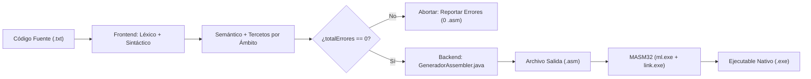

# Guía de Estudio y Defensa Oral — Etapa 4: Generación de Código Assembler (Pentium x86 / MASM32)

**Materia:** Diseño de Compiladores I / Compiladores e Intérpretes  
**Carrera:** Ingeniería de Sistemas — UNICEN  
**Grupo:** 20  
**Objetivo de este documento:** Bitácora pedagógica viva donde se registran todos los hitos de implementación del backend, fundamentos arquitectónicos de la CPU x86 y el coprocesador 80x87, mapeo de estructuras intermedias a código de máquina, preguntas incisivas de los docentes y respuestas modelo para defender el compilador con máxima solvencia en la mesa evaluadora.

---

## 🗺️ Mapa General de la Etapa 4 en Hitos Progresivos

```text
[Hito 1] Estructura MASM32, Sección .data e Impresión por Consola (POUT) (COMPLETADO)
    │
    ▼
[Hito 2] Variables Auxiliares (@aux), Aritmética Entera/Flotante, Asignaciones y tos() (Tema 34) (COMPLETADO)
    │
    ▼
[Hito 3] Control de Flujo: Comparaciones Enteras/Flotantes, Lógica Inversa y Saltos (IF, REPEAT UNTIL)
    │
    ▼
[Hito 4] Subrutinas: Funciones Ordinarias, AUTO FUNCTION (Tema 21) y Métodos de Clases
    │
    ▼
[Hito 5] Chequeos en Tiempo de Ejecución Asignados (c, d, g, i) e Integración Final
```

---

## 📌 Hito 1: Estructura MASM32, Sección `.data` e Impresión por Consola (`POUT`)

---

### 1.1. Introducción a la Etapa 4 para la Defensa Oral

#### ¿Qué hace el backend del compilador del Grupo 20?
En las etapas anteriores construimos el **Frontend** y la **Fase Semántica / Código Intermedio**:
1. **Etapa 1 (Léxico):** El autómata finito determinista descompuso el flujo de caracteres en tokens y cargó los primeros identificadores y constantes en la Tabla de Símbolos.
2. **Etapa 2 (Sintáctico):** El parser LALR(1) generado con BYacc/J verificó la estructura de la gramática libre de contexto y se recuperó de errores sin detener la ejecución.
3. **Etapa 3 (Semántico y Tercetos):** Se validaron tipos, ámbitos (name mangling con `@`), visibilidad de clases, y se generó la representación intermedia en forma de **Tercetos agrupados por ámbito** (`Map<String, ArrayList<Terceto>>`), donde cada ámbito tiene numeración local independiente comenzando en `0..N-1`.

La **Etapa 4** constituye el **Backend (Fase de Síntesis)** de nuestro compilador:
- Toma como entrada los **Tercetos agrupados por ámbito** y la **Tabla de Símbolos enriquecida**.
- Aplica el mecanismo obligatorio de la cátedra: **Variables Auxiliares en Memoria (`@aux`)** para almacenar los resultados intermedios de expresiones complejas.
- Traduce las operaciones a instrucciones reales del microprocesador **Intel Pentium x86 de 32 bits** (utilizando registros enteros `AL`, `BL`, `AX`, `EAX` para nuestro tipo `SHORTINT` de 8 bits con signo `[-128, 127]`) y de su **Coprocesador Matemático 80x87 / FPU** (utilizando la pila de registros `ST(0)..ST(7)` para nuestro tipo `SINGLEF` de punto flotante de 32 bits IEEE 754).
- Incorpora las subrutinas de soporte de la biblioteca de C (`msvcrt.dll` vía `printf`) para imprimir por pantalla la sentencia `POUT`.
- Genera un archivo con extensión `.asm` listo para ser procesado por el ensamblador **MASM32** (`ml.exe`) y enlazado por el linker (`link.exe`) para producir un ejecutable nativo `.exe` de Windows de 32 bits.

#### ¿Por qué el archivo `.asm` solo se genera cuando `totalErrores == 0`?
Una premisa arquitectónica elemental en el diseño de compiladores industriales y académicos es que **nunca se debe generar código ejecutable si ocurrieron errores previos** (sean léxicos, sintácticos o semánticos).
- **Razón Teórica:** La representación intermedia (tercetos) generada ante un programa con errores sintácticos o semánticos contiene inconsistencias estructurales: operandos nulos, tipos incompatibles no resueltos o ramas de bifurcación incompletas. Intentar traducir esas anomalías a Assembler produciría código de máquina con accesos a punteros corruptos, violaciones de segmento o instrucciones sin sentido en el hardware.
- **Implementación en nuestro compilador:** Al terminar la invocación a `par.yyparse()`, el método principal consulta si la suma de errores léxicos, sintácticos y semánticos es estrictamente igual a `0`. Si `totalErrores > 0`, el compilador informa el balance de fallas, aborta la fase de síntesis y devuelve control con código de error, protegiendo al usuario y al sistema operativo.



---

### 1.2. Explicación Línea por Línea del Encabezado MASM32

El archivo `.asm` emitido por nuestro compilador sigue con absoluta fidelidad la plantilla oficial establecida por la cátedra en `teoria/teoria_parte4/herramientas/ej_impresion.md` y `printf-variables.pdf`. A continuación se detalla el propósito de cada directiva:

```nasm
.386
.model flat, stdcall
option casemap :none
include \masm32\include\masm32rt.inc
includelib \masm32\lib\kernel32.lib
includelib \masm32\lib\masm32.lib
dll_dllcrt0 PROTO C
printf PROTO C :VARARG

.data
    ; Sección de datos: variables, auxiliares, constantes literales y de control

.code
    ; Sección de código: subrutinas de clases y funciones

start:
    ; Punto de entrada del programa (ámbito "main")
    ...
    invoke ExitProcess, 0
end start
```

#### Desglose Técnico Exhaustivo:

1. **`.386` (Conjunto de Instrucciones):**
   - Le indica al ensamblador MASM que habilite el repertorio de instrucciones de 32 bits de la arquitectura Intel 80386 en adelante (Pentium). Permite el uso de registros extendidos de 32 bits (`EAX`, `EBX`, `ECX`, `EDX`, `ESP`, `EBP`), el direccionamiento base + índice con escalado y las instrucciones aritméticas de palabra doble.

2. **`.model flat, stdcall` (Modelo de Memoria y Convención de Llamadas):**
   - **`flat`:** Establece el modelo de memoria plano protegido característico de los sistemas operativos modernos de 32 bits (Windows NT / 2000 / XP / 7 / 10 / 11). A diferencia del modelo segmentado de 16 bits del DOS (`small`, `large`) donde el programador debía manipular manualmente los registros de segmento `CS`, `DS`, `SS` y `ES`, en el modelo `flat` todo el espacio de direccionamiento virtual (hasta 4 GB) conforma un único segmento contiguo y lineal. Los selectores de segmento ya vienen configurados por el sistema operativo y no deben ser modificados.
   - **`stdcall`:** Define la convención de llamadas estándar por defecto de la API de Windows Win32. Bajo `stdcall`, los parámetros se apilan en el stack de derecha a izquierda y es la **función llamada (callee)** la responsable de limpiar la pila antes de retornar mediante la instrucción `RET n` (donde `n` es la cantidad de bytes que ocupaban los parámetros).

3. **`option casemap :none` (Sensibilidad a Mayúsculas y Minúsculas):**
   - Por defecto, el ensamblador MASM es insensible a las mayúsculas (*case-insensitive*), transformando internamente todos los identificadores a mayúsculas. Esta directiva desactiva esa conducta y vuelve al ensamblador **case-sensitive**, lo que resulta indispensable para que los identificadores de nuestro lenguaje fuente, las variables con name mangling (`_main@a`) y las funciones de bibliotecas externas de C (`printf`) se resuelvan con sus nombres exactos en el enlazador.

4. **`include \masm32\include\masm32rt.inc`:**
   - Archivo de cabecera maestro del SDK MASM32. Incluye automáticamente definiciones de constantes del sistema, prototipos estándar y macros de conveniencia de ensamblado, como la macro de cadenas de formato `cfm$()`.

5. **`includelib \masm32\lib\kernel32.lib` y `includelib \masm32\lib\masm32.lib`:**
   - Directivas que instruyen al ensamblador para que inserte en el archivo objeto (`.obj`) la directiva de enlace con las bibliotecas de importación estáticas de Windows. `kernel32.lib` resuelve las llamadas básicas al núcleo del sistema operativo (en particular `ExitProcess`), mientras que `masm32.lib` provee utilidades complementarias del paquete.

6. **`dll_dllcrt0 PROTO C`:**
   - Prototipo de la función de arranque e inicialización del runtime de C (`msvcrt.dll`). Su presencia es requerida por la infraestructura de MASM32 cuando se enlazan programas que consumen funciones de la biblioteca estándar de C sin utilizar un punto de entrada tradicional de C.

7. **`printf PROTO C :VARARG`:**
   - Declaración del prototipo externo de la función `printf`.
   - **`PROTO C`:** Especifica que esta función NO utiliza la convención `stdcall`, sino la convención clásica de C (**`cdecl`**). En `cdecl`, los parámetros se colocan en la pila de derecha a izquierda, pero es el **llamador (caller)** el responsable de limpiar la pila después del retorno (o bien la macro de llamada `invoke` genera automáticamente el ajuste `ADD ESP, n`). Esto es estrictamente obligatorio para funciones con cantidad variable de argumentos.
   - **`:VARARG`:** Informa que la función acepta una lista de argumentos de longitud indefinida (como mínimo la cadena de formato de control).

8. **`.data` (Sección de Datos):**
   - Abre la sección del ejecutable donde se reservan e inicializan los datos estáticos del programa. En Windows PE (*Portable Executable*), esta sección se mapea en páginas de memoria con permisos de Lectura y Escritura (`PAGE_READWRITE`).

9. **`.code` (Sección de Código):**
   - Abre la sección de instrucciones ejecutables (sección `.text` en formato binario). En Windows PE, se mapea en páginas con permisos de Lectura y Ejecución (`PAGE_EXECUTE_READ`), previniendo la corrupción accidental o ejecución de datos.

10. **`start:`:**
    - Etiqueta que marca el punto exacto donde el sistema operativo debe comenzar la ejecución del hilo principal del proceso. En nuestro compilador, aquí comienza la traducción de los tercetos del ámbito raíz `"main"`.

11. **`invoke ExitProcess, 0`:**
    - Instrucción que invoca a la API nativa de Windows `ExitProcess` pasando el código de salida `0` (indicando finalización exitosa). Esto asegura que el proceso se destruya de forma limpia, liberando toda la memoria, descriptores de consola y recursos asociados.

12. **`end start`:**
    - Directiva final requerida por MASM. No solo indica el fin físico del archivo fuente a ensamblar, sino que el argumento `start` le comunica al enlazador que la etiqueta `start` es el *Entry Point* oficial del programa ejecutable.

---

### 1.3. Mapeo de la Tabla de Símbolos a la Sección `.data`

En un procesador x86, la memoria física y virtual no entiende conceptos de alto nivel como "enteros con signo", "variables locales" o "clases": únicamente entiende **bloques de bytes consecutivos en memoria**.

La Tabla de Símbolos construida a lo largo de las Etapas 1, 2 y 3 contiene la información de tipo, ámbito y uso de cada identificador. El generador de Assembler recorre las entradas de la Tabla de Símbolos y emite la directiva MASM adecuada según el tamaño de cada tipo de dato.

#### Tabla de Directivas de Datos MASM32 para el Grupo 20:

| Directiva MASM | Nombre Completo | Tamaño | Rango / Formato | Uso en el Grupo 20 | Ejemplo Emitido en `.data` |
| :--- | :--- | :--- | :--- | :--- | :--- |
| **`DB`** | *Define Byte* | 1 byte (8 bits) | `[-128, 127]` (con signo) o ASCII | Variables, parámetros y `@aux` de tipo **`SHORTINT`** (Tema 1); cadenas de texto literales (Tema 10); flags de recursión | `_main@a DB ?`<br>`_cte_10s DB 10`<br>`_str_0 DB "Compiladores", 0` |
| **`DW`** | *Define Word* | 2 bytes (16 bits) | `[-32768, 32767]` | Variables de soporte del compilador: `@aux_print_short` para promoción de `SHORTINT` en `printf`, y `@aux_tos` para conversión `tos()` (Tema 34) | `@aux_print_short DW ?`<br>`@aux_tos DW ?` |
| **`DD`** | *Define Doubleword* | 4 bytes (32 bits) | IEEE 754 Simple Precisión | Variables, constantes y `@aux` de tipo **`SINGLEF`** (Tema 7) | `_main@f DD ?`<br>`_cte_3_5 DD 3.5` |
| **`DQ`** | *Define Quadword* | 8 bytes (64 bits) | IEEE 754 Doble Precisión | Variable de soporte de impresión: `@aux_print_float` requerida por `printf` para recibir flotantes extendidos de 64 bits | `@aux_print_float DQ ?` |
| **`DT`** | *Define Ten Bytes* | 10 bytes (80 bits) | IEEE 754 Precisión Extendida | Formato interno nativo de los registros de la FPU `ST(0)..ST(7)` | Uso interno de la FPU |

#### Variables no inicializadas (`?`) vs. Constantes con valor literal
- **Variables, Parámetros y Auxiliares:**
  Se declaran utilizando el operador de no inicialización **`?`** (ejemplo: `_main@x DB ?` o `_main@f DD ?`).
  Esto significa que el compilador no necesita escribir ningún valor en el binario: simplemente le indica al sistema operativo cuántos bytes debe reservar en el segmento de datos cuando cargue el ejecutable en memoria.
- **Constantes Literales:**
  Se declaran con su valor concreto conocido en tiempo de compilación:
  - Constantes enteras cortas (`SHORTINT`): `_cte_10s DB 10` o `_cte_neg_5 DB -5`.
  - Constantes flotantes (`SINGLEF`): `_cte_3_5 DD 3.5`.
  - Cadenas de caracteres: `_str_0 DB "Texto a mostrar", 0`. Toda cadena se emite delimitada con comillas dobles y terminada obligatoriamente con el byte nulo **`0`** (convención de cadenas de C / ASCIIZ). Si la cadena en el fuente era vacía `""`, se emite simplemente `_str_0 DB 0`.

#### ¿Qué sucede con las variables `COMPTIME` (Tema 22) en `.data`?
En nuestro lenguaje, el **Tema 22** define variables evaluadas en tiempo de compilación con la sintaxis:
```text
COMPTIME <tipo> <identificador> := <expresion_constante>;
```
- **Principio Fundamental de Compilación:** Una variable de tiempo de compilación NO existe en tiempo de ejecución.
- En la **Etapa 3**, cada vez que el parser reconoció una expresión constante asignada a una variable `COMPTIME`, computó su valor aritmético de forma estática en Java, lo guardó en el atributo `VALOR` de la Tabla de Símbolos y marcó el atributo `COMPTIME = "SI"`. Posteriormente, en todas las expresiones donde aparecía dicha variable, el compilador reemplazó directamente su uso por el valor literal de la constante (plegado y propagación de constantes).
- **En la sección `.data` de la Etapa 4:** Como la variable `COMPTIME` ya cumplió su ciclo de vida y fue completamente absorbida en tiempo de traducción, **no requiere almacenamiento en la memoria de runtime**. Para mantener claridad pedagógica y permitir auditar el código generado, el compilador la emite comentada o directamente la omite de `.data`:
  ```nasm
  ; Variable COMPTIME (Tema 22) resuelta estaticamente en compilacion:
  ; _main@LIMITE EQU 100
  ```

#### Normalización de Identificadores para MASM32
En la Tabla de Símbolos, las claves de las variables poseen name mangling con el carácter arroba (ejemplo: `"main@a"`, `"main@Clase@metodo@x"`), mientras que las constantes tienen claves como `"10$s"`, `"-5"`, `"3.5"`, `"1.5s+2"` o `"\"Mensaje\""`.

El ensamblador MASM32 tiene restricciones estrictas sobre los caracteres permitidos en los nombres de variables y etiquetas:
1. **Variables y Parámetros:**
   MASM32 permite letras, números y los caracteres especiales `_`, `@`, `$`, `?`. Sin embargo, para evitar que un nombre comience con dígitos o colisione con palabras reservadas de ensamblador, **prefijamos todas las variables con un guión bajo**:
   - Clave TS `"main@a"` $\to$ Símbolo MASM `_main@a`.
   - Clave TS `"main@Fact@n"` $\to$ Símbolo MASM `_main@Fact@n`.
2. **Variables Auxiliares e Internas:**
   Comienzan con `@` (ejemplo: `@aux_main_0`, `@aux_print_short`). MASM32 admite el carácter `@` como primer carácter de un identificador de usuario.
3. **Constantes Literales:**
   Las constantes no tienen nombres de usuario en la Tabla de Símbolos (su clave es su propio texto literal). Para poder referenciarlas en las instrucciones x86, el generador les asigna nombres normalizados y unívocos:
   - **Cadenas de texto:** Se mapean a identificadores correlativos: `_str_0`, `_str_1`, `_str_2`, etc.
   - **Números enteros y flotantes:** Se normalizan reemplazando caracteres inválidos:
     - El signo negativo `-` se convierte en `neg_`.
     - El punto decimal `.` se convierte en `_`.
     - El signo positivo `+` en exponentes se convierte en `pos_`.
     - El sufijo de exponente `s` o `S` del Grupo 20 se convierte en `E`.
     - Se antepone el prefijo `_cte_`.
     - *Ejemplos:*
       - `10$s` $\to$ `_cte_10s DB 10`
       - `-5` $\to$ `_cte_neg_5 DB -5`
       - `3.5` $\to$ `_cte_3_5 DD 3.5`
       - `1.17549435s-38` $\to$ `_cte_1_17549435Eneg_38 DD 1.17549435E-38`
4. **Formateo Estricto de Literales Flotantes para MASM32:**
   La directiva `DD` de MASM32 exige una sintaxis numérica rigurosa:
   - Si un flotante viene con punto inicial (ej. `.5`), MASM da error de sintaxis; debe emitirse con cero a la izquierda: `0.5`.
   - Si un flotante viene con punto final sin decimales (ej. `3.`), debe emitirse con cero a la derecha: `3.0`.
   - Los exponentes con el sufijo asignado al Grupo 20 (`s` o `S`, como `2.5s+3`) deben traducirse al formato estándar de IEEE que entiende MASM, reemplazando la `'s'` por la letra `'E'` (`2.5E+3`).

---

### 1.4. Traducción de `POUT` y las Particularidades de `printf` en MASM32

En nuestro lenguaje, la sentencia de salida por pantalla es:
```text
POUT ( <expresion> );
```
En la Etapa 3, esto genera el terceto:
```text
i ( POUT , operando1 , _ )
```
Para traducir este terceto a Assembler, invocamos la función `printf` de la biblioteca estándar de C incluida en MASM32. Sin embargo, **imprimir en C desde Assembler x86 encierra sutilezas técnicas críticas de representación física** que los docentes de la cátedra evalúan rigurosamente en la defensa oral (`printf-variables.pdf` y `ej_impresion.md`).

#### Caso 1: Impresión de Cadenas de Texto (`CADENA`)

Cuando `operando1` es una cadena literal:
```text
( POUT , "Hola Mundo" , _ )
```
En la sección `.data` la cadena reside como:
```nasm
_str_0 DB "Hola Mundo", 0
```
Para imprimirla, la función `printf` espera recibir la **dirección de memoria (puntero)** donde comienza el primer carácter:
```nasm
invoke printf, cfm$("%s\n"), OFFSET _str_0
```
- **`OFFSET _str_0`:** Operador de MASM que obtiene la dirección efectiva de 32 bits de la variable en el segmento de datos (equivalente al operador `&` de C). Si omitiéramos `OFFSET`, MASM intentaría pasar los primeros 4 bytes del texto desreferenciado como un entero, provocando una violación de acceso (*Access Violation / Segmentation Fault*) cuando `printf` intente leer esa dirección inexistente.
- **`cfm$("%s\n")`:** Macro provista por `masm32rt.inc` que crea automáticamente en tiempo de ensamblado la cadena literal de formato en la sección de datos con retorno de carro y fin nulo, y devuelve su puntero.

---

#### Caso 2: Impresión de Enteros Cortos (`SHORTINT` — 8 bits con signo)

El tipo entero de nuestro Grupo 20 es **`SHORTINT`**, almacenado en **1 byte (8 bits con signo, rango `[-128, 127]`)** en formato de complemento a dos:

```text
Bits:     [ b7 | b6 | b5 | b4 | b3 | b2 | b1 | b0 ]
          ▲
          └─ Bit de signo (0 = positivo, 1 = negativo)
```

##### El problema de la función `printf`:
En la biblioteca de C de 32 bits (`msvcrt.dll`), la función `printf` utiliza especificadores de formato estándar:
- `%d` espera un entero de 32 bits (`DWORD`, 4 bytes).
- `%hd` espera un entero corto de 16 bits (`WORD`, 2 bytes).
- No existe un modificador universal y portable de 8 bits en este runtime para pasar un único byte por la pila de 32 bits. Si pasáramos a ciegas un byte a la pila, los 8 bits superiores de la palabra contendrían **basura residual** de operaciones previas, corrompiendo por completo el número impreso.

##### La solución técnica: Extensión de Signo con `MOVSX AX, AL`:
Para imprimir un `SHORTINT` de forma 100% segura y precisa, la cátedra exige realizar una **promoción a entero de 16 bits** respetando el signo aritmético (`printf-variables.pdf`, pág. 2).

El código generado es:
```nasm
MOV AL, _main@a
MOVSX AX, AL
MOV @aux_print_short, AX
invoke printf, cfm$("%hd\n"), @aux_print_short
```

##### Análisis Bit a Bit: ¿Por qué `MOVSX` y no `MOVZX`?
Veamos qué ocurre en los registros cuando `_main@a` contiene el número negativo `-10$s`:
- En representación hexadecimal de complemento a dos en 8 bits:  
  $-10 = 256 - 10 = 246 = \text{0xF6} = 11110110_2$.
- Ejecutamos `MOV AL, _main@a`:  
  `AL` contiene `11110110_2` (`0xF6`). El bit más significativo (bit 7) es **`1`** (indica signo negativo).
- **Instrucción `MOVSX AX, AL` (*Move with Sign-Extension*):**  
  Copia el contenido de `AL` al registro `AX` de 16 bits y **replica el bit de signo** en todos los bits de la parte alta `AH`:
  ```text
  Antes de MOVSX:
  AX = [ AH (basura ????????) ] [ AL (11110110 = -10) ]

  Después de MOVSX AX, AL:
  AX = [ AH (11111111 = 0xFF) ] [ AL (11110110 = 0xF6) ]
  AX = 0xFFF6
  ```
  En complemento a dos de 16 bits, `0xFFF6` representa exactamente el valor decimal **`-10`**. Al guardarlo en `@aux_print_short` (`DW`) e imprimirlo con `%hd`, la consola muestra correctamente `-10`.

##### ¿Qué pasaría si usáramos `MOVZX`?
`MOVZX` (*Move with Zero-Extension*) rellena la parte alta con ceros (`0x00`):
```text
AX = [ AH (00000000 = 0x00) ] [ AL (11110110 = 0xF6) ]
AX = 0x00F6 = 246 decimal (¡POSITIVO!)
```
Habríamos convertido el número `-10` en `+246`, destruyendo la semántica del programa.

##### ¿Qué pasaría si hiciéramos `MOV AL, _main@a` sin tocar `AH`?
Si `AH` contenía, por ejemplo, `0x12` de una instrucción previa, `AX` valdría `0x12F6` (decimal `4854`), imprimiendo un número completamente disparatado.

---

#### Caso 3: Impresión de Flotantes (`SINGLEF` — 32 bits IEEE 754)

El tipo de punto flotante asignado al Grupo 20 es **`SINGLEF`**, representado en memoria con **4 bytes (32 bits, directiva `DD`)** según la norma IEEE 754:
```text
[ 1 bit de signo | 8 bits de exponente sesgado | 23 bits de mantisa ]
```

##### La exigencia de la convención de llamadas de C:
En el estándar del lenguaje C, cuando una función recibe una lista variable de argumentos (`VARARG`, como `printf`), entra en juego la regla de promoción por defecto (*Default Argument Promotion*): **todo argumento de tipo `float` (32 bits) debe promoverse obligatoriamente a `double` (64 bits) antes de colocarse en la pila** (`printf-variables.pdf`, pág. 1-2).

En MASM32, el especificador de formato utilizado por la cátedra para imprimir flotantes en `printf` es:
```nasm
invoke printf, cfm$("%Lf\n"), @aux_print_float
```
donde `@aux_print_float` está declarada en la sección `.data` como **`DQ ?`** (64 bits, Quadword).

##### La solución elegante: Promoción por Hardware en el Coprocesador 80x87
¿Cómo convertimos nuestro número `SINGLEF` de 32 bits a un `double` de 64 bits sin escribir complejos algoritmos de corrimiento de bits y reajuste de exponentes? **El coprocesador matemático 80x87 lo hace de forma completamente gratuita en una sola operación**.

El código generado es:
```nasm
FLD _main@f
FSTP @aux_print_float
invoke printf, cfm$("%Lf\n"), @aux_print_float
```

##### Mecanismo Interno del Coprocesador:
1. **`FLD _main@f` (*Float Load*):**  
   Lee los 4 bytes de `_main@f` (`DD`, 32 bits) desde la memoria y los empuja al tope de la pila de la FPU, en el registro `ST(0)`.  
   *Detalle clave de arquitectura:* Todos los registros internos de la FPU (`ST(0)` a `ST(7)`) operan siempre en **precisión extendida de 80 bits (10 bytes)**. Al ejecutar `FLD`, el circuito del coprocesador expande automáticamente el flotante de 32 bits a 80 bits, sin perder un solo bit de precisión.
2. **`FSTP @aux_print_float` (*Float Store and Pop*):**  
   Toma el valor de 80 bits alojado en `ST(0)`, lo convierte al formato de destino especificado por la directiva de la variable receptora (al ser `@aux_print_float` de tipo `DQ`, lo convierte a **IEEE 754 de 64 bits**), lo escribe en memoria y **desapila el registro** (*pop*).  
   Al hacer el *pop*, la pila de la FPU queda exactamente en el mismo estado en que estaba antes de la impresión, evitando cualquier desbordamiento (*Stack Overflow* en la FPU).
3. **`invoke printf`:**  
   Pasa los 8 bytes de `@aux_print_float` a la función `printf`, que con `%Lf` lee los 64 bits y muestra el número real en la consola con total precisión.

```text
    Memoria (.data)              Pila del Coprocesador (FPU)           Memoria (.data)
   ┌───────────────┐                  ┌─────────────┐                 ┌───────────────┐
   │ _main@f (DD)  │                  │    ST(0)    │                 │@aux_print_... │
   │    32 bits    │ ──[ FLD ]──────> │   80 bits   │ ──[ FSTP ]────> │    (DQ)       │
   └───────────────┘                  └─────────────┘                 │   64 bits     │
                                                                      └───────────────┘
                                                                              │
                                                                       [ printf %Lf ]
                                                                              ▼
                                                                        Consola Windows
```

---

### 1.5. Preguntas de Defensa Oral del Hito 1 (Con Respuestas Modelo)

A continuación se presentan 5 preguntas incisivas típicas de la mesa evaluadora de la cátedra para el Hito 1, con el nivel de rigor conceptual esperado de un alumno de ingeniería del Grupo 20:

---

#### ❓ Pregunta 1: ¿Por qué en la sección `.data` de MASM32 declaramos las variables con directivas como `DB ?` o `DD ?` en lugar de usar palabras reservadas de alto nivel como `SHORTINT` o `SINGLEF`? ¿Qué rol cumple la Tabla de Símbolos en este proceso?

* **Respuesta Modelo para la Defensa:**  
  "En la arquitectura x86, el procesador no tiene tipado estático ni comprende conceptos de alto nivel como `SHORTINT`, `SINGLEF` o registros de clases. En el nivel de lenguaje de máquina, los tipos se reducen estrictamente al **tamaño físico en bytes** y a la **interpretación de las instrucciones que operan sobre ellos**.
  
  Por esa razón:
  - Nuestro tipo `SHORTINT` (entero de 8 bits con signo `[-128, 127]`) se mapea a la directiva **`DB` (*Define Byte*)**, que reserva exactamente 1 byte de memoria.
  - Nuestro tipo `SINGLEF` (flotante de 32 bits IEEE 754) se mapea a la directiva **`DD` (*Define Doubleword*)**, que reserva 4 bytes de memoria.
  - El signo de interrogación **`?`** indica que se trata de memoria no inicializada; no ocupa espacio en el binario en disco, sino que el sistema operativo reserva esos bytes en memoria RAM cuando carga el segmento de datos.
  
  El rol de la **Tabla de Símbolos** en esta fase es fundamental: actúa como el diccionario de traducción del compilador. Durante las Etapas 1, 2 y 3, la Tabla de Símbolos registró el tipo, el ámbito y el identificador de cada variable. En la Etapa 4, el generador de Assembler itera sobre todas las entradas de la Tabla de Símbolos: consulta el atributo `TIPO` de cada entrada para decidir si emitir `DB ?` o `DD ?`, y traduce la clave con name mangling (por ejemplo `main@a`) a un identificador seguro para MASM32 (`_main@a`)."

---

#### ❓ Pregunta 2: Si el tipo `SHORTINT` del Grupo 20 ocupa 1 byte, ¿por qué para imprimirlo con `printf` no pasamos directamente la variable a la pila? ¿Por qué es obligatorio usar `MOVSX AX, AL` y qué pasaría si usáramos `MOVZX` o dejáramos basura en `AH`? Mostrame un ejemplo con el valor `-10$s`.

* **Respuesta Modelo para la Defensa:**  
  "La función `printf` de la biblioteca estándar de C (`msvcrt.dll`) en Windows de 32 bits no posee un especificador portable para imprimir un solo byte aislado; su especificador más pequeño para enteros con signo es `%hd`, que espera un entero corto de 16 bits (`WORD`, 2 bytes). Si empujáramos un solo byte a la pila o a un registro de 16 bits, los 8 bits superiores contendrían basura residual de instrucciones anteriores.
  
  Para resolver esto de forma rigurosa, la cátedra exige promover el `SHORTINT` a 16 bits utilizando la instrucción **`MOVSX AX, AL` (*Move with Sign-Extension*)**.
  
  Veamos qué pasa con el valor `-10$s`:
  1. En memoria, en complemento a dos de 8 bits, $-10$ se representa como `11110110_2` (`0xF6`). El bit más significativo (bit 7) vale `1` (signo negativo).
  2. Cargamos el byte en `AL`: `MOV AL, _main@a`.
  3. Ejecutamos `MOVSX AX, AL`: esta instrucción no solo copia `AL` a `AX`, sino que **inspecciona el bit 7 de `AL` y lo replica en los 8 bits del registro `AH`**. Como el bit 7 era `1`, llena `AH` con unos (`11111111_2` = `0xFF`).
  4. El registro `AX` queda con el valor `0xFFF6`, que en complemento a dos de 16 bits es exactamente el número decimal **`-10`**. Al pasarlo a `printf` con `%hd`, la consola imprime `-10` de forma intachable.
  
  **¿Qué pasaría si usáramos `MOVZX`?**  
  `MOVZX` realiza extensión con ceros: rellenaría `AH` con `0x00`. El registro `AX` quedaría con `0x00F6`, que en decimal es **`+246`**. Habríamos transformado un número negativo en positivo, rompiendo la semántica del programa.
  
  **¿Qué pasaría si dejáramos basura en `AH`?**  
  Si hiciéramos `MOV AL, _main@a` y no limpiáramos `AH`, si `AH` tenía por ejemplo `0x05`, `AX` valdría `0x05F6` (decimal `1526`), imprimiendo un número completamente disparatado."

---

#### ❓ Pregunta 3: En la sección `.data` definieron `@aux_print_float DQ ?` (64 bits, 8 bytes). Si el tipo de datos de su lenguaje es `SINGLEF` de 32 bits (`DD`), ¿por qué la variable de soporte de impresión tiene 64 bits? ¿Cómo colabora el coprocesador 80x87 en esta conversión?

* **Respuesta Modelo para la Defensa:**  
  "Esto responde a la especificación de la convención de llamadas del lenguaje C en funciones con cantidad variable de argumentos (`VARARG`). Según el estándar de C, cuando se pasa un argumento de punto flotante a una función como `printf`, se aplica la promoción automática por defecto: **los argumentos de 32 bits (`float`) deben convertirse obligatoriamente a doble precisión de 64 bits (`double`)**.
  
  En MASM32, la directiva de formato provista por la cátedra es `%Lf`, la cual espera leer de la memoria un bloque de **64 bits (`DQ`, Quadword)**.
  
  En lugar de implementar software complejo para reacomodar la mantisa y el exponente sesgado de 32 a 64 bits, **aprovechamos la arquitectura nativa del coprocesador 80x87**:
  1. Hacemos `FLD _main@f`: el coprocesador lee el número de 32 bits de memoria y lo empuja al tope de su pila interna `ST(0)`. Como todos los registros de la FPU operan internamente en precisión extendida de **80 bits**, el hardware del coprocesador expande automáticamente el número a 80 bits en una sola instrucción de máquina.
  2. Hacemos `FSTP @aux_print_float`: como la variable de destino fue declarada como `DQ` (64 bits), la instrucción `FSTP` toma el valor de 80 bits de `ST(0)`, lo redondea y convierte automáticamente por hardware al formato IEEE 754 de 64 bits, lo deposita en la variable auxiliar y **desapila el registro** (*pop*).
  
  De esta forma, en dos instrucciones de hardware logramos una promoción perfecta a 64 bits sin pérdida de precisión y dejando la pila del coprocesador totalmente limpia para las instrucciones siguientes."

---

#### ❓ Pregunta 4: ¿Por qué las variables declaradas con `COMPTIME` (Tema 22) no necesitan reservar espacio en la sección `.data` durante la ejecución del programa?

* **Respuesta Modelo para la Defensa:**  
  "El Tema 22 asignado a nuestro grupo define variables en tiempo de compilación (`COMPTIME`). La semántica de estas variables establece que su valor se fija estáticamente durante la compilación y jamás cambia en tiempo de ejecución.
  
  Por lo tanto, siguiendo las etapas del compilador:
  1. En la **Etapa 3**, cuando el analizador semántico procesó la sentencia `COMPTIME <tipo> x := <expresion>;`, evaluó la expresión aritmética en Java, validó los límites de rango del tipo y guardó el resultado estático en el atributo `VALOR` de la entrada de `x` en la Tabla de Símbolos, marcando `COMPTIME = "SI"`.
  2. En todas las apariciones posteriores de `x` en el código fuente, el compilador aplicó **plegado y propagación de constantes**: no generó tercetos de lectura de memoria sobre `x`, sino que utilizó directamente su valor numérico literal.
  
  Como en el código ejecutable ningún terceto lee ni escribe sobre la dirección de memoria de la variable `COMPTIME`, reservar un byte o cuatro bytes en `.data` sería un desperdicio injustificado de memoria. En la Etapa 4, el generador de Assembler reconoce que la variable tiene `COMPTIME = "SI"` y simplemente la omite de `.data` (o la emite como un comentario de documentación en el `.asm`), demostrando que nuestro compilador realiza optimizaciones estáticas reales."

---

#### ❓ Pregunta 5: ¿Qué función cumple la macro `cfm$("%s\n")` y por qué es obligatorio utilizar el operador `OFFSET` al pasar una variable de cadena a `printf`?

* **Respuesta Modelo para la Defensa:**  
  "La macro **`cfm$` (*Constant Format String*)** es una utilidad provista por `masm32rt.inc`. Cuando escribimos `cfm$("%s\n")`, el preprocesador de MASM32 genera en tiempo de ensamblado una cadena literal anónima en el segmento de constantes terminada en byte nulo (`0`), y sustituye la macro en la instrucción `invoke` por la dirección de memoria de dicha cadena de formato. Esto evita que tengamos que inventar y declarar manualmente una etiqueta en `.data` para cada formato de `printf`.
  
  Por otro lado, el uso de **`OFFSET`** es estrictamente obligatorio por cómo funciona el direccionamiento en x86:
  - En la sección `.data`, una cadena se declara como:
    ```nasm
    _str_0 DB "Mensaje", 0
    ```
  - La función `printf`, ante el especificador `%s`, espera recibir un **puntero de 32 bits** (la dirección de memoria en RAM donde empieza el primer byte de la cadena).
  - Si escribiéramos erróneamente `invoke printf, cfm$("%s\n"), _str_0` (sin `OFFSET`), MASM intentaría leer el **contenido** de la memoria en la dirección `_str_0` (es decir, los caracteres `'M'`, `'e'`, `'n'`, `'s'` interpretados como un entero de 32 bits: `0x736E654D`) y colocaría ese valor en la pila.
  - Cuando `printf` intente usar `0x736E654D` como una dirección de memoria para leer el texto, el procesador detectará que esa dirección no pertenece al espacio de memoria accesible del programa y el sistema operativo lanzará de inmediato una excepción por violación de acceso (*Access Violation / Crash*).
  - Al colocar **`OFFSET _str_0`**, le indicamos a MASM que no desreferencie la memoria, sino que cargue la **dirección efectiva (puntero)** de `_str_0`, permitiendo que `printf` recorra carácter por carácter hasta encontrar el byte nulo terminador `0`."

---

### 1.6. Próximo Paso: Hito 2 (Completado)
La infraestructura base y la capacidad de emitir `.data` y `POUT` quedaron plenamente consolidadas en el Hito 1. A continuación se detalla la implementación y defensa oral del Hito 2.

---

## 📌 Hito 2: Variables Auxiliares (`@aux`), Aritmética Entera/Flotante, Asignaciones y `tos()` (Tema 34)

---

### 2.1. Introducción a la Arquitectura: CPU vs. Memoria RAM

Para entender el código Assembler que genera este hito, hay que comprender una regla física de la arquitectura Intel x86:

> **Regla de Oro de x86:** El procesador **NO puede operar de memoria a memoria**.  
> Una instrucción como `ADD _a, _b` (donde ambas variables residen en la RAM) es **inválida e ilegal** para el hardware.

#### ¿Cómo resuelve una operación la CPU?
La CPU tiene unos pequeños casilleros de almacenamiento ultrarrápidos dentro del propio chip llamados **Registros**. Para hacer cualquier cuenta aritmética (`+`, `-`, `*`, `/`):
1. Trae uno de los operandos desde la memoria RAM a un registro interno (`MOV AL, operando1`).
2. Realiza la operación aritmética combinando ese registro con el segundo operando (`ADD AL, operando2`).
3. Guarda el resultado obtenido en una variable de memoria para no perderlo (`MOV @aux, AL`).

```text
    Memoria RAM (.data)               CPU (Registro AL)               Memoria RAM (.data)
   ┌───────────────────┐             ┌─────────────────┐             ┌───────────────────┐
   │     _main@a       │ ──[ MOV ]──>│       AL        │             │                   │
   └───────────────────┘             │   (Operación    │             │      @aux0        │
   ┌───────────────────┐             │    ADD / SUB    │ ──[ MOV ]──>│ (Resultado para   │
   │     _main@b       │ ──[ ADD ]──>│   IMUL / IDIV)  │             │  próximo terceto) │
   └───────────────────┘             └─────────────────┘             └───────────────────┘
```

#### ¿Por qué usamos Variables Auxiliares (`@aux`) y cómo se pre-registran?
En la Etapa 3, cada operación aritmética generó un terceto con un índice local (por ejemplo, el terceto `3: (+, a, b)`). Cuando tercetos posteriores quieren usar ese resultado, lo referencian como `[3]`.

En Assembler, como los registros de la CPU son escasos y se sobreescriben en la siguiente instrucción, **cada terceto que produce un resultado se asocia a una variable auxiliar en memoria (`@aux3`)**:
- En el ámbito `"main"`, el terceto `i` genera la variable `@aux<i>` (ej. `@aux3`, `@aux4`, `@aux17`).
- En ámbitos anidados (funciones/métodos), genera `@aux_<ambito>_<i>`.
- **Pre-registro en la Tabla de Símbolos:** Antes de emitir la sección `.data`, el generador recorre los tercetos, detecta las operaciones (`+`, `-`, `*`, `/`, `tos`) e inserta en la Tabla de Símbolos la entrada `@aux<i>` con su tipo (`SHORTINT` o `SINGLEF`) y uso `"auxiliar"`. Así, la sección `.data` emite automáticamente `@aux3 DB ?` (si es entero) o `@aux17 DD ?` (si es flotante).

---

### 2.2. Aritmética Entera de 8 bits (`SHORTINT`)

El tipo `SHORTINT` del Grupo 20 ocupa **1 byte con signo (`[-128, 127]`)**, por lo que se opera con la parte baja del registro acumulador: **`AL`** (8 bits).

#### 1. Suma (`+`) y Resta (`-`)
Directas y simétricas:
- **Suma:**
  ```nasm
  MOV AL, _main@a       ; Carga operando 1 en AL
  ADD AL, _main@b       ; Suma operando 2 a AL (AL = AL + b)
  MOV @aux0, AL         ; Almacena resultado en la variable auxiliar
  ```
- **Resta:**
  ```nasm
  MOV AL, _main@a       ; Carga operando 1 en AL
  SUB AL, _main@b       ; Resta operando 2 a AL (AL = AL - b)
  MOV @aux1, AL         ; Almacena resultado en la variable auxiliar
  ```

#### 2. Multiplicación Entera con Signo: `IMUL`
En x86, multiplicar dos números de 8 bits puede dar un resultado de hasta 16 bits (ejemplo: $100 \times 2 = 200$, que no cabe en 8 bits).  
Por eso, la instrucción de multiplicación entera con signo **`IMUL operando2`**:
- Multiplica implícitamente el contenido de **`AL`** por el operando especificado.
- Deposita el resultado completo de 16 bits en el registro **`AX`** (`AH:AL`).
- La parte baja del resultado queda en **`AL`**, que es lo que guardamos en nuestra variable auxiliar `DB`:
  ```nasm
  MOV AL, _main@b       ; Carga multiplicando en AL
  IMUL _cte_2           ; AX = AL * 2 (con signo)
  MOV @aux3, AL         ; Guarda el byte de resultado en @aux3
  ```

#### 3. División Entera con Signo: `IDIV` y la necesidad crítica de `CBW`
La división en x86 tiene una particularidad de diseño que los docentes preguntan siempre en la defensa:
> **Particularidad de x86:** Cuando se ejecuta `IDIV divisor` con un divisor de 8 bits (un byte), el procesador **NO toma a `AL` como dividendo**, sino que **espera obligatoriamente un dividendo de 16 bits alojado en todo el registro `AX` (`AH:AL`)**.

Si solo cargáramos `MOV AL, dividendo`, la parte alta **`AH` contendría basura** de instrucciones anteriores, produciendo un resultado completamente erróneo o una excepción de división por cero/desbordamiento (*Divide Overflow Exception*).

##### ¿Cómo se prepara `AX` de forma segura? La instrucción `CBW`
Para extender el signo del byte en `AL` a los 16 bits de `AX`, la arquitectura x86 provee la instrucción nativa **`CBW` (*Convert Byte to Word*)**:
- Si `AL` es positivo (bit 7 en `0`), `CBW` rellena `AH` con `0x00`.
- Si `AL` es negativo (bit 7 en `1`), `CBW` rellena `AH` con `0xFF`.
- Tras ejecutar `IDIV divisor`:
  - El **cociente** entero de la división queda en **`AL`**.
  - El **resto** (módulo) queda en **`AH`**.

Código emitido por nuestro compilador:
```nasm
MOV AL, _cte_6          ; Carga dividendo de 8 bits en AL
CBW                     ; Extiende signo de AL a todo AX (AH:AL)
IDIV _main@b            ; Divide AX por b. Cociente en AL, resto en AH
MOV @aux5, AL           ; Guarda el cociente en @aux5
```

---

### 2.3. Aritmética de Punto Flotante (`SINGLEF`) en el Coprocesador 80x87 (FPU)

A diferencia de los enteros que usan los registros de propósito general (`AL`, `AX`), los números de punto flotante `SINGLEF` (32 bits IEEE 754, directiva `DD`) se procesan en el **Coprocesador Matemático 80x87 (FPU)**.

#### La Pila de Registros de la FPU: `ST(0)` a `ST(7)`
El coprocesador opera como una **calculadora de notación polaca inversa (RPN)** basada en una pila circular de 8 registros de 80 bits:
- **`ST(0)`** es el tope de la pila (*Top of Stack*).
- **`FLD operando` (*Float Load*):** Empuja un valor a la pila. Lo que estaba en `ST(0)` pasa a `ST(1)`, y el nuevo dato queda en `ST(0)`.
- **`FSTP destino` (*Float Store and Pop*):** Copia el valor de `ST(0)` a la memoria RAM (convirtiéndolo a 32 bits `DD`) y **desapila el registro**.

> **Principio de Limpieza de Pila:** La FPU solo tiene 8 registros. Si dejáramos valores acumulados sin desapilar, al cabo de 8 cálculos la pila se desbordaría (*Floating-Point Stack Overflow*). Por eso, **cada operación de terceto flotante siempre culmina con `FSTP @aux`, garantizando que la pila quede vacía y lista para el siguiente cálculo**.

#### Traducción de las Operaciones Flotantes:
- **Suma (`+`):**
  ```nasm
  FLD @aux17            ; Carga operando 1 en ST(0)
  FADD @aux18           ; ST(0) = ST(0) + @aux18
  FSTP @aux19           ; Guarda en memoria (DD) y limpia la pila
  ```
- **Resta (`-`):**
  ```nasm
  FLD @aux19            ; Carga operando 1 en ST(0)
  FSUB _cte_1_5         ; ST(0) = ST(0) - 1.5
  FSTP @aux20           ; Guarda en memoria y limpia la pila
  ```
- **Multiplicación (`*`):**
  ```nasm
  FLD _cte_3_0          ; Carga operando 1 en ST(0)
  FMUL _main@y          ; ST(0) = ST(0) * y
  FSTP @aux18           ; Guarda en memoria y limpia la pila
  ```
- **División (`/`):**
  ```nasm
  FLD _main@x           ; Carga dividendo en ST(0)
  FDIV _main@y          ; ST(0) = ST(0) / y
  FSTP @aux17           ; Guarda en memoria y limpia la pila
  ```

---

### 2.4. Asignaciones (`:=`) e Inline Assignment (Tema 17)

#### 1. Asignación Simple (`:=`)
Copia el valor del operando derecho al operando izquierdo a través de un registro intermedio:
- **Para `SHORTINT`:**
  ```nasm
  MOV AL, _cte_10       ; Carga valor en registro AL
  MOV _main@a, AL       ; Almacena en la variable destino
  ```
- **Para `SINGLEF`:**
  ```nasm
  FLD _cte_12_5         ; Carga valor en ST(0) de la FPU
  FSTP _main@x          ; Almacena en variable destino y desapila
  ```

#### 2. Asignaciones dentro de Expresiones (Tema 17: `b = (exp)`)
En nuestro lenguaje, el Tema 17 permite expresiones como `c := (b = (4$s)) + a;`.
- En la Etapa 3, la asignación genera un terceto de asignación: `7: (:=, b, 4$s)`.
- El terceto que suma referenciará a esa asignación mediante `[7]`.
- **Resolución en el generador (`resolverOperandoAsm`):** Cuando un operando es una referencia a un terceto cuyo operador es `":="`, el compilador sabe que el valor calculado ya fue asignado a su variable destino (`b`). Por lo tanto, en lugar de buscar un `@aux7`, lee directamente la variable asignada `_main@b`, generando código limpio y sin variables redundantes:
  ```nasm
  MOV AL, _cte_4
  MOV _main@b, AL       ; Se ejecuta la asignacion b = 4
  MOV AL, _main@b       ; Se lee el valor asignado de b
  ADD AL, _main@a       ; Se suma con a
  MOV @aux10, AL
  MOV AL, @aux10
  MOV _main@c, AL       ; Se asigna a c
  ```

---

### 2.5. Conversión Explícita `tos()` (Tema 34: `SINGLEF` a `SHORTINT`)

El **Tema 34** asignado al Grupo 20 define la función de conversión explícita `tos(expresion)`, que toma un número de punto flotante de 32 bits (`SINGLEF`) y lo convierte a un entero corto de 8 bits con signo (`SHORTINT`).

#### El Desafío de Hardware:
En el coprocesador 80x87, la instrucción para convertir un flotante a entero y almacenarlo en memoria es **`FISTP` (*Floating-Point Integer Store and Pop*)**.  
Sin embargo:
> **Limitación del 80x87:** La instrucción `FISTP` **solo soporta enteros de 16 bits (`WORD` / `DW`), 32 bits (`DWORD` / `DD`) o 64 bits (`QWORD` / `DQ`)**. El hardware de la FPU **no puede escribir un entero de 8 bits (`BYTE` / `DB`) directamente**.

#### La Solución del Grupo 20 con `@aux_tos DW ?`:
Para sortear esta restricción física de la FPU, incorporamos en la sección `.data` una variable auxiliar de puente de 16 bits:
```nasm
.data
    @aux_tos DW ?       ; Variable puente de 16 bits para FISTP
```
Y generamos la siguiente secuencia de traducción:
```nasm
FLD _main@x             ; 1. Carga el flotante en ST(0)
FISTP @aux_tos          ; 2. FPU trunca/redondea a entero de 16 bits y guarda en @aux_tos (libera ST(0))
MOV AX, @aux_tos        ; 3. Carga los 16 bits en AX
MOV @aux26, AL          ; 4. Toma la parte baja AL (8 bits) y la guarda en la variable auxiliar SHORTINT
```
De esta manera, respetamos la convención de tipos de la cátedra, cumplimos con la física del coprocesador y obtenemos el `SHORTINT` exacto en un byte.

---

### 2.6. Traza Completa de Verificación: Programa de Prueba Hito 2

A continuación se muestra el programa fuente de prueba (`tests/etapa4_hito2_aritmetica.txt`), los tercetos intermedios generados y el código Assembler resultante verificado:

#### Código Fuente (`tests/etapa4_hito2_aritmetica.txt`):
```text
SHORTINT a, b, c, res_int;
SINGLEF x, y, z, res_flt;

// Aritmetica entera
a := 10$s;
b := 3$s;
res_int := a + b * 2$s - 6$s / b;
POUT(res_int);

// Asignacion en expresion (Tema 17)
c := (b = (4$s)) + a;
POUT(b);
POUT(c);

// Aritmetica flotante
x := 12.5;
y := 2.5;
z := x / y + 3.0 * y - 1.5;
POUT(z);

// Conversion explicita tos() (Tema 34)
res_flt := x + y;
res_int := tos(res_flt) + a;
POUT(res_int);
POUT(tos(x));
```

#### Código Assembler Emitido (`tests/etapa4_hito2_aritmetica.asm`):
```nasm
.386
.model flat, stdcall
option casemap :none
include \masm32\include\masm32rt.inc
includelib \masm32\lib\kernel32.lib
includelib \masm32\lib\masm32.lib
dll_dllcrt0 PROTO C
printf PROTO C :VARARG

.data
    _main@a DB ?
    _main@b DB ?
    _main@c DB ?
    _main@res_int DB ?
    _main@x DD ?
    _main@y DD ?
    _main@z DD ?
    _main@res_flt DD ?
    _str_0 DB "--- Prueba Hito 2: Aritmetica Entera (SHORTINT) ---", 0
    _cte_10 DB 10
    _cte_3 DB 3
    _cte_2 DB 2
    _cte_6 DB 6
    _cte_4 DB 4
    _str_1 DB "--- Prueba Hito 2: Aritmetica Flotante (SINGLEF) ---", 0
    _cte_12_5 DD 12.5
    _cte_2_5 DD 2.5
    _cte_3_0 DD 3.0
    _cte_1_5 DD 1.5
    _str_2 DB "--- Prueba Hito 2: Conversion explicita tos() (Tema 34) ---", 0
    @aux3 DB ?
    @aux4 DB ?
    @aux5 DB ?
    @aux6 DB ?
    @aux10 DB ?
    @aux17 DD ?
    @aux18 DD ?
    @aux19 DD ?
    @aux20 DD ?
    @aux24 DD ?
    @aux26 DB ?
    @aux27 DB ?
    @aux30 DB ?
    @aux_print_short DW ?
    @aux_print_float DQ ?
    @aux_tos DW ?

.code
start:
    ; a := 10$s; b := 3$s;
    MOV AL, _cte_10
    MOV _main@a, AL
    MOV AL, _cte_3
    MOV _main@b, AL

    ; res_int := a + b * 2$s - 6$s / b;
    MOV AL, _main@b
    IMUL _cte_2
    MOV @aux3, AL
    MOV AL, _main@a
    ADD AL, @aux3
    MOV @aux4, AL
    MOV AL, _cte_6
    CBW
    IDIV _main@b
    MOV @aux5, AL
    MOV AL, @aux4
    SUB AL, @aux5
    MOV @aux6, AL
    MOV AL, @aux6
    MOV _main@res_int, AL

    ; Asignacion en expresion: c := (b = (4$s)) + a;
    MOV AL, _cte_4
    MOV _main@b, AL
    MOV AL, _main@b
    ADD AL, _main@a
    MOV @aux10, AL
    MOV AL, @aux10
    MOV _main@c, AL

    ; Aritmetica flotante: z := x / y + 3.0 * y - 1.5;
    FLD _main@x
    FDIV _main@y
    FSTP @aux17
    FLD _cte_3_0
    FMUL _main@y
    FSTP @aux18
    FLD @aux17
    FADD @aux18
    FSTP @aux19
    FLD @aux19
    FSUB _cte_1_5
    FSTP @aux20
    FLD @aux20
    FSTP _main@z

    ; Conversion explicita tos(): res_int := tos(res_flt) + a;
    FLD _main@res_flt
    FISTP @aux_tos
    MOV AX, @aux_tos
    MOV @aux26, AL
    MOV AL, @aux26
    ADD AL, _main@a
    MOV @aux27, AL
    MOV AL, @aux27
    MOV _main@res_int, AL

    invoke ExitProcess, 0
end start
```

---

### 2.7. Preguntas de Defensa Oral del Hito 2 (Con Respuestas Modelo)

---

#### ❓ Pregunta 1: En la división entera de `SHORTINT`, ¿por qué es estrictamente obligatorio ejecutar la instrucción `CBW` antes de `IDIV`? ¿Qué pasaría si la omitiéramos cuando dividimos un número negativo?

* **Respuesta Modelo para la Defensa:**  
  "En la arquitectura Intel x86, cuando ejecutamos `IDIV` pasando como operando un divisor de 8 bits (un byte), el microprocesador **asume obligatoriamente que el dividendo tiene 16 bits y se encuentra en el registro `AX` (`AH:AL`)**.
  
  Si cargamos nuestro dividendo en `AL` con `MOV AL, dividendo` y no ejecutamos `CBW`, la parte alta `AH` contendrá cualquier valor basura que haya quedado de instrucciones previas.
  
  La instrucción **`CBW` (*Convert Byte to Word*)** realiza una **extensión de signo por hardware**: toma el bit más significativo (bit 7) de `AL` y lo replica en los 8 bits de `AH`:
  - Si el número es positivo (ej. `+6`), `CBW` coloca `0x00` en `AH`, formando `0x0006` en `AX`.
  - Si el número es negativo (ej. `-6`, que en complemento a dos es `0xFA`), `CBW` coloca `0xFF` en `AH`, formando `0xFFFA` en `AX`, que es exactamente `-6` en 16 bits.
  
  **¿Qué pasaría si la omitiéramos con un número negativo?**  
  Si `AL` vale `-6` (`0xFA`) y `AH` quedó en `0x00` de una cuenta anterior, el registro `AX` valdría `0x00FA` (decimal `+250`). Al dividir, por ejemplo, por `+2`, obtendríamos `+125` en lugar de `-3`, alterando por completo el resultado aritmético o provocando una interrupción por desbordamiento de división."

---

#### ❓ Pregunta 2: ¿Por qué en x86 no generamos código del estilo `ADD _main@a, _main@b`? ¿Cómo se vincula esta limitación física con las variables auxiliares `@aux` de la cátedra?

* **Respuesta Modelo para la Defensa:**  
  "La arquitectura CISC x86 de Intel prohíbe las operaciones aritméticas de memoria a memoria en una sola instrucción. Toda operación aritmética binaria exige que al menos uno de los operandos resida en un registro de la CPU (`ADD registro, memoria` o `ADD memoria, registro`).
  
  Por este motivo, para sumar `a + b`:
  1. Cargamos una variable en un registro: `MOV AL, _main@a`.
  2. Operamos contra la segunda variable: `ADD AL, _main@b`.
  
  Aquí surge la necesidad de las **variables auxiliares (`@aux`)**: los registros de la CPU son muy limitados (en 8 bits prácticamente solo disponemos de `AL`, `BL`, `CL`, `DL`) y en la siguiente operación intermedia o llamada a función ese registro se sobreescribirá.
  
  Siguiendo la técnica de la cátedra, cada terceto `i` almacena inmediatamente su resultado en una variable auxiliar en memoria (`MOV @aux<i>, AL`). De esta manera, cualquier terceto posterior que referencie a `[i]` puede leer de forma unívoca y segura el valor desde `@aux<i>` en la sección `.data`, sin riesgo de que se haya perdido de los registros."

---

#### ❓ Pregunta 3: En las operaciones de punto flotante en la FPU, ¿por qué cada terceto termina con `FSTP @aux` y no con `FST @aux`? ¿Qué consecuencia fatal tendría usar `FST` en una expresión compleja?

* **Respuesta Modelo para la Defensa:**  
  "El coprocesador 80x87 posee una pila física de solo **8 registros de datos (`ST(0)` a `ST(7)`)**.
  
  - La instrucción **`FST @aux` (*Float Store*)** copia el valor de `ST(0)` a la memoria, pero **deja el valor en la pila**.
  - La instrucción **`FSTP @aux` (*Float Store and Pop*)** copia el valor a la memoria y **desapila el registro** (*pop*), liberando esa posición de la pila.
  
  Si usáramos `FST`, cada operación aritmética dejaría un número flotante residual en la pila del coprocesador. En un programa con expresiones con más de 8 operaciones o dentro de un bucle `REPEAT UNTIL`, la pila se llenaría rápidamente.
  
  Al llegar al noveno `FLD`, la FPU detectaría un **desbordamiento de pila (*FPU Stack Overflow*)**, activaría la bandera de error `IE` (*Invalid Operation Exception*) y comenzaría a devolver valores especiales `NaN` (*Not a Number*) o `IND` (*Indeterminate*), arruinando todos los cálculos posteriores. Al usar rigurosamente **`FSTP`**, garantizamos que la pila de la FPU comience y termine completamente vacía en cada terceto."

---

#### ❓ Pregunta 4: En el Tema 34 (conversión explícita `tos()`), ¿por qué no guardamos el resultado directamente de la FPU a la variable de 1 byte usando `FISTP @aux`? ¿Por qué es obligatoria la variable intermedia `@aux_tos DW ?`?

* **Respuesta Modelo para la Defensa:**  
  "Esto se debe a una **restricción física de diseño del coprocesador Intel 80x87**.
  
  La instrucción `FISTP` (*Floating-Point Integer Store and Pop*) fue diseñada para convertir números reales en enteros de hardware, pero sus formatos admitidos por el microcódigo son exclusivamente:
  - Enteros cortos de 16 bits (`WORD`, 2 bytes).
  - Enteros estándar de 32 bits (`DWORD`, 4 bytes).
  - Enteros largos de 64 bits (`QWORD`, 8 bytes).
  
  El hardware del coprocesador **no implementa una microinstrucción para almacenar enteros de 8 bits (un byte)**. Intentar hacer `FISTP` sobre una variable declarada con `DB` provocaría un error de sintaxis en MASM32 o corrompería el byte adyacente en memoria al escribir 2 bytes donde solo se reservó 1.
  
  Para resolver esto de forma limpia y defendible:
  1. Declaramos en `.data` una variable soporte de 16 bits: `@aux_tos DW ?`.
  2. Ejecutamos `FISTP @aux_tos`, descargando el entero de 16 bits válido.
  3. Lo cargamos en el registro `AX`: `MOV AX, @aux_tos`.
  4. Extraemos su byte inferior `AL` (los 8 bits con signo que corresponden al rango `[-128, 127]`) y lo guardamos en la variable auxiliar de destino: `MOV @aux, AL`."

---

#### ❓ Pregunta 5: ¿Cómo maneja el generador de código del Grupo 20 las asignaciones dentro de expresiones del Tema 17 (ejemplo: `c := (b = (4$s)) + a;`) sin generar tercetos ni variables auxiliares redundantes?

* **Respuesta Modelo para la Defensa:**  
  "En nuestro compilador, las asignaciones en expresiones del Tema 17 se sintetizan en la Etapa 3 como tercetos de asignación ordinarios: `7: (:=, b, 4$s)`. La expresión que suma recibe como operando la referencia `[7]`.
  
  En lugar de crear una variable auxiliar redundante `@aux7` para duplicar el valor de `b`, el método `resolverOperandoAsm` inspecciona el operador del terceto referenciado:
  - Si el terceto de origen es una operación aritmética (`+`, `-`, etc.), retorna su variable auxiliar `@aux<i>`.
  - Si el terceto de origen es una asignación `":="`, el compilador deduce que el valor ya fue transferido a su variable receptora (`b`).
  
  Por lo tanto, la referencia `[7]` se resuelve directamente al nombre de ensamblador de la variable asignada: `_main@b`. Esto produce un código Assembler natural, directo y eficiente, tal como lo escribiría un alumno o un compilador optimizador tradicional."

---

### 2.8. Próximo Paso: Hito 3
Con la aritmética entera, flotante, asignaciones y conversión de tipos completadas y verificadas, avanzaremos al **Hito 3: Control de Flujo: Comparaciones Enteras y Flotantes, Lógica Inversa y Saltos Condicionales/Incondicionales (`IF`, `REPEAT UNTIL`)**.
