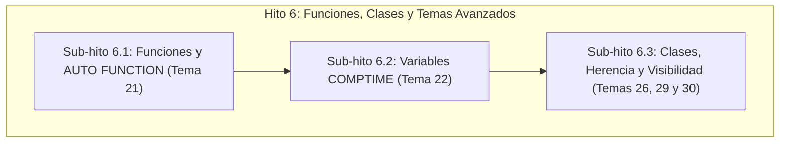

# Plan de Implementación — Hito 6: Funciones, Clases y Temas Avanzados

**Materia:** Diseño de Compiladores I / Compiladores e Intérpretes  
**Grupo:** 20 · Ingeniería de Sistemas  
**Etapa:** Etapa 3 (Generación de Código Intermedio por Tercetos y Chequeos Semánticos)  
**Documento base:** `teoria/Tp3.pdf`, diapositivas de la cátedra (`teoria/teoria_parte3/`) y especificación del Grupo 20 (`teoria/puntos_asignados.md`).

---

## 🎯 Visión General y Filosofía de Diseño

Siguiendo las pautas de la cátedra y las reglas del proyecto:
1. **Sin sobreingeniería**: Se utilizan estructuras estándar de Java (`ArrayList`, `HashMap`/`LinkedHashMap`, variables primitivas y bucles tradicionales). Cero patrones innecesarios o librerías externas.
2. **Totalmente defendible ante la mesa examinadora**: Cada línea de código responde a una producción gramatical, a una acción del autómata de pila LALR(1) o a una regla taxativa de las diapositivas de la cátedra.
3. **Modularidad estricta**: Dividimos el Hito 6 en 3 sub-hitos progresivos e independientes, testeando cada uno exhaustivamente con casos válidos y de error antes de pasar al siguiente.

---

## 🧩 Sub-hito 6.1: Funciones Tradicionales y `AUTO FUNCTION` (Tema 21)

### 1. Requerimientos de la Cátedra (`Tp3.pdf`)
- **Registro en Tabla de Símbolos**:
  - Nombre de la función con name mangling (`f:main`).
  - Tipo de retorno (`SHORTINT`, `SINGLEF` o `"auto"` temporal).
  - Uso: `"funcion"`.
  - Firma de parámetros formales: lista ordenada de nombres mangled y sus tipos.
- **Invocaciones**:
  - Búsqueda con resolución de ámbitos (`buscarIdentificador`).
  - Verificación de aridad: número de parámetros reales igual al de formales.
  - Pasaje de parámetros por copia: generación de tercetos `( := , paramFormalMangled , paramReal )`.
  - Verificación de tipos en parámetros: control de compatibilidad (con conversión explícita `tos()` si corresponde, según Tema 34).
  - Terceto de invocación: `( CALL , f:mangled , - )`.
  - El resultado de la llamada sintetiza el tipo de retorno para la expresión que la contiene.
- **Retornos (`RET`)**:
  - Terceto: `( RET , [exp] o lexema , - )`.
  - Funciones con tipo explícito: chequeo de compatibilidad entre la expresión del `RET` y el tipo declarado.
  - Funciones sin `RET`: se genera un valor de retorno por defecto (`0$s` o `0.0`).
- **Tema 21 (`AUTO FUNCTION`)**:
  - Sintácticamente: obligatoriedad de al menos un `RET(...)` (ya garantizado en `gram.y`).
  - Semánticamente:
    > *"Estas funciones deben tener al menos un retorno, pero permiten también varios retornos de tipos diferentes. El compilador deberá determinar, para este tipo de funciones, el tipo de retorno más abarcativo cuando existen retornos de tipos diferentes."* (`Tp3.pdf`)
  - Si los retornos son todos `SHORTINT` $\rightarrow$ tipo inferido `SHORTINT`.
  - Si los retornos son todos `SINGLEF` $\rightarrow$ tipo inferido `SINGLEF`.
  - Si hay mezcla de `SHORTINT` y `SINGLEF` $\rightarrow$ tipo inferido `SINGLEF` (más abarcativo).
  - Al reducir el final de la función (`END;`), se actualiza el tipo en la Tabla de Símbolos.

### 2. Cambios Concretos en el Código
- **`TablaSimbolos.java`**:
  - Métodos simples para registrar y recuperar la firma de parámetros de una función:
    `guardarParametroFuncion(String funcionMangled, String tipoParam, String nombreParam)` y `obtenerParametros(String funcionMangled)`.
  - Método `actualizarTipo(String mangling, String nuevoTipo)` para sellar la inferencia en `AUTO FUNCTION`.
- **`gram.y`**:
  - En `parametro_formal`: registrar tipo y nombre en la función actual.
  - En `sentencia_ret`:
    - Emitir terceto `( RET , $3.sval , - )`.
    - En funciones normales: comparar tipo de `$3.obj` con el tipo de la función.
    - En `AUTO FUNCTION`: acumular el tipo más abarcativo en una variable `tipo_retorno_auto_acumulado`.
  - Al cerrar la función (`declaracion_funciones`):
    - Si es `AUTO FUNCTION`, invocar `TablaSimbolos.actualizarTipo(...)`.
  - En `factor : IDENTIFICADOR '(' lista_expresiones ')'` y `factor : IDENTIFICADOR '(' ')'`:
    - Buscar la función en la Tabla de Símbolos.
    - Chequear cantidad y tipos de parámetros.
    - Emitir tercetos de copia de parámetros `( := , pFormal , pReal )`.
    - Emitir terceto `( CALL , f_mangled , - )`.
    - Sintetizar `$$ = new ParserVal("[" + idCall + "]"); $$.obj = tipoRetorno;`.

### 3. Casos de Prueba Sub-hito 6.1
- `test_hito6_funciones_ok.txt`:
  - Función tradicional `SHORTINT FUNCTION suma(...)` con llamada y asignación.
  - `AUTO FUNCTION` con retorno único.
  - `AUTO FUNCTION` con retornos múltiples en ramas `IF-ELSE` (`SHORTINT` y `SINGLEF`), verificando la inferencia a `SINGLEF`.
- `test_hito6_funciones_error.txt`:
  - Error: llamada con distinta cantidad de parámetros.
  - Error: parámetro con tipo incompatible.
  - Error: retorno incompatible en función con tipo estático declarado.
  - Error: invocar función inexistente o identificador que no es función.

---

## ⚡ Sub-hito 6.2: Variables en Tiempo de Compilación `COMPTIME` (Tema 22)

### 1. Requerimientos de la Cátedra (`Tp3.pdf`)
- **Concepto**:
  > *"El compilador deberá registrar, para estas variables, el valor que reciban a lo largo del programa. Cada vez que la variable sea usada en código, en el código intermedio se utilizará, en lugar del nombre de esa variable, el valor registrado en ese momento."*
  > *"El compilador debe verificar que estas variables se usen en contextos donde se pueda determinar su valor en tiempo de compilación."*
- **Reglas semánticas**:
  - Se declaran como `COMPTIME tipo id;`.
  - En la Tabla de Símbolos llevan el atributo `COMPTIME = "true"` y un atributo `VALOR_ESTATICO`.
  - Si se asigna una expresión estática (constantes o variables comptime ya evaluadas, ej. `x := 3$s; x := x + 2$s;`):
    - Se evalúa la constante en el compilador.
    - Se almacena el nuevo valor en la Tabla de Símbolos.
    - **NO se generan tercetos de asignación en runtime**.
  - Si se intenta asignar una variable de ejecución (`x := z;` con `z` de runtime) o el resultado de una función no constante:
    - **Error semántico:** `No se puede asignar un valor de tiempo de ejecucion a una variable COMPTIME`.
  - Al usar la variable `COMPTIME` en sentencias normales (`z := x + 1$s;`):
    - Se reemplaza directamente por su valor constante registrado (ej. `( + , 5$s , 1$s )`), sin referenciar al símbolo de memoria `x:main`.

### 2. Cambios Concretos en el Código
- **`TablaSimbolos.java`**:
  - Métodos `esComptime(int ref)` / `esComptime(String mangling)`.
  - `setValorComptime(int ref, String valor, String tipo)`.
  - `getValorComptime(int ref)`.
- **`gram.y`**:
  - En `asignacion`:
    - Chequear si la variable del lado izquierdo es `COMPTIME`.
    - Si es `COMPTIME`:
      - Verificar si el lado derecho es resoluble estáticamente (constante o expresión constante).
      - Si es estático: calcular el valor numérico, actualizar `VALOR_ESTATICO` en TS y **no emitir terceto de asignación**.
      - Si no es estático: reportar `Error semantico: Intento de asignar variable en tiempo de ejecucion a variable COMPTIME`.
  - En `factor : IDENTIFICADOR`:
    - Si el identificador es `COMPTIME`, sustituir su operando por el lexema de su valor constante actual (ej. `4$s`).

### 3. Casos de Prueba Sub-hito 6.2
- `test_hito6_comptime_ok.txt`:
  - Declaración y reasignación de variables `COMPTIME` con operaciones aritméticas estáticas.
  - Uso de variable `COMPTIME` en expresiones de variables comunes, verificando que los tercetos contengan las constantes directas y ningún terceto de runtime para las comptime.
- `test_hito6_comptime_error.txt`:
  - Error: asignación de variable de ejecución a variable `COMPTIME`.
  - Error: uso de variable `COMPTIME` antes de recibir un valor constante inicial.

---

## 🏛️ Sub-hito 6.3: Clases, Herencia y Visibilidad (Temas 26, 29 y 30)

### 1. Requerimientos de la Cátedra (`Tp3.pdf`)

#### A. Herencia Múltiple — Desambiguado Opción 1 (Tema 30)
- Sintaxis: `EXTENDS c1, c2, c3;` en el cuerpo de la clase.
- Búsqueda de miembros (atributos y métodos):
  1. Primero en la clase propia del objeto.
  2. Si no existe, buscar en las clases de la lista `EXTENDS` en orden estricto de izquierda a derecha.
  3. Primer coincidencia encontrada gana (Opción 1).
  4. Si no se encuentra en ninguna: error semántico de miembro no declarado.

#### B. Import/Export de Atributos y Métodos (Tema 26)
- Sintaxis:
  - Clase: `CLASS b IMPORT FROM a, c BEGIN ... END;`
  - Miembros: `tipo x EXPORT TO b, d;`
- Visibilidad:
  - Si la clase `B` importa a la clase `A`, solo puede acceder a aquellos atributos y métodos de `A` que contengan explícitamente a `B` en su lista `EXPORT TO`.
  - Si un miembro no exporta a `B`, se emite: `Error semantico: El miembro 'x' de la clase 'A' no esta exportado a la clase 'B'`.

#### C. Acceso Posicional a Atributos (Tema 29)
- Sintaxis: `obj[0$s]` o `obj[idx]`.
- Mapeo:
  - El índice `0` corresponde al primer atributo declarado en la clase del objeto, el `1` al segundo, etc.
- Validaciones semánticas:
  - `obj` debe ser una instancia de una clase válida.
  - El índice debe ser de tipo entero (`SHORTINT`) positivo.
  - Si es constante: verificar que $0 \le \text{índice} < \text{cantidad\_atributos}$. Si excede: `Error semantico: Indice posicional fuera de rango para la clase`.
  - Si es variable: validar que sea de tipo `SHORTINT`.
- En tercetos: se resuelve al atributo correspondiente mangled o terceto de acceso posicional.

### 2. Cambios Concretos en el Código
- **`TablaSimbolos.java`**:
  - Almacenar para cada clase:
    - Lista de clases base (`EXTENDS`).
    - Lista de clases importadas (`IMPORT_FROM`).
    - Lista ordenada de atributos propios (`atributos_ordenados`).
  - Para cada atributo/método:
    - Lista de clases a las que exporta (`EXPORT_TO`).
  - Método `buscarMiembroEnJerarquia(String clase, String nombreMiembro)`:
    - Implementa el recorrido Opción 1 (primero local, luego iteración en lista `EXTENDS`).
  - Método `obtenerAtributoPosicional(String clase, int indice)`:
    - Retorna el nombre del atributo en la posición indicada.
- **`gram.y`**:
  - En `acceso_posicional` (`IDENTIFICADOR '[' expresion ']'`):
    - Validar tipo del objeto, tipo del índice y límites.
    - Sintetizar el atributo real y su tipo.
  - En `invocacion_metodo` (`IDENTIFICADOR '.' IDENTIFICADOR '(' ... ')'`):
    - Resolver clase del objeto.
    - Buscar método con jerarquía y visibilidad (IMPORT/EXPORT).
    - Emitir tercetos de invocación de método.

### 3. Casos de Prueba Sub-hito 6.3
- `test_hito6_clases_ok.txt`:
  - Clases con `EXTENDS` múltiple donde un método heredado se resuelve por orden de aparición.
  - Uso de `IMPORT FROM` y `EXPORT TO` válido.
  - Acceso posicional `obj[0$s]` y `obj[1$s]` asignando y leyendo valores.
- `test_hito6_clases_error.txt`:
  - Error: acceso posicional con índice fuera de rango o negativo.
  - Error: intento de acceder a miembro no exportado a la clase cliente.
  - Error: heredar de una clase inexistente en `EXTENDS`.

---

## 📅 Cronograma de Ejecución y Checklist de Aprobación

| Paso | Tarea | Verificación | Estado |
| :---: | :--- | :--- | :---: |
| **6.1.1** | Infraestructura de firma de parámetros y retorno en `TablaSimbolos` | Tests unitarios / compilar | Pendiente |
| **6.1.2** | Tercetos de `RET`, invocación `CALL` y copia de parámetros en `gram.y` | Parser compila con cero conflictos | Pendiente |
| **6.1.3** | Inferencia de tipos y retornos múltiples en `AUTO FUNCTION` (Tema 21) | `tests/test_hito6_funciones_*.txt` | Pendiente |
| **6.2.1** | Atributos y evaluación estática de variables `COMPTIME` (Tema 22) | Supresión de tercetos en runtime | Pendiente |
| **6.2.2** | Chequeos semánticos y sustitución directa de constantes `COMPTIME` | `tests/test_hito6_comptime_*.txt` | Pendiente |
| **6.3.1** | Almacenamiento de jerarquía `EXTENDS` y resolución Opción 1 (Tema 30) | Búsqueda ordenada en TS | Pendiente |
| **6.3.2** | Control de visibilidad `IMPORT FROM` / `EXPORT TO` (Tema 26) | Chequeo estático de permisos | Pendiente |
| **6.3.3** | Mapeo y validación de acceso posicional `obj[idx]` (Tema 29) | Control de límites y tipos | Pendiente |
| **6.4** | Actualización de bitácora pedagógica `GUIA_DEFENSA_ETAPA3.md` | Documentación para defensa oral | Pendiente |
